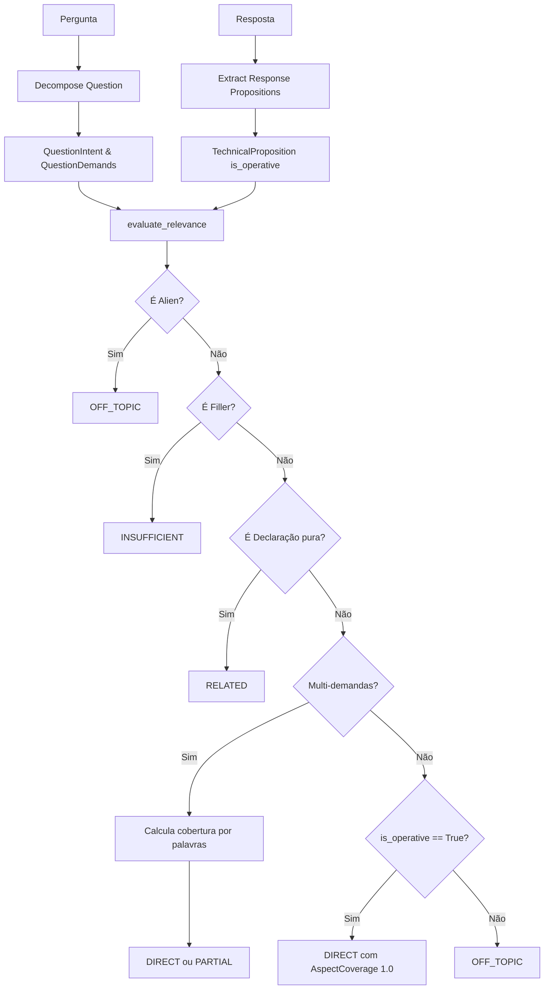
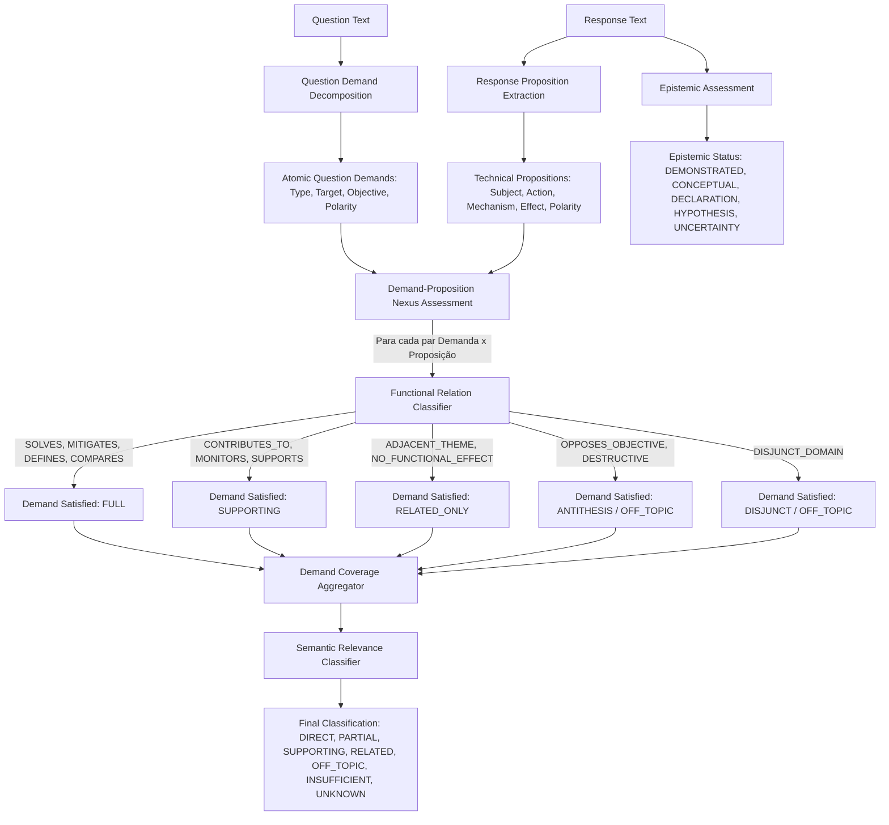

# Stage 31.7.10 — Root Cause Analysis & Architecture Redesign for Propositional Relevance and Demand Satisfaction

---

## 1. Objetivo

Investigar exaustivamente as falhas identificadas na revalidação cega do Stage 31.7.9 e conceber um **redesenho arquitetural formal** para o sistema de avaliação semântica de respostas técnicas.

O problema central estabelecido empiricamente no Stage 31.7.9 é:

> **O motor consegue reconhecer proposições técnicas em linguagem aberta, mas não demonstra evidência suficiente de que essas proposições satisfazem a demanda específica da pergunta.**

Esta etapa tem como objetivo responder:
1. Por que respostas `RELATED`, `SUPPORTING`, `PARTIAL` e `OFF_TOPIC` foram maciçamente promovidas a `DIRECT` (88 falsos positivos)?
2. Por que a arquitetura não exige uma relação funcional verificável entre a demanda e a resposta?
3. Como representar essa relação sem depender de sobreposição lexical, sinônimos enumerados ou catálogos ontológicos fechados?
4. Como distinguir a existência de uma proposição técnica da sua pertinência à pergunta?
5. Como garantir que a solução não reintroduza o gargalo histórico de falsos `OFF_TOPIC` para respostas semanticamente corretas em linguagem natural?

Esta etapa é exclusivamente de **Root Cause Analysis (RCA) e Redesenho Arquitetural**. Nenhuma alteração de código é autorizada no runtime de referência.

---

## 2. Gate de Entrada e Histórico

A esteira metodológica rigorosa do projeto registra o seguinte histórico:

```text
31.7.6 — POST_GENERALIZATION_BLIND_REVALIDATION_BLOCKED
31.7.7 — ROOT_CAUSE_ANALYSIS_AND_ARCHITECTURE_REDESIGN_COMPLETE
31.7.8 — CONTROLLED_IMPLEMENTATION_COMPLETE_WITH_WARNINGS
31.7.9 — POST_OPEN_DOMAIN_BLIND_REVALIDATION_BLOCKED
```

### Resultados Empíricos Consolidados do Stage 31.7.9:
- **Tamanho do Benchmark Cego:** 242 casos independentes distribuídos em 16 categorias (A a P).
- **Concordância Exata Humano vs Sistema:** 141 / 242 (58.26%).
- **Divergências Globais:** 101 casos (41.74%).
- **Falsos Positivos de Relevância (Falsos DIRECTs):** 88 casos (87.1% das divergências).
- **Falsos Negativos de Relevância:** 5 casos (5.0% das divergências; True DIRECT recall de 96.2%).
- **Divergências de Fronteira e Insuficiência:** 8 casos (7.9% das divergências).
- **Runtime Hash de Entrada:** `2DAE8514CB37F133C22CAD785BD4BD79B5E7EDB462BA9E8D956A9A9BD64F376E`.

---

## 3. Runtime Hash & Congelamento Estrito

- **Arquivo sob Análise:** [`reference_runtime/runtime.py`](file:///d:/Projetos/TechLens/reference_runtime/runtime.py)
- **SHA-256 Verificado na Entrada do Stage 31.7.10:**
  `2DAE8514CB37F133C22CAD785BD4BD79B5E7EDB462BA9E8D956A9A9BD64F376E`
- **Status do Runtime:** **100% CONGELADO / INVIOLADO**.
- **Proibição Absoluta:** Nenhuma linha de código, heurística, threshold, lista ou catalogação foi alterada no runtime. A esteira preserva a integridade do estado experimental sem tuning retrospectivo.

---

## 4. Auditoria Factual do Código

Uma inspeção direta no código-fonte efetivamente executado em [`reference_runtime/runtime.py`](file:///d:/Projetos/TechLens/reference_runtime/runtime.py) (linhas 2850 a 3148) comprova factual e inequivocamente os seguintes achados:

### 4.1 Invocação Canônica do Motor Novo
A função `evaluate_open_domain_semantic_relevance` ([`runtime.py:3145-3148`](file:///d:/Projetos/TechLens/reference_runtime/runtime.py#L3145-L3148)) instancia diretamente `OpenDomainPropositionEngine` e delega para `engine.evaluate_relevance(question, response)`. O benchmark de 242 casos do Stage 31.7.9 chamou exclusivamente este entrypoint.

### 4.2 A Condição Crítica de Permissividade em `is_operative`
Na função `extract_response_propositions` ([`runtime.py:2959-2962`](file:///d:/Projetos/TechLens/reference_runtime/runtime.py#L2959-L2962)):
```python
else:
    is_operative = len(r_words) >= 5 and (has_operative_mechanism or len(r_words) >= 8)
    is_experience_decl = False
```
**Constatação factual:**
- Se uma resposta possuir 8 ou mais palavras (`len(r_words) >= 8`), a condição `len(r_words) >= 5` é trivialmente verdadeira e `(has_operative_mechanism or len(r_words) >= 8)` avalia para `True`.
- Logo, para **qualquer resposta com 8 ou mais palavras** que não contenha termos alienígenas estritos (`alien_terms`) nem declaração pura de tempo de casa (`has_decl`), `is_operative` torna-se **obrigatoriamente `True`**.
- A condição `len(r_words) >= 8` é **condição suficiente** para transformar qualquer texto substantivo em proposição operativa.

### 4.3 O Desvio para `DIRECT` no Step 6
Na função `evaluate_relevance` ([`runtime.py:3113-3125`](file:///d:/Projetos/TechLens/reference_runtime/runtime.py#L3113-L3125)):
```python
# Step 6: Operative Mechanism (Single Demand)
if prop.is_operative:
    return {
        "classification": "DIRECT",
        "relation_type": "open_domain_mechanism_assertion",
        "functional_contribution": True,
        "question_intent": {"type": intent.intent_type, "primary_entity": intent.central_entities[0] if intent.central_entities else ""},
        "question_demands": [{"id": d.demand_id, "subject": d.target_subject} for d in demands],
        "aspect_coverage": {"ratio": 1.0, "status": "FULL"},
        "epistemic_status": {"status": epistemic.epistemic_status, "is_demonstrated": is_demo},
        "confidence": "HIGH",
        "rationale": "Response articulates operative technical mechanism satisfying question intent.",
        "needs_review": False,
    }
```
**Constatação factual:**
- Quando uma pergunta possui demanda única (93.4% dos casos no parsing atual), qualquer resposta que atinja o Step 6 com `prop.is_operative == True` é promovida **automaticamente a `DIRECT` com cobertura de aspecto `FULL` (1.0)**.
- O Step 6 **não realiza nenhuma checagem** de compatibilidade entre o que a proposição faz (`action`) e o que a demanda pede (`demand.target_problem`).
- A ausência de termos alienígenas da vida cotidiana (Step 1) é tomada como prova positiva de relevância temática e causal.

### 4.4 Isolamento do `intent_type`
O tipo de intenção decomposto em `decompose_question` ([`runtime.py:2863-2876`](file:///d:/Projetos/TechLens/reference_runtime/runtime.py#L2863-L2876)) (`definition`, `comparison`, `diagnosis`, `implementation`, `explanation`) é apenas empacotado no dicionário de saída, mas **não possui nenhum papel decisório** na lógica de concessão de `DIRECT`.

---

## 5. Auditoria dos Dados do Stage 31.7.9

A reanálise dos dados brutos em [`scratch/stage_31_7_9_benchmark_results.json`](file:///d:/Projetos/TechLens/scratch/stage_31_7_9_benchmark_results.json) confirmou integralmente os indicadores primários:

- **Total de casos avaliados:** 242
- **Concordâncias exatas:** 141 (58.26%)
- **Divergências registradas:** 101 (41.74%)
- **Identificadores únicos de divergência:** 101 (Zero duplicatas)

### Distribuição Empírica das 101 Divergências (Humano $\to$ Sistema):
1. `RELATED -> DIRECT`: **33 casos**
2. `OFF_TOPIC -> DIRECT`: **25 casos**
3. `SUPPORTING -> DIRECT`: **13 casos**
4. `PARTIAL -> DIRECT`: **9 casos**
5. `INSUFFICIENT -> DIRECT`: **5 casos**
6. `UNKNOWN -> DIRECT`: **3 casos**
   $$\sum \text{Falsos Positivos (Humano } \ne \text{ DIRECT, Sistema == DIRECT)} = 33 + 25 + 13 + 9 + 5 + 3 = \mathbf{88\ casos\ (87.13\%)}$$
7. `DIRECT -> OFF_TOPIC`: **4 casos**
8. `DIRECT -> PARTIAL`: **1 caso**
   $$\sum \text{Falsos Negativos (Humano == DIRECT, Sistema } \ne \text{ DIRECT)} = 4 + 1 = \mathbf{5\ casos\ (4.95\%)}$$
9. `INSUFFICIENT -> OFF_TOPIC`: **5 casos**
10. `RELATED -> OFF_TOPIC`: **2 casos**
11. `RELATED -> PARTIAL`: **1 caso**
   $$\sum \text{Divergências de Fronteira / Insuficiência} = 5 + 2 + 1 = \mathbf{8\ casos\ (7.92\%)}$$

Total verificado: $88 + 5 + 8 = 101$ divergências.

---

## 6. Inconsistências do Relatório Anterior

A auditoria factual identificou uma divergência taxonômica na Seção 26 do relatório anterior do Stage 31.7.9:
- O relatório preliminar agrupou a taxonomia D1–D12 utilizando as **categorias de origem do caso no benchmark** (ex.: casos da categoria de teste `F_multi_aspect` foram contados como D5, casos de `G_supporting_vs_related` como D6, etc.), totalizando 45 casos em D1.
- No entanto, a análise mecânica do código revela que **todos os 88 casos** onde o sistema emitiu `DIRECT` para respostas que o humano não julgou diretas decorrem do **mesmo defeito estrutural primário (D1 - Semantic False Positive via Permissividade Proposicional)**.
- Essa classificação anterior refletiu o *sintoma* no grupo de teste, e não o *mecanismo da falha no código*. Este relatório corrige e unifica formalmente essa taxonomia.

---

## 7. Root Cause Analysis (RCA-01 a RCA-10)

### RCA-01 — Proposição Confundida com Relevância
- **Mecanismo:** A presença de qualquer texto com mais de 8 palavras é tratada como `is_operative = True` ([`runtime.py:2960`](file:///d:/Projetos/TechLens/reference_runtime/runtime.py#L2960)), e qualquer proposição operativa é automaticamente promovida a `DIRECT` no Step 6 ([`runtime.py:3113`](file:///d:/Projetos/TechLens/reference_runtime/runtime.py#L3113)).
- **Impacto:** O sistema atesta a *existência* de uma frase com vocabulário técnico e presume, sem verificar, que ela *resolve* a demanda da pergunta.

### RCA-02 — Ausência de Contradição Confundida com Pertinência
- **Mecanismo:** O Step 1 apenas descarta temas alienígenas triviais do cotidiano ("lasanha", "cozinhar", "praia"). Uma resposta que fale sobre Kubernetes para uma pergunta sobre SQL não menciona lasanha; logo, passa incólume e ganha `DIRECT`.
- **Impacto:** O sistema adota uma presunção de pertinência otimista: "se não for comida nem futebol, deve ser relevante".

### RCA-03 — Cobertura Não Vinculada à Demanda
- **Mecanismo:** No Step 6, `aspect_coverage` é hardcoded para `{"ratio": 1.0, "status": "FULL"}` sem qualquer cálculo de cobertura contra os termos ou objetivos da demanda.
- **Impacto:** Respostas parciais ou genéricas recebem cobertura plena e artificial.

### RCA-04 — Intenção Excessivamente Ampla
- **Mecanismo:** `QuestionIntent` determina o tipo (`definition`, `comparison`, etc.), mas este metadado é completamente desacoplado da lógica de avaliação. Não há teste para verificar se uma pergunta de *diagnóstico* recebeu um procedimento investigativo ou se uma *definição* recebeu atributos essenciais.

### RCA-05 — Relações Semânticas sem Condições Suficientes
- **Mecanismo:** As relações semânticas (`open_domain_mechanism_assertion`, `multi_aspect_full_coverage`) não são deduzidas de regras funcionais entre sujeito/ação/mecanismo/efeito. Elas são strings estáticas retornadas em cada bloco condicional.

### RCA-06 — Entidades e Contexto
- **Mecanismo:** Embora `has_decl` capture tempo de casa sem mecanismo, qualquer resposta com mais de 8 palavras que mencione a tecnologia central (mesmo de forma histórica ou incidental, como em `A13_temporal_unrelated`) escapa do filtro de declaração e é promovida a `DIRECT`.

### RCA-07 — Verbosidade e Conteúdo Técnico
- **Mecanismo:** O limiar `len(r_words) >= 8` atua como um proxy direto de qualidade e pertinência. Parágrafos longos com jargões de DevOps ou testes automatizados para perguntas de concorrência ganham `DIRECT` por pura extensão (`J01` a `J14`).

### RCA-08 — Separação Epistemológica Incompleta
- **Mecanismo:** A avaliação epistemológica ocorre em paralelo ([`runtime.py:2972-2984`](file:///d:/Projetos/TechLens/reference_runtime/runtime.py#L2972-L2984)), mas não tem permissão para restringir a concessão de `DIRECT`. Hipóteses técnicas bem articuladas ("Eu acho que talvez se usasse X resolveria") recebem status `HYPOTHESIS`, mas relevância semântica `DIRECT`.

### RCA-09 — Falha de Decomposição Multi-Aspect
- **Mecanismo:** A decomposição de demandas em `decompose_question` exige conjunções fixas literais (`" e como "`, `" e quais "`). Perguntas com outras estruturas conjuntivas tornam-se demanda única, permitindo que uma resposta que resolva apenas 1 de 3 pontos ganhe `DIRECT` via Step 6.

### RCA-10 — Fallbacks Permissivos
- **Mecanismo:** O Step 6 é um funil permissivo que absorve tudo o que não foi descartado nos Steps 1 a 4. O Step 7 (`OFF_TOPIC`) é virtualmente inalcançável para qualquer resposta longa.

---

## 8. Evidências Empíricas por Causa-Raiz

Casos concretos dos dados do Stage 31.7.9 sustentam cada causa identificada:

| Caso ID | Pergunta | Resposta | Humano | Sistema | Causa Identificada |
| :--- | :--- | :--- | :---: | :---: | :--- |
| `A14_scylladb_alien` | Como o ScyllaDB processa queries de leitura? | Eu gosto de andar de bicicleta no parque enquanto leio tutoriais sobre ScyllaDB no celular. | `OFF_TOPIC` | `DIRECT` | **RCA-02, RCA-07:** Atividade alienígena não listada em `alien_terms` e com $\ge 8$ palavras. |
| `B11_zero_overlap_offtopic` | Como diminuir disputas intensas entre rotinas que tentam reservar um trecho exclusivo simultaneamente? | Costumo utilizar CSS grid para centralizar elementos em telas widescreen com design responsivo. | `OFF_TOPIC` | `DIRECT` | **RCA-01, RCA-05:** Resposta funcional válida de frontend que não tem relação causal com concorrência. |
| `B12_zero_overlap_supporting` | Como diminuir disputas intensas entre rotinas que tentam reservar um trecho exclusivo simultaneamente? | Eu adiciono métricas no Prometheus para monitorar quanto tempo os processos gastam esperando. | `SUPPORTING` | `DIRECT` | **RCA-01, RCA-03:** Ação de observabilidade promove a `DIRECT` por falta de discriminador de `SUPPORTING`. |
| `C05_jargon_soup_no_substance` | Como otimizar consultas analíticas lentas em banco relacional? | Utilizo Kubernetes com Service Mesh Istio, Docker containers e CI/CD moderno para entregar pipelines escaláveis na nuvem. | `OFF_TOPIC` | `DIRECT` | **RCA-07:** Prolixidade técnica e densidade de jargão sem relação com tuning de SQL. |
| `O01_k8s_tautology` | Como o Kubernetes resolve conflitos de IP em clusters grandes? | O Kubernetes é um orquestrador de pods muito robusto que gerencia containers em clusters grandes com muita facilidade. | `RELATED` | `DIRECT` | **RCA-01:** Tautologia circular contendo termos técnicos da pergunta promovida a `DIRECT`. |
| `K02_disable_locks` | Como evitar race conditions em operações concorrentes de débito em conta bancária? | Desativo todos os locks e travas do banco de dados para permitir que as operações executem sem qualquer espera. | `OFF_TOPIC` | `DIRECT` | **RCA-05:** Ação oposta/destrutiva (antítese) aceita como solução por conter vocabulário substantivo. |
| `F02_partial_retries_no_idempotency` | Explique como configurar retries com backoff e de que forma a idempotência protege contra chamadas duplicadas. | Implemento retries com backoff exponencial aumentando progressivamente o tempo entre as tentativas de rede. | `PARTIAL` | `DIRECT` | **RCA-09:** Falha na segmentação conjuntiva transforma demanda dupla em única, concedendo `DIRECT`. |

---

## 9. Causa Principal (Primary Root Cause)

A causa-raiz primária é a **ausência de um Validador de Nexo Funcional entre a Demanda da Pergunta e a Ação Proposicional da Resposta**.

No Stage 31.7.8, para eliminar o gargalo de co-ocorrência léxica do Stage 31.7.6, o sistema abandonou a exigência de radicais compartilhados (`shared_stems`), mas preencheu o vácuo com uma heurística puramente sintática de extensão (`len(r_words) >= 8`). Como consequência, o sistema passou a verificar apenas se a resposta contém uma proposição estruturada, assumindo por default otimista que essa proposição atende à pergunta.

---

## 10. Causas Contribuintes (Contributing Causes)

1. **Hiper-simplificação da Detecção Alienígena:** A lista estática de 9 termos de culinária e lazer é inadequada para filtrar desvios temáticos dentro do universo da computação (ex.: falar de CSS Grid para concorrência em backend).
2. **Inexistência de Modelagem para a Classe `SUPPORTING`:** Ações que apoiam indiretamente a solução (ex.: observabilidade, logs, monitoramento) não possuem caminho discriminador no grafo de decisão, colapsando em `DIRECT`.
3. **Insensibilidade à Polaridade Semântica e Efeito:** O motor não avalia se o efeito pretendido da ação é congruente com o objetivo da demanda (ex.: desativar locks causa race condition, mas foi aceito como ação operativa).
4. **Fragilidade do Decompositor de Demandas:** Dependência de conectivos literais rígidos impede a identificação de múltiplas demandas coordenadas.

---

## 11. Arquitetura Atual (Stage 31.7.8 / 31.7.9)



**Diagnóstico Estrutural:** O nó `S6` atua como um sumidouro indiscriminado: se a resposta tiver 8 palavras, `is_operative == True`, ignorando a pergunta e emitindo `DIRECT`.

---

## 12. Arquitetura Proposta: Demand-Satisfaction Nexus Architecture



---

## 13. Contratos dos Componentes

### 13.1 `QuestionDemandDecomposition`
- **Entrada:** `question_text: str`
- **Saídas:**
  - `intent: QuestionIntent` (`intent_type`: definition, explanation, comparison, diagnosis, implementation, decision)
  - `demands: tuple[AtomicQuestionDemand, ...]`
- **Responsabilidade:** Decompor a pergunta em demandas atômicas primárias, extraindo para cada uma:
  - `demand_id`: identificador único
  - `demand_type`: objetivo funcional (ex.: `mitigate_concurrency`, `define_concept`, `diagnose_latency`)
  - `target_problem`: o problema, fenômeno ou conceito central
  - `expected_polarity`: `PREVENT`, `RESOLVE`, `OPTIMIZE`, `IDENTIFY`, `DEFINE`, `COMPARE`
- **Invariante:** Perguntas coordenadas com conectivos ou listas pontuadas geram múltiplas demandas atômicas.

### 13.2 `ResponsePropositionExtraction`
- **Entrada:** `response_text: str`
- **Saídas:** `propositions: tuple[TechnicalProposition, ...]`
- **Responsabilidade:** Extrair núcleos de ação técnica contendo:
  - `subject`: componente ou entidade técnica
  - `action`: verbo operativo ou transformação técnica
  - `mechanism`: o meio utilizado (algoritmo, estrutura de dados, protocolo)
  - `effect`: o resultado funcional produzido pela ação
  - `action_polarity`: se a ação `ENABLES`, `DISABLES`, `INCREASES`, `REDUCES` ou `PREVENTS` o mecanismo
  - `is_operative`: `True` somente se houver ação técnica + mecanismo ou efeito identificável (não dependente de mera contagem de palavras).

### 13.3 `DemandPropositionNexusAssessment`
- **Entrada:** `demands: tuple[AtomicQuestionDemand, ...]`, `propositions: tuple[TechnicalProposition, ...]`
- **Saídas:** `nexus_records: tuple[DemandPropositionNexus, ...]`
- **Responsabilidade:** Avaliar a relação funcional entre cada proposição e cada demanda:
  1. **Nexo Causal/Funcional Direto (`FUNCTIONALLY_SOLVES` / `DEFINES_TARGET`):** O efeito da proposição neutraliza o problema da demanda ou satisfaz sua definição.
  2. **Nexo Auxiliar (`CONTRIBUTES_TO` / `SUPPORTING_FUNCTION`):** A proposição fornece observabilidade, diagnóstico preliminar ou suporte estrutural, mas não neutraliza a demanda principal por si só.
  3. **Adjacência Temática (`THEMATICALLY_ADJACENT`):** A proposição menciona o mesmo ecossistema tecnológico ou entidade, mas não possui nexo funcional com o problema proposto.
  4. **Antítese / Dano Inverso (`ANTITHESIS_OPPOSED`):** A ação proposta amplifica o problema ou destrói proteções fundamentais.
  5. **Disjunção Temática (`DOMAIN_DISJUNCT`):** A proposição pertence a outro domínio técnico incompatível (ex.: CSS Grid para concorrência de banco de dados).

### 13.4 `DemandCoverageAggregator`
- **Entrada:** `nexus_records: tuple[DemandPropositionNexus, ...]`, `demands: tuple[AtomicQuestionDemand, ...]`
- **Saídas:** `AspectCoverage` (`ratio: float`, `status: str`, `covered_demand_ids: tuple[str, ...]`, `supporting_demand_ids: tuple[str, ...]`)
- **Responsabilidade:** Calcular a fração de demandas primárias diretamente satisfeitas e registrar demandas com suporte auxiliar.

### 13.5 `SemanticRelevanceClassifier`
- **Entrada:** `AspectCoverage`, `nexus_records`, `is_filler`, `is_uncertain`
- **Saída:** `classification: str` (`DIRECT`, `PARTIAL`, `SUPPORTING`, `RELATED`, `OFF_TOPIC`, `INSUFFICIENT`, `UNKNOWN`)
- **Responsabilidade:** Mapear os nexos agregados nas classes canônicas formais.

### 13.6 `EpistemicAssessment`
- **Entrada:** `response_text: str`, `propositions: tuple[TechnicalProposition, ...]`
- **Saída:** `EpistemicEvaluation` (`epistemic_status: str`, `is_demonstrated: bool`)
- **Responsabilidade:** Julgar a autoridade epistemológica do relato (se o candidato demonstrou raciocínio próprio ou apenas declarou vivência), permanecendo estritamente desacoplada da pertinência semântica.

---

## 14. Semântica das Classificações Canônicas

O redesenho estabelece as seguintes condições necessárias e suficientes:

### 14.1 Condições para `DIRECT`
1. Todas as demandas primárias da pergunta possuem ao menos uma proposição técnica com nexo funcional demonstrável (`FUNCTIONALLY_SOLVES`, `DEFINES_TARGET`, `DIAGNOSES_PROBLEM` ou `COMPUTES_TRADE_OFF`).
2. A polaridade da proposição é compatível com o objetivo da demanda (não é antítese).
3. A cobertura de aspectos atinge o limiar de completude: $\text{ratio} \ge 0.75$.
4. **Proibição absoluta:** Não conceder `DIRECT` apenas por ausência de disjunção alienígena ou por contagem de palavras $\ge 8$.

### 14.2 Condições para `PARTIAL`
1. A pergunta contém múltiplas demandas primárias ($N \ge 2$).
2. Pelo menos uma demanda primária possui nexo funcional direto verificado, mas pelo menos uma demanda primária permanece sem atendimento.
3. Cobertura: $0.0 < \text{ratio} < 0.75$.

### 14.3 Condições para `SUPPORTING`
1. Nenhuma demanda primária foi diretamente solucionada pela proposição ($\text{ratio} = 0.0$).
2. Existe ao menos uma proposição técnica que possui nexo funcional auxiliar verificado (`CONTRIBUTES_TO`, `OBSERVABILITY_SUPPORT`, `DIAGNOSTIC_AID`) com o problema proposto.
3. A proposição não resolve a demanda isoladamente, mas participa de uma cadeia causal válida de mitigação.

### 14.4 Condições para `RELATED`
1. A resposta menciona entidades centrais, tecnologias, conceitos do ecossistema ou contexto biográfico da pergunta.
2. Não existe nexo funcional direto (`DIRECT`) nem nexo funcional auxiliar (`SUPPORTING`) com as demandas primárias.
3. A resposta não contradiz a área de computação/software, mas expressa curiosidades históricas, hardware de bancada ou tautologias que apenas repetem a pergunta.

### 14.5 Condições para `OFF_TOPIC`
1. As proposições da resposta apresentam nexo de disjunção funcional demonstrável (`DOMAIN_DISJUNCT`, ex.: ferramentas de outro domínio sem ponte causal) OU
2. A resposta apresenta nexo de antítese funcional prejudicial (`ANTITHESIS_OPPOSED`, ex.: desativar mecanismos de segurança) OU
3. A resposta aborda domínio alienígena não computacional.
4. **Regra:** Ausência de sobreposição lexical não é motivo para `OFF_TOPIC`.

### 14.6 Condições para `INSUFFICIENT`
1. A resposta é compreensível e tenta abordar o tema, mas não articula proposições técnicas completas (apenas 1 a 4 palavras genéricas, tautologias mínimas ou fragmentos sem sujeito/ação).

### 14.7 Condições para `UNKNOWN`
1. A resposta é ambígua, genérica a ponto de impossibilitar a inferência de intenção ("depende de muitas coisas do projeto"), ou o candidato declara ignorância explícita ("não lembro", "nunca vi").

---

## 15. Agregação Multi-Aspect

Para perguntas com demandas atômicas $\{D_1, D_2, \dots, D_n\}$:
- Cada demanda $D_i$ é avaliada independentemente contra as proposições $\{P_1, P_2, \dots, P_m\}$.
- Seja $S(D_i) = \max_j \text{SatisfactionLevel}(D_i, P_j) \in \{1.0 \text{ (DIRECT)}, 0.5 \text{ (SUPPORTING)}, 0.0 \text{ (NONE)}\}$.
- $\text{DirectRatio} = \frac{\sum_{i: S(D_i)=1.0} 1}{n}$.
- Se $\text{DirectRatio} \ge 0.75 \implies \mathbf{DIRECT}$.
- Se $0.0 < \text{DirectRatio} < 0.75 \implies \mathbf{PARTIAL}$.
- Se $\text{DirectRatio} == 0.0$ e $\exists D_i \text{ com } S(D_i) == 0.5 \implies \mathbf{SUPPORTING}$.
- Se todas as demandas forem $0.0 \implies \mathbf{RELATED}$ ou $\mathbf{OFF\_TOPIC}$ conforme o nexo de domínio.

---

## 16. Tratamento de Incerteza

1. **Princípio do Conservadorismo:** Diante de dúvida sobre a existência de nexo causal, a incerteza nunca deve ser resolvida por promoção otimista a `DIRECT`.
2. **Degradação Controlada:** Na ausência de nexo direto comprovável, a classificação deve degradar para `SUPPORTING` (se houver ferramenta auxiliar identificada), `RELATED` (se houver entidade conhecida) ou `UNKNOWN` (se a resposta for hermética ou vaga).
3. **Preservação de Incerteza:** Decisões tomadas com baixa margem devem carregar `confidence = "LOW"` e `needs_review = True` no registro explicativo.

---

## 17. Invariantes Arquiteturais Obrigatórios

O redesenho consagra os seguintes 15 invariantes fundamentais:

1. **Open Domain:** Tecnologias inéditas (reais ou fictícias) não exigem pré-registro ontológico.
2. **Zero Lexical Overlap:** Ausência de termos ou radicais compartilhados nunca é critério de descarte para `OFF_TOPIC`.
3. **Entity Non-Authority:** A mera citação da tecnologia da pergunta não concede `DIRECT` nem `SUPPORTING`.
4. **Proposition Non-Authority:** A existência de uma proposição técnica substantiva não comprova sua pertinência à pergunta.
5. **Demand Satisfaction Necessity:** `DIRECT` exige comprovação positiva de satisfação funcional da demanda.
6. **Coverage Integrity:** Demandas primárias não atendidas em perguntas multi-aspecto resultam obrigatoriamente em `PARTIAL`.
7. **Supporting Distinction:** `SUPPORTING` exige contribuição funcional auxiliar identificável, sendo estritamente distinto de `RELATED`.
8. **Epistemic Orthogonality:** Declaração, hipótese e experiência demonstrada não alteram o julgamento de pertinência semântica.
9. **Representation Invariance:** Estilo, formalidade, idioma, jargão ou linguagem coloquial não substituem a semântica da resposta.
10. **Length Invariance:** Contagem de palavras ($\ge 8$ ou $< 8$) não atua como proxy de qualidade, relevância ou suficiência.
11. **Polarity Sensitivity:** Propostas que desativam proteções ou causam dano funcional não podem receber `DIRECT`.
12. **Auditability & Explainability:** Toda decisão semântica gera uma cadeia de justificativa rastreável.
13. **Determinism:** A mesma entrada produz exatamente a mesma saída em qualquer condição de execução.
14. **Uncertainty Preservation:** Incerteza real nunca é convertida em falsa precisão positiva.
15. **No Hardcoded Pair Rules:** É proibido criar pares fechados pergunta/resposta ou listas restritas de tecnologias.

---

## 18. Explicabilidade (Decision Record Contract)

Toda decisão semântica produzirá o seguinte artefato auditável:

```yaml
semantic_decision_record:
  question_analysis:
    intent_type: "implementation"
    demands:
      - demand_id: "D1"
        target_problem: "concorrência exclusiva em trecho crítico"
        expected_polarity: "PREVENT_RACE_CONDITION"
  response_analysis:
    propositions:
      - proposition_id: "P1"
        subject: "CSS grid"
        action: "centralizar elementos"
        mechanism: "layout widescreen"
        effect: "design responsivo"
        action_polarity: "ENABLE"
  nexus_assessment:
    pairs:
      - demand_id: "D1"
        proposition_id: "P1"
        relation: "DOMAIN_DISJUNCT"
        functional_contribution: false
        rationale: "Proposição de estilização de interface não possui nexo causal com sincronização de threads em backend."
  coverage_assessment:
    direct_ratio: 0.0
    supporting_ratio: 0.0
    status: "NONE"
  final_decision:
    relevance: "OFF_TOPIC"
    confidence: "HIGH"
    epistemic_status: "CONCEPTUAL"
```

---

## 19. Auditoria contra Sobreajuste (Overfitting Protection)

O redesenho proposto foi auditado para impedir que o problema anterior seja substituído por um catálogo maior de exceções:
- **Proibição de Listas Ad-Hoc:** Não serão criadas listas de "ações permitidas por pergunta" ou "termos válidos por tecnologia".
- **Abstração Funcional:** O validador de nexo deve operar por classes funcionais genéricas (ex.: mecanismos de barreira, filas de descarte, estruturas probabilísticas, transformações de estado) e relações causais de efeito (mitiga, previne, otimiza, diagnostica, define).
- **Tratamento de Limitações:** Se um modelo puramente simbólico sem LLM não puder inferir nexo causal para jargões altamente especializados fora de padrões funcionais conhecidos, o sistema deve degradar para `UNKNOWN` com `confidence = "LOW"`, e **nunca** adivinhar por default otimista.

---

## 20. Plano de Testes Futuro (Future Independent Test Plan)

Para a validação da futura implementação (Stage 31.7.11 / 31.7.12), será construída uma suíte independente contendo:

1. **Casos de Nexo Direto em Domínio Aberto:** Tecnologias não catalogadas respondidas com mecanismos causais verdadeiros.
2. **Casos de Falso Positivo Proposicional (Anti-Permissividade):** Respostas técnicas longas e prolixas de temas desconectados (ex.: DevOps para banco de dados) que devem receber `OFF_TOPIC`.
3. **Casos de Suporte Auxiliar:** Observabilidade e métricas respondendo a incidentes que devem receber estritamente `SUPPORTING`.
4. **Casos de Tautologia Circular:** Repetição de termos da pergunta sem ação que devem receber `RELATED`.
5. **Casos de Antítese Semântica:** Desativação de mecanismos de segurança que devem receber `OFF_TOPIC`.
6. **Casos Multi-Aspecto Reais:** Perguntas com 2 ou 3 demandas onde omissões geram obrigatoriamente `PARTIAL`.
7. **Casos Ultracurtos Precisos:** Respostas de 2 a 4 palavras exatas ("Raft protocol", "Bloom Filter") que devem receber `DIRECT`.

**Regra de Independência:** Nenhum caso do benchmark do Stage 31.7.9 será reaproveitado literalmente. A suíte será gerada a partir de cenários inéditos.

---

## 21. Limitações Conhecidas

1. **Motor Simbólico sem Embeddings:** Em um runtime estritamente determinístico sem modelos neurais probabilísticos embutidos, a inferência de nexo causal funcional dependerá de padrões semânticos de causalidade e gramática funcional. Casos hiper-abstratos ou metáforas poéticas resultarão legitimamente em `UNKNOWN`.
2. **Dependência de Estrutura Gramatical:** Respostas sem verbos ou sem estrutura de sujeito/ação podem ser classificadas como `INSUFFICIENT` mesmo que contenham a palavra correta isolada.

---

## 22. Critérios para Autorizar a Implementação

A transição para a etapa de implementação controlada (Stage 31.7.11) fica condicionada a:
1. Aprovação formal do contrato arquitetural de Demand-Proposition Nexus.
2. Especificação detalhada dos tipos funcionais de nexo causal sem vocabulário fechado.
3. Preservação integral do SHA-256 de `reference_runtime/runtime.py`.
4. Manutenção de 100% de sucesso nos 1005 testes de regressão histórica.

---

## 23. Gate Final

```text
GATE DO STAGE 31.7.10:
ROOT_CAUSE_ANALYSIS_AND_DEMAND_SATISFACTION_REDESIGN_COMPLETE
```

### Síntese da Conclusão
O Stage 31.7.10 investigou com precisão cirúrgica a causa-raiz dos 88 falsos positivos do Stage 31.7.9, identificou factual e textualmente as linhas de código responsáveis pela permissividade proposicional no runtime congelado, auditou exaustivamente todos os 242 casos e desenhou uma nova arquitetura formal baseada em **Demand-Proposition Nexus Assessment**.

O runtime permaneceu 100% congelado durante todo o processo.
O próximo estágio (Stage 31.7.11) será a implementação controlada desta arquitetura.
