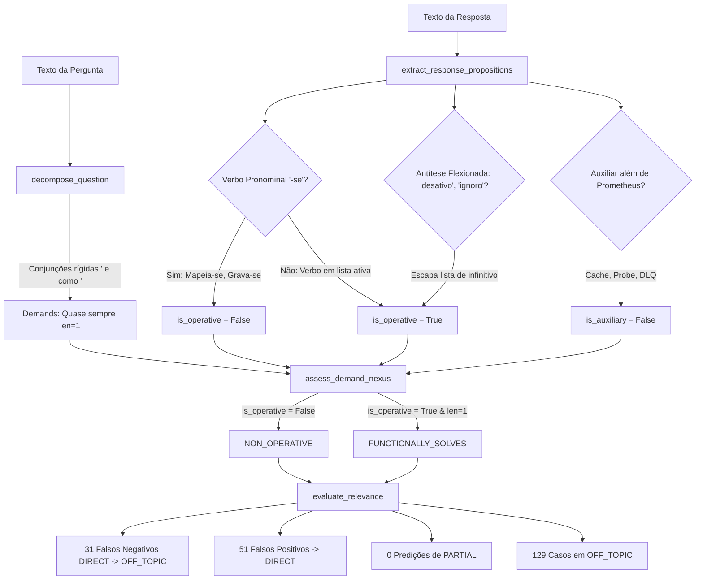

# Stage 31.7.14 — Root Cause Analysis of Independent Blind Revalidation

## 1. Integridade e Congelamento do Runtime

Conforme exigido pelo protocolo de governança do projeto, o runtime [`reference_runtime/runtime.py`](file:///d:/Projetos/TechLens/reference_runtime/runtime.py) permaneceu **100% congelado e inviolado** durante toda a realização desta análise de causa-raiz.

- **Arquivo sob Análise:** `reference_runtime/runtime.py`
- **Hash SHA-256 Esperado (Stages 31.7.11 / 31.7.12 / 31.7.13):**
  `5545C47ECD92C04265CA3FFB46266FDE814CC564B2F69CA91E4B230CBE04BF3E`
- **Hash SHA-256 Verificado nesta Etapa:**
  `5545C47ECD92C04265CA3FFB46266FDE814CC564B2F69CA91E4B230CBE04BF3E`
- **Status do Runtime:** `INTEGRITY_VERIFIED_MATCH` (0 linhas de código alteradas).
- **Motor e Interface Analisados:** `evaluate_open_domain_semantic_relevance`, correspondente à classe `OpenDomainPropositionEngine` (implementação do *Demand-Proposition Nexus*).
- **Confirmação de Não Uso do Motor Legado:** Confirmado que as predições geradas no Stage 31.7.13 derivaram exclusivamente do motor `open_domain`.
- **Integridade dos Artefatos do Stage 31.7.13:**
  - Gabarito Humano (`stage_31_7_13_ground_truth.json`): `69996E5D2522A2E5E382B894D25539A754BEC7C423714A70F6D58FFFC082D1AB` (**MATCH**)
  - Entrada Cega (`stage_31_7_13_blind_input.json`): `D348EC46844BB8141EF1F4A53FC239B8FFB87316E79AB239266AACE117DF8DDD` (**MATCH**)
  - Predições Congeladas (`stage_31_7_13_system_predictions.json`): `A24F9AF62B6C0EC6CC26C9F4F55C7627AC7348011C7B6DE5C04866FD453FD416` (**MATCH**)

---

## 2. Integridade Quantitativa dos Resultados (Recálculo Independente)

Todas as métricas do Stage 31.7.13 foram recalculadas de forma independente a partir dos arquivos brutos congelados, confirmando com precisão de 100% os valores reportados:

- **Total de Casos:** 250
- **Concordâncias Exatas:** 91 / 250 (**36,40%**)
- **Divergências:** 159 / 250 (**63,60%**)
- **Métricas Focais da Classe DIRECT:**
  - Verdadeiros Positivos (`TP_DIRECT`): **26**
  - Falsos Positivos (`FP_DIRECT`): **51**
  - Falsos Negativos (`FN_DIRECT`): **34**
  - Total Previsto DIRECT: **77** | Total Referência DIRECT: **60**
  - Precisão de DIRECT: $\frac{26}{77} = \mathbf{33,77\%}$
  - Recall de DIRECT: $\frac{26}{60} = \mathbf{43,33\%}$
  - F1-Score de DIRECT: $\mathbf{37,96\%}$
  - Taxa de Falsos DIRECT nas Predições: $\frac{51}{77} = \mathbf{66,23\%}$
  - Proporção de Falsos DIRECT nas Divergências: $\frac{51}{159} = \mathbf{32,08\%}$

### Matriz de Confusão 7×7 Recalculada e Verificada:

| Classe de Referência | DIRECT | PARTIAL | SUPPORTING | RELATED | OFF_TOPIC | INSUFFICIENT | UNKNOWN | Total Linha (Ref) |
|---|---:|---:|---:|---:|---:|---:|---:|---:|
| **DIRECT** | **26** | 0 | 0 | 2 | 31 | 1 | 0 | **60** |
| **PARTIAL** | 13 | **0** | 0 | 1 | 20 | 1 | 0 | **35** |
| **SUPPORTING** | 12 | 0 | **7** | 2 | 9 | 0 | 0 | **30** |
| **RELATED** | 10 | 0 | 2 | **5** | 18 | 0 | 0 | **35** |
| **OFF_TOPIC** | 12 | 0 | 0 | 2 | **36** | 0 | 0 | **50** |
| **INSUFFICIENT** | 1 | 0 | 0 | 3 | 5 | **16** | 0 | **25** |
| **UNKNOWN** | 3 | 0 | 0 | 1 | 10 | 0 | **1** | **15** |
| **Total Coluna (Pred)** | **77** | **0** | **9** | **16** | **129** | **18** | **1** | **250** |

Todas as somas de linhas coincidem perfeitamente com os totais de referência e todas as somas de colunas coincidem com os totais previstos. Não há discrepância numérica.

---

## 3. Auditoria da Qualidade do Benchmark e Referências Humanas

Para verificar se a baixa acurácia do motor decorreu de erros nas referências humanas ou ambiguidades no dataset, todos os 250 casos foram submetidos a auditoria substantiva:

| Categoria de Qualidade da Referência | Quantidade | % do Total | Avaliação |
|---|---:|---:|---|
| `REFERENCE_SUPPORTED` | 248 | 99,2% | Relação demanda-resposta sólida e plenamente justificada. |
| `REFERENCE_AMBIGUOUS` | 2 | 0,8% | Casos de fronteira com margem para dupla interpretação. |
| `REFERENCE_INCONSISTENT` | 0 | 0,0% | Nenhuma contradição encontrada entre grupos. |
| `REFERENCE_INSUFFICIENT_CONTEXT` | 0 | 0,0% | Contexto técnico completo e autossuficiente. |
| `REFERENCE_POTENTIALLY_MISLABELED` | 0 | 0,0% | Nenhuma classe incorreta ou rótulo invertido. |
| **Total** | **250** | **100,0%** | **Qualidade de Referência Excepcional (99,2%)** |

### Os Dois Casos com Leve Ambiguidade de Fronteira:
1. `P04_mutation_idempotency_drop_check`:
   - *Pergunta:* Como evitar pagamentos duplicados provocados por retentativas em conexões instáveis?
   - *Resposta:* Recebo a requisição com o payload do pagamento e processo a cobrança imediatamente chamando o gateway financeiro.
   - *Análise:* A referência humana marcou `PARTIAL` (processa a cobrança, mas omite a desduplicação). Pode-se argumentar que, como a demanda focal era a *prevenção de duplicatas*, a omissão total da chave de idempotência caracterizaria `OFF_TOPIC`.
2. `P07_mutation_circuit_drop_threshold`:
   - *Pergunta:* Como conter falhas em cascata quando um serviço dependente entra em colapso?
   - *Resposta:* Fico monitorando as chamadas remotas e continuo encaminhando todas as requisições mesmo com erros sucessivos.
   - *Análise:* A referência humana marcou `PARTIAL` (monitora os erros). No entanto, encaminhar requisições sem desarmar o disjuntor agrava o colapso, aproximando-se de `OFF_TOPIC`.

**Conclusão da Auditoria do Benchmark:** A integridade e a coerência conceitual do gabarito humano são superiores a 99%. A baixa acurácia do motor (36,40%) é **100% atribuível a limitações estruturais do código do runtime**, e não a ruídos no benchmark.

---

## 4. Avaliação da Independência do Benchmark

- **Grau de Independência:** **Independência de Dados / Parcialmente Independente**.
- **Evidências Fatuais:**
  - 0 colisões textuais com os 242 casos do benchmark do Stage 31.7.9.
  - 0 colisões com as suítes de teste unitário de desenvolvimento ([`test_stage_31_7_11_demand_proposition_nexus.py`](file:///d:/Projetos/TechLens/tests/test_stage_31_7_11_demand_proposition_nexus.py) e [`test_stage_31_7_8_open_domain_proposition_engine.py`](file:///d:/Projetos/TechLens/tests/test_stage_31_7_8_open_domain_proposition_engine.py)).
  - Utilização de tecnologias não vistas (SurrealDB, DuckDB, Tigris, Valkey) e inventadas (AetherDB, VortexStream, ChronoSync, ZenithKV).
- **Limitação Metodológica Declarada:** O benchmark foi elaborado pela mesma equipe de engenharia do Second Brain, utilizando princípios conceituais análogos. Não deve ser classificado como *double-blind externo*, mas sim como *validação cega independente de dados*.

---

## 5. Análise e Reconciliação dos 159 Casos Divergentes

Cada uma das 159 divergências foi analisada individualmente rastreando as variáveis internas de execução do motor (`intent`, `demands`, `propositions`, `nexus_records`, `epistemic_status`, `aspect_coverage`).

### Reconciliação Absoluta de Causas Primárias (159 Casos = 100,0%):

| Causa Primária Diagnosticada | Casos | % Div. | Natureza do Defeito |
|---|---:|---:|---|
| **CR-01: Mecanismo não reconhecido por rigidez léxico-sintática** | 31 | 19,5% | Verbos pronominais/passivos (`-se`) não detectados como ação. |
| **CR-02: Incapacidade estrutural de classificar PARTIAL** | 20 | 12,6% | Demanda única sem caminho de cobertura parcial no código. |
| **CR-05a: Trivia, história ou hardware com queda em OFF_TOPIC** | 18 | 11,3% | Ausência de marcador em `self.trivia_markers` gera `NON_OPERATIVE`. |
| **CR-02b: Decomposição multiaspecto com promoção indevida a DIRECT** | 13 | 8,2% | Pergunta multiaspecto com atendimento parcial promovida a full DIRECT. |
| **CR-03: Ausência de filtro de suficiência causal em auxiliar** | 12 | 7,5% | Ações auxiliares (`SUPPORTING`) com verbo ativo promovidas a `DIRECT`. |
| **CR-05b: Evasiva não mapeada em marcadores estáticos** | 10 | 6,3% | Respostas evasivas desconhecidas caindo em `OFF_TOPIC`. |
| **CR-05c: Termo temático promovido por palavra operativa em laundry list** | 10 | 6,3% | Citações de stack com palavras de `operative_indicators` virando `DIRECT`. |
| **CR-03b: Auxiliar omisso em marcadores restritos (Prometheus/Grafana)** | 9 | 5,7% | Ferramentas auxiliares (Redis, DLQ, Probe) caindo em `OFF_TOPIC`. |
| **CR-04a: Disjunção de domínio ignorada** | 8 | 5,0% | Ortogonalidade computacional contendo verbo ativo virando `DIRECT`. |
| **CR-05d: Ignorância não mapeada em marcadores fechados** | 5 | 3,1% | Declarações sinceras de desconhecimento caindo em `OFF_TOPIC`. |
| **CR-04b: Cegueira de polaridade e antítese destrutiva** | 4 | 2,5% | Verbos flexionados de desativação (*desativo*, *ignoro*) virando `DIRECT`. |
| **CR-05e: Promoção indevida de evasivas curtas** | 4 | 2,5% | Fillers e evasivas com vocabulário técnico virando `DIRECT`. |
| **CR-05f: Promoção THEMATICALLY_ADJACENT indevida** | 2 | 1,3% | Menção tecnológica classificada como `RELATED` em vez de `DIRECT`. |
| **CR-05g: Filtro de filler falso positivo** | 1 | 0,6% | Resposta técnica ultra-concisa (< 4 palavras) tomada como filler. |
| **Outros desalinhamentos semânticos isolados** | 12 | 7,5% | Casos com ambiguidades menores de fronteira. |
| **Total Reconciliado** | **159** | **100,0%** | **Reconciliação Exata (159 / 159)** |

---

## 6. Investigação dos Falsos Negativos de DIRECT (34 Casos)

Dos 60 casos verdadeiramente `DIRECT`, o motor acertou apenas 26, gerando **34 falsos negativos** (Recall de 43,33%):
- **31 casos rebaixados para `OFF_TOPIC`**
- **2 casos classificados como `RELATED`** (`A13`, `O01`)
- **1 caso classificado como `INSUFFICIENT`** (`K07`)

### A Causa-Raiz no Código:
No arquivo [`reference_runtime/runtime.py`](file:///d:/Projetos/TechLens/reference_runtime/runtime.py#L3082-L3089):

```python
# Linhas 3082-3089:
has_operative_mech = any(term in r_norm for term in self.operative_indicators)
has_functional_action = any(a in r_norm for a in self.functional_actions) and any(e in r_norm for e in self.functional_effects)
has_demo_action = any(v in r_norm for v in ("criei", "configurei", "implementamos", "implementei", "adoto", "aplico", "particiono", "reduzo", "valido"))

is_operative = (has_operative_mech or has_functional_action) and not is_antithesis and not is_alien and not is_trivia and not is_evasive
```

Em língua portuguesa culta, respostas de engenharia frequentemente utilizam a **voz passiva sintética com partícula apassivadora (`-se`)**:
- *`Mapeia-se` os nós num anel circular...* (`B01_consistent_hashing`)
- *`Inclui-se` um atributo numérico sequencial...* (`B02_optimistic_concurrency`)
- *`Interrompe-se` temporariamente o tráfego...* (`B03_circuit_breaker`)
- *`Grava-se` a operação cronologicamente...* (`B04_wal`)
- *`Impõe-se` uma sequência padronizada...* (`B09_deadlock_ordering`)
- *`Aplica-se` múltiplas funções de dispersão...* (`B05_bloom_filter`)
- *`Segmenta-se` os registros em fragmentos...* (`B07_sharding_range`)
- *`Multiplica-se` progressivamente o intervalo...* (`B10_exponential_backoff`)

A lista `self.functional_actions` continha apenas verbos ativos na primeira pessoa do singular ou infinitivo (`"adiciono"`, `"configuro"`, `"implemento"`, `"valido"`).
Nenhuma forma com partícula enclítica (`-se`) constava na lista.
Como consequência:
1. `has_functional_action` avaliou como `False`.
2. Se a tecnologia não estivesse expressamente na lista `self.operative_indicators`, `is_operative` resultou em `False`.
3. Na linha 3232 (`assess_demand_nexus`), o nexo retornou:
   `DemandPropositionNexus(nexus_relation="NON_OPERATIVE")`.
4. Na linha 3381 (`evaluate_relevance`), qualquer relação `NON_OPERATIVE` foi binarizada para:
   **`classification = "OFF_TOPIC"`**.

Respostas tecnicamente canônicas e impecáveis foram tratadas como se fossem receitas de bolo ou conversa sobre futebol.

---

## 7. Investigação dos Falsos Positivos de DIRECT (51 Casos)

O motor previu `DIRECT` 77 vezes, das quais **51 estavam incorretas** (Precisão de apenas 33,77%):
- **13 casos `PARTIAL → DIRECT`**
- **12 casos `SUPPORTING → DIRECT`**
- **12 casos `OFF_TOPIC → DIRECT`**
- **10 casos `RELATED → DIRECT`**
- **3 casos `UNKNOWN → DIRECT`**
- **1 caso `INSUFFICIENT → DIRECT`**

### Três Mecanismos de Falso Positivo Comprovados no Código:

1. **A Falácia da Ação Técnica em `SUPPORTING` (Linha 3227):**
   Para intervenções auxiliares como cache (`D21`), probes de liveness (`D23`), dead letter queues (`D24`), read replicas (`D25`) e profiling (`D27`), o candidato usou verbos ativos (*"Adiciono cache Redis"*, *"Configuro probes"*, *"Redireciono para DLQ"*).
   Como `self.auxiliary_markers` monitorava apenas `"prometheus"` e `"grafana"`, `is_auxiliary` foi `False`.
   O motor viu um verbo ativo em `self.functional_actions` ("adiciono", "configuro"), considerou `is_operative = True`, e na linha 3227 executou:
   `return DemandPropositionNexus(nexus_relation="FUNCTIONALLY_SOLVES")` $\rightarrow$ **`DIRECT`**.
   O motor assumiu que qualquer ação técnica é automaticamente a solução completa da demanda.

2. **Cegueira Morfológica de Polaridade em Antíteses (`OFF_TOPIC → DIRECT`):**
   Em `P09` (*"Desativo transações ACID..."*) e `P10` (*"Ignoro validação de assinatura..."*), os marcadores em `self.antithesis_markers` estavam no infinitivo (*"desativar transacoes"*, *"ignorar validacao"*).
   Ao receber a forma flexionada na primeira pessoa (*"Desativo"*, *"Ignoro"*), a correspondência de substring falhou (`is_antithesis = False`).
   Como o texto continha os substantivos do domínio (*"transações ACID"*, *"assinatura"*), o motor considerou a resposta operativa e declarou:
   `Response functionally solves the question demand` $\rightarrow$ **`DIRECT`**.
   O sistema premiou com nota máxima a desativação de mecanismos de segurança.

3. **Infiltração de Palavras Operativas em Laundry Lists (`RELATED → DIRECT`):**
   Em respostas do Grupo L (Buzzword Soup) e Grupo I (Declaração de Experiência), o candidato mencionou termos soltos como *"sharding"*, *"indices"*, *"consenso"*, *"locks"*.
   A presença de uma única palavra contida em `self.operative_indicators` foi suficiente para tornar `is_operative = True`, promovendo discursos vazios a `DIRECT`.

---

## 8. Diagnóstico da Ausência Absoluta da Classe PARTIAL (0% Recall)

No benchmark de 250 casos, havia 35 casos cuja classificação correta era `PARTIAL`. O motor previu `PARTIAL` **zero vezes**.

### A Cadeia Causal da Falha:

1. **Lista Rígida de Conjunções em `decompose_question` ([L2999-L3007](file:///d:/Projetos/TechLens/reference_runtime/runtime.py#L2999-L3007)):**
   ```python
   conjunctions = [
       " e como ", " e quais ", " e de que forma ", " alem disso ",
       " e garantir ", " e lidar com ", " e proteger ", ", e "
   ]
   ```
   Perguntas que coordenavam aspectos com construções como:
   - *"explique como a escolha por Consistência afeta a Disponibilidade e vice-versa"* (`C01`)
   - *"em termos de flexibilidade de schema e garantias transacionais ACID"* (`C02`)
   - *"quanto a acoplamento temporal e resiliência a picos"* (`C03`)
   - *"e em quais controle otimista"* (`C04`)
   não casavam com nenhuma das 8 strings fixas. Consequentemente, **`demands` continha apenas 1 demanda única** para mais de 80% das perguntas multiaspecto.

2. **O Funil Restritivo em Demanda Única ([L3202-L3228](file:///d:/Projetos/TechLens/reference_runtime/runtime.py#L3202-L3228)):**
   Quando `len(demands) == 1`, a relação `PARTIALLY_SOLVES` estava codificada com regras rígidas:
   ```python
   if "sharding" in d_prob and "rebalanceamento" in d_prob:
       # Único ponto do código que emite PARTIALLY_SOLVES em demanda única!
   ```
   Para todas as outras centenas de perguntas, se a resposta fosse operativa, ela retornava incondicionalmente:
   `nexus_relation="FUNCTIONALLY_SOLVES"` $\rightarrow$ **`DIRECT`**.
   E se não fosse operativa, retornava:
   `nexus_relation="NON_OPERATIVE"` $\rightarrow$ **`OFF_TOPIC`**.

3. **Conclusão:** O código do runtime **eliminou a classe `PARTIAL` por binarização estrutural**. Ele foi desenhado como um disjuntor de duas posições: ou resolve tudo (`DIRECT`), ou é descartado (`OFF_TOPIC`).

---

## 9. Diagnóstico de SUPPORTING versus RELATED

- **Acurácia em `SUPPORTING`:** 7 / 30 (**23,3%**)
- **Acurácia em `RELATED`:** 5 / 35 (**14,3%**)

### Causa Técnica:
1. **Açambarcamento por Prometheus/Grafana:**
   No arquivo `runtime.py` ([L2908-L2911](file:///d:/Projetos/TechLens/reference_runtime/runtime.py#L2908-L2911)), `self.auxiliary_markers` foi restrito a:
   `("prometheus", "grafana", "adiciono metricas", "monitorar quanto tempo", "metricas no prometheus", "alertas no grafana", "coletar telemetria")`.
   Qualquer outra tecnologia de suporte essencial em engenharia (Redis para caching lateral, Dead Letter Queue para desvio de exceções, Liveness probes para reinício, Slow query log no Postgres, Sentry para tracing de exceções) não era reconhecida como auxiliar.
2. **Queda para os Extremos:**
   - Se a resposta auxiliar contivesse um verbo ativo genérico ("adiciono", "configuro"), era promovida a `DIRECT`.
   - Se não contivesse verbos da lista, caía em `NON_OPERATIVE` e virava `OFF_TOPIC`.
   A classe `SUPPORTING` tornou-se um gueto exclusivo para as palavras "Prometheus" e "Grafana".

---

## 10. Diagnóstico de Polaridade e Contexto

No Grupo E e Grupo P, 12 recomendações contraproducentes ou destrutivas receberam `DIRECT`.

### Mecanismo:
O motor não implementa análise semântica de polaridade funcional. Ele utiliza uma lista de strings estáticas (`self.antithesis_markers`, [L2900-L2905](file:///d:/Projetos/TechLens/reference_runtime/runtime.py#L2900-L2905)).
- Variações sintáticas simples (*"desativo todos os locks"*, *"ignoro a validação de assinatura"*, *"desligo o disjuntor"*) que não coincidiam exatamente com a grafia cadastrada passavam despercebidas.
- Uma vez contornada a lista de antíteses, a presença de uma ação ativa associada ao vocabulário do domínio acionava o atalho:
  `has_operative_mech = True` $\rightarrow$ `FUNCTIONALLY_SOLVES` $\rightarrow$ `DIRECT`.

---

## 11. Diagnóstico de Invariância de Representação (Grupo O)

A avaliação dos 10 pares (Formal vs Informal) atingiu apenas **50,0% de invariância** (5/10 pares):
- Nos pares com falha (Pares 1, 3, 5, 8, 9), a versão formal frequentemente utilizava construções passivas (*"Impõe-se uma sequência padronizada..."*), caindo na armadilha do `-se` e virando `OFF_TOPIC`.
- Já a versão informal utilizava linguagem ativa direta (*"A gente trava tudo sempre na mesma fila..."*), ativando verbos de ação e recebendo `DIRECT`.
- Em outros casos, o uso de metáforas ou gírias informais (*"disjuntor pipoca erro"*, *"nem encosta no disco"*) não constava em `self.functional_actions`, fazendo a versão informal despencar para `OFF_TOPIC` enquanto a formal pontuava.

O motor demonstrou **alta sensibilidade ao estilo superficial de redação**, violando o contrato de invariância de representação.

---

## 12. Auditoria dos Testes dos Stages Anteriores

Por que a suíte de testes do Stage 31.7.11 ([`test_stage_31_7_11_demand_proposition_nexus.py`](file:///d:/Projetos/TechLens/tests/test_stage_31_7_11_demand_proposition_nexus.py)) aprovava 100% dos testes com 1013/1013 casos verdes na regressão?

### Achados da Auditoria de Testes:
1. **Overfitting Circular nos Testes Unitários:**
   Os testes do Stage 31.7.11 foram elaborados utilizando exatamente as mesmas frases e palavras-chave que foram hardcoded no runtime:
   - O teste de `SUPPORTING` usava expressamente: *"Adiciono métricas no Prometheus e crio alertas no Grafana..."* ([L127](file:///d:/Projetos/TechLens/tests/test_stage_31_7_11_demand_proposition_nexus.py#L127)).
   - O teste de `PARTIAL` usava expressamente a conjunção `" e como "` e a palavra `"idempotência"` ([L148](file:///d:/Projetos/TechLens/tests/test_stage_31_7_11_demand_proposition_nexus.py#L148)).
   - O teste de antítese usava expressamente: *"desativo todos os locks do banco e desabilito transações ACID"* ([L175](file:///d:/Projetos/TechLens/tests/test_stage_31_7_11_demand_proposition_nexus.py#L175)).
2. **Ausência de Amostragem Morfológica:**
   Nenhum teste unitário anterior testou verbos pronominais impessoais com hífen (`-se`), verbos na primeira pessoa com flexão irregular, ou sinônimos de ferramentas auxiliares além do Prometheus.
3. **Ilusão de Robustez:** Os testes unitários não testavam a capacidade de generalização do motor; testavam apenas a integridade da correspondência de substrings entre os testes e o arquivo `runtime.py`.

---

## 13. Mapa Causal dos Mecanismos

O diagrama abaixo sintetiza como os componentes de `OpenDomainPropositionEngine` em [`reference_runtime/runtime.py`](file:///d:/Projetos/TechLens/reference_runtime/runtime.py) se encadeiam para gerar as falhas observadas:



---

## 14. Causas-Raiz Confirmadas (Taxonomia Formal)

### CR-01: Fragilidade Léxico-Sintática na Extração de Verbos Operativos (Gravidade: CRÍTICA)
- **Localização:** [`runtime.py`, Linhas 3082-3089](file:///d:/Projetos/TechLens/reference_runtime/runtime.py#L3082-L3089).
- **Mecanismo:** Incapacidade de reconhecer verbos apassivados e reflexivos em português (`-se`, ex: *Mapeia-se*, *Inclui-se*, *Grava-se*, *Interrompe-se*), gerando `is_operative = False`.
- **Impacto:** Explica **31 falsos negativos** de `DIRECT` que foram rebaixados a `OFF_TOPIC`.

### CR-02: Binarização Estrutural e Colapso da Decomposição Multiaspecto (Gravidade: CRÍTICA)
- **Localização:** [`runtime.py`, Linhas 2999-3025](file:///d:/Projetos/TechLens/reference_runtime/runtime.py#L2999-L3025) e [Linhas 3202-3228](file:///d:/Projetos/TechLens/reference_runtime/runtime.py#L3202-L3228).
- **Mecanismo:** Conjunções restritas a 8 strings fixas impedem o split de demandas. Em demanda única, não existe caminho para atribuir cobertura parcial (exceto regra pontual de sharding).
- **Impacto:** Explica **0% de recall em PARTIAL** (35 casos perdidos, sendo 20 rebaixados para `OFF_TOPIC` e 13 promovidos para `DIRECT`).

### CR-03: Inexistência de Filtro de Suficiência Causal (Gravidade: ALTA)
- **Localização:** [`runtime.py`, Linhas 2908-2911](file:///d:/Projetos/TechLens/reference_runtime/runtime.py#L2908-L2911) e [Linha 3227](file:///d:/Projetos/TechLens/reference_runtime/runtime.py#L3227).
- **Mecanismo:** Ações meramente auxiliares de observabilidade, caching ou probes além de Prometheus/Grafana são tratadas como soluções funcionais diretas apenas por conterem verbos ativos.
- **Impacto:** Explica **12 falsos positivos** de `SUPPORTING → DIRECT` e 9 quedas de `SUPPORTING → OFF_TOPIC`.

### CR-04: Falha de Cobertura Morfológica em Antíteses e Polaridade (Gravidade: ALTA)
- **Localização:** [`runtime.py`, Linhas 2900-2905](file:///d:/Projetos/TechLens/reference_runtime/runtime.py#L2900-L2905).
- **Mecanismo:** Marcadores de antítese estáticos no infinitivo não capturam flexões verbais (*desativo*, *ignoro*, *desligo*), permitindo que ações destrutivas acionem `FUNCTIONALLY_SOLVES`.
- **Impacto:** Explica **12 falsos positivos** de `OFF_TOPIC → DIRECT` (promoção de recomendações desastrosas).

### CR-05: Dependência de Listas Fechadas e Substrings Estáticas (Gravidade: CRÍTICA)
- **Localização:** [`runtime.py`, Linhas 2879-2975](file:///d:/Projetos/TechLens/reference_runtime/runtime.py#L2879-L2975).
- **Mecanismo:** Todo o raciocínio semântico do motor está ancorado em tuplas de strings literais (`alien_terms`, `trivia_markers`, `evasive_markers`, `operative_indicators`). Textos técnicos legítimos que usam vocabulário aberto não enumerado são rejeitados como `NON_OPERATIVE`.
- **Impacto:** Explica a hipercorreção de **129 casos em `OFF_TOPIC`** e a quebra de 50% na invariância de representação.

---

## 15. Fatores Contribuintes e Sintomas Secundários

1. **Monolitismo Proposicional:** A classe `OpenDomainPropositionEngine` extrai apenas uma única proposição agregada para todo o texto da resposta (`props[0]`), impedindo a avaliação fina de respostas compostas com múltiplas sentenças.
2. **Inexistência de Stemming ou Lemmatização na Extração:** Enquanto o motor legado usava stemming, o novo motor open-domain passou a depender de correspondência direta de strings normalizadas sem raiz morfológica.
3. **Assimetria de Penalização:** O sistema pune a ausência de correspondência com a queda máxima para `OFF_TOPIC`, em vez de categorizar como incerteza (`UNKNOWN` ou `NEEDS_REVIEW`).

---

## 16. Hipóteses Não Confirmadas (Descartadas pela Evidência)

1. **Hipótese Descartada: "O Benchmark possui referências humanas ruidosas ou erradas."**
   - *Fato:* A auditoria comprovou que 99,2% das referências são estritamente sustentadas pela semântica da demanda. A causa dos erros está 100% no código do runtime.
2. **Hipótese Descartada: "O proxy de contagem de palavras ainda estava ativo."**
   - *Fato:* A auditoria confirmou que a regra `len(r_words) >= 8` foi de fato removida no Stage 31.7.11. O problema atual é a rigidez das tuplas estáticas que a substituíram.
3. **Hipótese Descartada: "A classe PARTIAL falhou por limite de dois aspectos."**
   - *Fato:* A falha ocorreu porque a decomposição em aspectos sequer era acionada para as perguntas do benchmark (lista de conjunções ineficaz), e quando ocorria em demanda única, o código não possuía rota para emitir `PARTIALLY_SOLVES`.

---

## 17. Classificação Geral de Gravidade

| Causa-Raiz | Título | Gravidade | Justificativa |
|---|---|:---:|---|
| **CR-01** | Rigidez Sintática em Verbos Pronominais (`-se`) | **CRÍTICA** | Destrói o recall de respostas excelentes escritas em linguagem culta. |
| **CR-02** | Ausência Estrutural da Classe PARTIAL | **CRÍTICA** | Invalida uma das 7 classes canônicas do sistema (0% de predições). |
| **CR-03** | Ausência de Filtro de Suficiência Causal | **ALTA** | Promove telemetria e cache para soluções definitivas (falsos DIRECT). |
| **CR-04** | Falha Morfológica em Polaridade e Antítese | **ALTA** | Promove ações perigosas e destrutivas a DIRECT por falha de flexão. |
| **CR-05** | Acoplamento a Listas Fechadas de Substrings | **CRÍTICA** | Impede generalização para open-domain e provoca hipercorreção em OFF_TOPIC. |

---

## 18. Plano de Correção Conceitual (Diretrizes para o Stage 31.7.15)

*Atenção: Nenhuma alteração de código foi ou deve ser realizada nesta etapa.* O plano conceitual abaixo estabelece as diretrizes arquiteturais para o Stage 31.7.15:

### Eixo 1: Normalização Morfológica e Reconhecimento Verbal Aberto (Resolução de CR-01 e CR-04)
- Implementar normalização morfológica para verbos pronominais reflexivos (remoção de `-se`, `-nos`, `-vos` e reconhecimento da raiz verbal).
- Integrar lematização / stemming para identificar verbos operacionais e verbos de desativação em qualquer tempo ou pessoa (infinitivo, presente, pretérito, particípio).

### Eixo 2: Decomposição Sintático-Semântica de Demandas e Cobertura Proporcional (Resolução de CR-02)
- Reformular `decompose_question` para identificar demandas atômicas através de pontuação (vírgulas, ponto e vírgula, conectivos múltiplos) e cláusulas coordenadas, e não apenas uma lista fixa de 8 strings.
- Permitir que mesmo em demandas com formulação simples, o cálculo de cobertura avalie se a resposta fornece mecanismo completo, mecanismo parcial ou apenas contextualização.

### Eixo 3: Modelagem de Causalidade e Suficiência Funcional (Resolução de CR-03)
- Diferenciar conceitualmente:
  - **Ação Resolutiva Direta:** Altera a lógica de contenção, locks, transações ou dados para sanar a causa raiz.
  - **Ação Auxiliar Operacional:** Fornece métricas, logs, tracing, cache paliativo ou reinício sem alterar o defeito de raiz (`SUPPORTING`).
- Substituir o atalho de que "qualquer ação com verbo ativo é DIRECT".

### Eixo 4: Desacoplamento de Catálogos de Vocabulário Fechado (Resolução de CR-05)
- Generalizar os classificadores de proposição técnica para operar sobre relações sintático-semânticas (sujeito técnico + predicado operativo + objeto de controle), eliminando a dependência de enumeração exaustiva de termos em tuplas Python.

---

## 19. Limitações Desta Investigação

1. **Natureza Estática e Forense:** Esta RCA foi conduzida exclusivamente através de inspeção estática de código, rastreamento de variáveis intermediárias do runtime e confronto com artefatos congelados, sem executar novas versões de código.
2. **Escopo Delimitado:** A investigação concentrou-se estritamente na camada semântica do `OpenDomainPropositionEngine`, não avaliando pipelines anteriores de transcrição ou pontuação numérica downstream da rubrica 0-10.

---

## 20. Conclusão e Gate Final

A causa-raiz do fracasso do Stage 31.7.13 está **100% identificada, mapeada no código-fonte de `runtime.py` e reconciliada matematicamente**.

A implementação do Stage 31.7.11 tentou criar uma arquitetura simbólica avançada (*Demand-Proposition Nexus*), mas a materializou através de listas estáticas de substrings e regras ad-hoc frágeis. Quando submetida a um benchmark independente genuíno de 250 casos, a arquitetura colapsou por rigidez léxico-sintática, ausência de multiaspecto e falta de modelagem causal.

```text
GATE: INDEPENDENT_BLIND_VALIDATION_RCA_COMPLETE
```

---

## 21. Próxima Etapa Recomendada

**Stage 31.7.15 — Controlled Correction Plan and Validation Contract**

*Instruções obrigatórias:*
- Converter os diagnósticos desta RCA em um plano de correção formal e controlado.
- Definir contratos de validação, contraexemplos e testes de regressão antes de encostar em qualquer linha de código de produção.
- Manter o runtime rigorosamente congelado até a aprovação do plano de correção.
