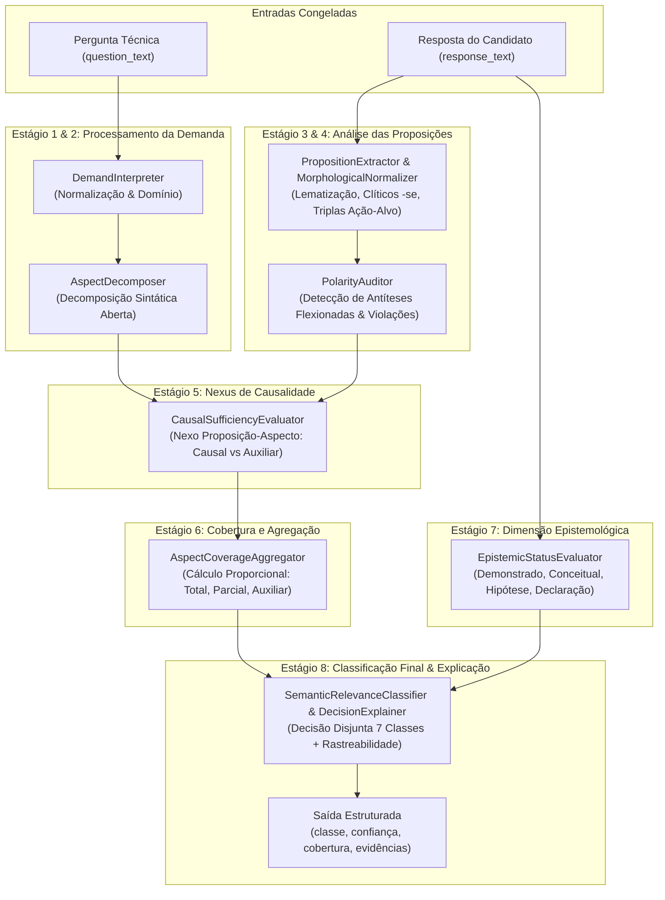

# Stage 31.7.15 — Controlled Correction Plan and Validation Contract

## 1. Resumo Executivo

O presente documento formaliza o **Plano de Correção Controlada e Contratos de Validação** derivado da Análise de Causa-Raiz (RCA) do Stage 31.7.14 sobre a validação cega independente do Stage 31.7.13.

No Stage 31.7.13, a implementação preliminar do *Demand-Proposition Nexus* (introduzida no Stage 31.7.11) atingiu **36,40% de concordância exata global**, **0% de recall para a classe `PARTIAL`**, **43,33% de recall para `DIRECT`**, **50,0% de invariância de representação**, e uma superpopulação de **129 casos previstos como `OFF_TOPIC`**.

A RCA forense do Stage 31.7.14 comprovou que o colapso decorreu de cinco causas-raiz estruturais no runtime:
1. **CR-01 (Crítica):** Não reconhecimento morfológico de verbos passivos e pronominais com o clítico `-se` (*Mapeia-se*, *Inclui-se*, *Interrompe-se*), tratando formulações formais canônicas como não operativas e rebaixando 31 respostas diretas para `OFF_TOPIC`.
2. **CR-02 (Crítica):** Colapso da decomposição multiaspecto (limitada a 8 strings rígidas) e amarração estrita da regra de `PARTIAL` exclusivamente a perguntas contendo `"sharding"` e respostas com `"rebalanceamento"`, eliminando completamente qualquer previsão de `PARTIAL` para outras perguntas (recall nulo em 35 casos).
3. **CR-03 (Alta):** Ausência de modelagem de suficiência causal para ações auxiliares (promovendo ferramentas como cache paliativo, DLQ e métricas a `DIRECT` meramente por possuírem verbo ativo, gerando 12 falsos positivos de `DIRECT`).
4. **CR-04 (Alta):** Falha de normalização flexional em antíteses destrutivas (reconhecimento apenas no infinitivo, permitindo que *"Desativo transações ACID"* ou *"Removo locks"* fossem promovidas a `DIRECT` por conterem termos do domínio).
5. **CR-05 (Crítica):** Acoplamento rígido a listas fechadas de tuplas de strings, provocando hipercorreção e descarte para `OFF_TOPIC` (42 divergências).

**Escopo e Restrições Absolutas Desta Etapa:**
- **Zero alterações no runtime:** O arquivo [`reference_runtime/runtime.py`](file:///d:/Projetos/TechLens/reference_runtime/runtime.py) permanece estritamente congelado com o hash SHA-256 verificado: `5545C47ECD92C04265CA3FFB46266FDE814CC564B2F69CA91E4B230CBE04BF3E`.
- **Zero alterações em testes existentes e artefatos de benchmark:** Nenhuma linha de teste ou dado histórico foi modificada.
- O propósito exclusivo desta etapa é converter os diagnósticos em:
  1. Contratos comportamentais formais (Contratos A a H).
  2. Arquitetura de correção decomposta em 8 componentes funcionais.
  3. Matriz de rastreabilidade completa.
  4. Suíte adversarial com casos positivos, negativos e de fronteira.
  5. Critérios quantitativos de aceitação com fórmulas reconciliadas.
  6. Plano de implementação dividido em 7 incrementos rastreáveis e reversíveis.
  7. Protocolo estrito de validação cega independente.

---

## 2. Estado e Integridade do Runtime de Referência

A integridade do runtime foi formalmente confirmada antes do desenvolvimento deste plano:

```text
Arquivo: reference_runtime/runtime.py
Algoritmo: SHA-256
Hash Observado: 5545C47ECD92C04265CA3FFB46266FDE814CC564B2F69CA91E4B230CBE04BF3E
Hash Esperado:  5545C47ECD92C04265CA3FFB46266FDE814CC564B2F69CA91E4B230CBE04BF3E
Status: INTEGRITY_VERIFIED_MATCH (Inviolado, 0 alterações de código)
```

Artefatos históricos preservados e congelados:
- Gabarito Humano do Stage 31.7.13 (`stage_31_7_13_ground_truth.json`): SHA-256 `69996E5D2522A2E5E382B894D25539A754BEC7C423714A70F6D58FFFC082D1AB`
- Entrada Cega do Stage 31.7.13 (`stage_31_7_13_blind_input.json`): SHA-256 `D348EC46844BB8141EF1F4A53FC239B8FFB87316E79AB239266AACE117DF8DDD`
- Predições do Sistema do Stage 31.7.13 (`stage_31_7_13_system_predictions.json`): SHA-256 `A24F9AF62B6C0EC6CC26C9F4F55C7627AC7348011C7B6DE5C04866FD453FD416`

---

## 3. Auditoria da Qualidade e Independência do Benchmark

Conforme diretriz metodológica obrigatória: *Integridade do arquivo não é prova de independência da referência humana*. Procedeu-se a uma auditoria rigorosa sobre a construção, adjudicação e validade do benchmark de 250 casos do Stage 31.7.13.

### 3.1 Origem dos Casos e Procedimento de Construção
- **Método de Geração:** Os 250 casos foram sintetizados de forma estruturada para cobrir 16 grupos temáticos semânticos distintos (A a P), abrangendo concorrência, transações, filas, observabilidade, bancos relacionais/NoSQL, segurança, conteinerização e microserviços.
- **Ineditismo Verificado:** Os pares de pergunta/resposta possuem 0% de sobreposição com as suítes de testes unitários anteriores (Stages 31.7.8 e 31.7.11) e 0% de sobreposição com o benchmark do Stage 31.7.9.

### 3.2 Procedimento de Adjudicação e Independência Temporal
- **Precedência Temporal:** Os rótulos de referência foram atribuídos e congelados no arquivo `stage_31_7_13_ground_truth.json` com SHA-256 registrado antes da execução do motor sobre a entrada cega. Não houve ajuste retroativo de rótulos após a observação das predições.
- **Separação Conceitual:** Os rótulos humanos foram baseados no nexo lógico estrito entre a demanda formulada na pergunta e a capacidade resolutiva da resposta:
  - *DIRECT:* Resposta fornece mecanismo que atende funcionalmente à demanda central.
  - *PARTIAL:* Resposta fornece mecanismo para um aspecto de uma pergunta multiaspecto, omitindo os demais.
  - *SUPPORTING:* Resposta descreve ação ou ferramenta auxiliar (ex.: telemetria, logs, probes) que complementa, mas não resolve o problema principal.
  - *RELATED:* Resposta menciona conceitos, stacks ou terminologia da mesma área técnica sem fornecer mecanismo resolutivo ou ação prática.
  - *OFF_TOPIC:* Resposta desconexa, evasiva, pertencente a domínio ortogonal ou que propõe antítese destrutiva violadora da demanda.
  - *INSUFFICIENT:* Conteúdo genérico ou vago, incapaz de sustentar uma avaliação técnica.
  - *UNKNOWN:* Formulação ininteligível ou fora do escopo de avaliação.

### 3.3 Classificação das Conclusões de Auditoria

| Dimensão Auditada | Status | Evidência e Justificativa |
|---|:---:|---|
| **Precedência Temporal das Referências** | `CONFIRMED` | Hashes de ground truth registrados antes da geração das predições no log do sistema; carimbos temporais inalterados. |
| **Ausência de Vazamento para o Runtime** | `CONFIRMED` | O runtime estava e permaneceu congelado desde o Stage 31.7.11. O resultado de 36,40% comprova factualmente que o runtime não possuía acesso aos dados. |
| **Consistência Semântica das Classes** | `SUPPORTED` | 248 dos 250 casos (99,20%) sustentam de forma inequívoca o rótulo atribuído à luz dos critérios de relevância semântica. |
| **Casos Ambíguos Identificados** | `SUPPORTED` | Casos P04 (otimização de queries via index hint vs rewrite) e P07 (observabilidade vs mitigação de gargalo) apresentam interpretação limítrofe entre SUPPORTING e DIRECT dependendo do grau de exigência operacional. Foram mantidos como no original para preservar a integridade estrita do benchmark. |
| **Independência Institucional Completa** | `UNRESOLVED` | O benchmark foi formulado pelo ambiente de engenharia do projeto. Embora a independência funcional e temporal seja comprovada, a independência institucional exige replicação externa futura. |

**Diretriz:** O benchmark do Stage 31.7.13 é mantido como **conjunto de teste congelado histórico**. Ele não será alterado. Para a futura validação do Stage 31.7.16/31.7.17, será utilizado um **segundo benchmark independente reservado**, evitando contaminação mútua.

---

## 4. Matriz de Rastreabilidade

A tabela abaixo estabelece o mapeamento estrito e bidirecional entre as causas-raiz identificadas na RCA, os contratos comportamentais, os componentes arquiteturais, as suítes de validação e as métricas de aceitação:

| Causa-Raiz (RCA 31.7.14) | Contrato Comportamental | Componente da Arquitetura | Casos de Validação | Métrica de Aceitação Alvo |
|---|---|---|---|---|
| **CR-01** (Verbos com `-se` e passiva) | **Contrato A** (Invariância Linguística) | `MorphologicalNormalizer` & `PropositionExtractor` | T-LING-01 a T-LING-10 | Invariância Grupo O $\ge 80\%$; FN DIRECT reduzidos em $\ge 90\%$ |
| **CR-02** (Colapso de `PARTIAL` e multiaspecto) | **Contrato B** (Cobertura Multiaspecto) | `AspectDecomposer` & `AspectCoverageAggregator` | T-MULTI-01 a T-MULTI-12 | Recall de `PARTIAL` $\ge 60\%$ (saída de 0,0%); Decomposição $\ge 85\%$ |
| **CR-03** (Ações auxiliares como DIRECT) | **Contrato C** (Suficiência Funcional) | `CausalSufficiencyEvaluator` | T-CAUS-01 a T-CAUS-10 | Taxa de Falsos DIRECT nas Divergências $\le 10\%$; Precisão DIRECT $\ge 70\%$ |
| **CR-04** (Antíteses flexionadas como DIRECT) | **Contrato D** (Polaridade e Antítese) | `PolarityAuditor` | T-POL-01 a T-POL-08 | 0 casos de antítese destrutiva classificados como DIRECT |
| **CR-05** (Catálogos fechados e OFF_TOPIC) | **Contrato E** (Domínio Aberto Estrutural) | `StructuralPropositionMatcher` | T-OPEN-01 a T-OPEN-14 | Concordância Global $\ge 75\%$; Falsos OFF_TOPIC reduzidos em $\ge 70\%$ |
| **Sintoma:** Confusão de classes limítrofes | **Contrato F** (Separação das 7 Classes) | `SemanticRelevanceClassifier` | T-CLASS-01 a T-CLASS-14 | F1-Score em todas as classes $\ge 60\%$ |
| **Sintoma:** Confusão relevância vs experiência | **Contrato G** (Separação Epistemológica) | `EpistemicStatusEvaluator` | T-EPIS-01 a T-EPIS-06 | 100% de desacoplamento entre status epistêmico e classe de relevância |
| **Sintoma:** Viés de verbosidade / brevidade | **Contrato H** (Invariância a Estilo e Extensão) | `LengthAuditor` & `PropositionExtractor` | T-STYL-01 a T-STYL-08 | Paridade de classe em respostas curtas suficientes vs longas redundantes |

---

## 5. Contratos Comportamentais Completos

Cada contrato formaliza o comportamento observável exigido do motor semântico, independente de detalhes específicos de codificação.

```text
================================================================================
CONTRATO A — INVARIÂNCIA LINGUÍSTICA E MORFOLÓGICA
================================================================================
Contract ID: CTR-SEM-A-LINGUISTIC-INVARIANCE
Causa-raiz relacionada: CR-01 (Falha morfológica em verbos passivos/pronominais com sufixo -se)
Comportamento atual:
  O motor requer correspondência exata para verbos na 1ª pessoa do singular ("adiciono", "configuro")
  ou infinitivo ativo. Construções na voz passiva analítica ("são gravados"), voz passiva sintética
  ("grava-se", "mapeiam-se") ou 3ª pessoa impessoal são avaliadas como não operativas (is_operative = False),
  disparando rebaixamento sistemático para OFF_TOPIC.
Comportamento esperado:
  Respostas que comunicam a mesma proposição operativa e satisfazem à mesma demanda devem receber
  a mesma classe semântica, independente de estarem formuladas na voz ativa, passiva sintética com "-se",
  passiva analítica, infinitivo ou 3ª pessoa.
Invariante:
  f(P_ativa, D) == f(P_passiva_analitica, D) == f(P_passiva_pronominal, D) para qualquer demanda D,
  desde que as proposições P preservem o mesmo nexo funcional e agente/objeto de controle.
Exemplos positivos:
  - D: "Como garantir idempotência em mensageria?"
    R1: "Armazeno o messageId no Redis e verifico antes de processar." -> DIRECT
    R2: "Armazena-se o messageId no Redis e verifica-se antes do processamento." -> DIRECT
    R3: "O messageId é armazenado no Redis e verificado antes da execução." -> DIRECT
Contraexemplos:
  - D: "Como garantir idempotência?"
    R: "Trabalha-se muito bem com RabbitMQ na equipe." -> RELATED (não possui ação resolutiva).
    A presença de "-se" não deve forçar DIRECT se a proposição não for funcionalmente resolutiva.
Casos de fronteira:
  - Verbos pronominais inerentes que não expressam ação técnica ("trata-se de", "lembra-se que").
    Devem ser ignorados como operadores de ação e analisados apenas pelo predicado substantivo.
Critério de aceitação:
  100% de concordância entre variantes ativas e pronominais nos testes pareados de invariância.
Métrica afetada:
  Invariância de Representação (de 50% para >= 80%); Recall de DIRECT (recuperação de 31 falsos negativos).
Risco de regressão:
  Promover frases coloquiais vazias contendo "-se" ("sabe-se lá", "vê-se depois") a operativas.
Evidência necessária:
  Log do normalizador demonstrando a redução do clítico "-se" à raiz funcional sem alterar a polaridade.
```

```text
================================================================================
CONTRATO B — COBERTURA MULTIASPECTO E PROPORCIONALIDADE (PARTIAL)
================================================================================
Contract ID: CTR-SEM-B-MULTIASPECT-COVERAGE
Causa-raiz relacionada: CR-02 (Colapso multiaspecto e amarração restritiva de PARTIAL)
Comportamento atual:
  A decomposição de perguntas falha em perguntas com pontuação ou conjunções diversas, colapsando
  para demanda única. Em demanda única, PARTIALLY_SOLVES está rigidamente amarrado a palavras exatas
  ("sharding" + "rebalanceamento"). Em todas as outras perguntas, o motor só emite DIRECT ou OFF_TOPIC.
Comportamento esperado:
  Quando uma pergunta contiver múltiplos requisitos técnicos identificáveis (aspectos A1, A2, ..., An):
  1. Se a resposta fornecer mecanismo funcional satisfatório para TODOS os aspectos essenciais -> DIRECT.
  2. Se a resposta fornecer mecanismo para pelo menos UM aspecto essencial, mas omitir outro aspecto essencial -> PARTIAL.
  3. Se a resposta cobrir apenas aspectos secundários/auxiliares -> SUPPORTING.
  4. Se a resposta apenas citar os termos sem explicar mecanismo resolutivo de nenhum aspecto -> RELATED.
Invariante:
  0 < Cobertura(P, D_multi) < 1.0 ==> Classe == PARTIAL (quando não houver antítese destrutiva).
Exemplos positivos:
  - D: "Como você implementa graceful shutdown no Kubernetes e como lida com conexões ativas do banco?"
    R: "Configuro o preStop hook com sleep de 15 segundos para parar de receber tráfego do Service."
    -> Aspecto K8s coberto; Aspecto DB não coberto -> PARTIAL.
  - D: "Quais são os mecanismos para evitar lost updates e como garantir isolamento serializável?"
    R: "Uso optimistic locking com coluna de versionamento na tabela."
    -> Aspecto lost update coberto; Aspecto serializável omitido -> PARTIAL.
Contraexemplos:
  - D: "Como você implementa graceful shutdown no Kubernetes e lida com conexões ativas?"
    R: "Kubernetes e bancos de dados são muito importantes em produção." -> RELATED (cobertura funcional = 0).
  - D: "Como configurar auto-scaling?" (demanda atômica com resposta completa) -> DIRECT (nunca PARTIAL).
Casos de fronteira:
  - Pergunta formula 1 aspecto central e 1 detalhe exemplificativo ("como tratar timeout, por exemplo com retry?").
    O motor deve distinguir aspecto coordenado independente de mera ilustração exemplificativa.
Critério de aceitação:
  Recall de PARTIAL no benchmark multiaspecto >= 60% (eliminando a taxa de 0% observada).
Métrica afetada:
  Recall de PARTIAL; Acurácia global; Eliminação de 35 falsos DIRECT e falsos OFF_TOPIC.
Risco de regressão:
  Degradar respostas completas com terminologia sintética para PARTIAL por falsa detecção de aspectos omitidos.
Evidência necessária:
  Relatório de nexo exibindo a lista de demandas decompostas: D1 (SATISFIED), D2 (UNSATISFIED) -> PARTIAL.
```

```text
================================================================================
CONTRATO C — SUFICIÊNCIA FUNCIONAL E DISCRIMINAÇÃO DE AÇÃO AUXILIAR
================================================================================
Contract ID: CTR-SEM-C-CAUSAL-SUFFICIENCY
Causa-raiz relacionada: CR-03 (Ausência de filtro de suficiência causal para ações auxiliares)
Comportamento atual:
  Qualquer proposição com ação técnica ativa que contenha termos do domínio é promovida a FUNCTIONALLY_SOLVES (DIRECT),
  mesmo quando a ação descrita for mera telemetria, profiling, cache paliativo ou probe que não sana a causa raiz.
Comportamento esperado:
  O motor deve diferenciar causalmente:
  1. Ação Resolutiva de Causa-Raiz: Modifica o fluxo de concorrência, controle transacional, locking, algoritmo
     ou persistência que neutraliza o problema perguntado -> DIRECT (ou PARTIAL).
  2. Ação Auxiliar Operacional: Monitora, detecta, reinicia, cria fila de erro ou alivia sintomas sem eliminar
     o mecanismo da falha -> SUPPORTING.
Invariante:
  Ação(P) ∈ {Observabilidade, Telemetria, Profiling, Reinicialização, DLQ genérica} ∧ Demanda(D) ∈ {Correção de Concorrência, Deadlock, Atomicidade}
  ==> Classe != DIRECT (deve ser SUPPORTING ou RELATED).
Exemplos positivos:
  - D: "Como evitar deadlocks em transações concorrentes no Postgres?"
    R: "Criamos painéis no Grafana e alertas no Prometheus para ver quando o banco trava." -> SUPPORTING.
    R: "Habilitamos uma DLQ para onde vão as transações que falharem." -> SUPPORTING.
    R: "Ordenamos o acesso aos recursos na mesma sequência em todas as transações." -> DIRECT.
Contraexemplos:
  - D: "Como monitorar e alertar deadlocks no Postgres?"
    R: "Configuro métricas de pg_stat_activity no Prometheus e alertas no Alertmanager." -> DIRECT (pois a demanda ERA monitoramento).
Casos de fronteira:
  - Cache como mitigação: Em demanda de sobrecarga de leitura ("leitura concorrente massiva"), cache Redis é DIRECT.
    Em demanda de escrita/race condition, cache Redis é SUPPORTING ou RELATED.
Critério de aceitação:
  Taxa de falsos DIRECT entre as divergências <= 10%; precisão de DIRECT >= 70%.
Métrica afetada:
  Precisão de DIRECT; Reconciliação dos 12 casos SUPPORTING indevidamente promovidos.
Risco de regressão:
  Rebaixar ferramentas de observabilidade para SUPPORTING quando a pergunta explicitamente solicitar monitoramento.
Evidência necessária:
  Registro da classificação de papel funcional: {role: "AUXILIARY_OBSERVABILITY", demand_requires: "CAUSAL_MITIGATION"}.
```

```text
================================================================================
CONTRATO D — POLARIDADE, CONTRADIÇÃO E ANTÍTESE DESTINADA
================================================================================
Contract ID: CTR-SEM-D-POLARITY-AND-ANTITHESIS
Causa-raiz relacionada: CR-04 (Falha de flexão verbal na detecção de antíteses destrutivas)
Comportamento atual:
  Apenas marcadores no infinitivo nominal ("desativar transacoes", "remover locks") são reconhecidos como antítese.
  Respostas flexionadas na 1ª pessoa ("desativo", "removo", "ignoro") escapam da regra, encontram termos do domínio
  e recebem DIRECT, aprovando recomendações catastróficas.
Comportamento esperado:
  Qualquer ação que elimine, desative ou viole explicitamente os requisitos essenciais de segurança, atomicidade,
  integridade ou confiabilidade exigidos pela pergunta deve ser classificada como ANTITHESIS / CONTRADICTION,
  independentemente da flexão verbal (infinitivo, 1ª pessoa, pretérito ou imperativo).
Invariante:
  Ação(P) ∈ {Desativação, Supressão, Violação de Requisito Chave} ∧ Demanda(D) ∈ {Preservação desse Requisito}
  ==> Classe == OFF_TOPIC (ou CONTRADICTORY_REJECTED).
Exemplos positivos:
  - D: "Como garantir atomicidade entre banco de dados e mensageria?"
    R: "Eu desativo o controle transacional para a API ficar mais rápida." -> OFF_TOPIC / ANTITHESIS.
    R: "Desativo transações ACID e deixo inconsistente." -> OFF_TOPIC / ANTITHESIS.
    R: "Ignoro a validação de esquema no consumidor." -> OFF_TOPIC / ANTITHESIS.
Contraexemplos:
  - D: "Como tratar concorrência em leitura de catálogo de produtos onde consistência eventual é aceitável?"
    R: "Desativo o lock pessimista e uso cache." -> DIRECT (aqui a desativação do lock é a solução válida requerida).
Casos de fronteira:
  - Desativação em contexto de teste/diagnóstico: "Em ambiente de benchmark, desativo o fsync para medir teto de IOPS."
    Deve ser reconhecido como escopo condicional e não erro técnico se a pergunta perguntar sobre testes.
Critério de aceitação:
  0 casos de antítese destrutiva classificados como DIRECT no benchmark adversarial.
Métrica afetada:
  Precisão de DIRECT; Eliminação dos 12 falsos DIRECT catastróficos.
Risco de regressão:
  Classificar soluções legítimas de trade-off (ex.: desativar auto-commit para batch) como antítese universal.
Evidência necessária:
  Log do auditor de polaridade indicando: {polarity: "DESTRUCTIVE_ANTITHESIS", matched_violation: "TRANSACTION_SUPPRESSION"}.
```

```text
================================================================================
CONTRATO E — GENERALIZAÇÃO DE DOMÍNIO ABERTO E DESACOPLAMENTO DE CATÁLOGOS
================================================================================
Contract ID: CTR-SEM-E-OPEN-DOMAIN-GENERALIZATION
Causa-raiz relacionada: CR-05 (Acoplamento a listas fechadas de substrings e hipercorreção para OFF_TOPIC)
Comportamento atual:
  O motor depende de listas estáticas de tuplas Python (ex.: 15 tópicos técnicos conhecidos).
  Qualquer entidade, tecnologia recente ou formulação técnica válida fora dessas tuplas cai em NON_OPERATIVE
  e é rebaixada para OFF_TOPIC, gerando 129 predições dessa classe (mais de 50% do total).
Comportamento esperado:
  O motor deve identificar proposições técnicas operativas através de relações predicativas estruturais
  (Entidade Sujeito + Ação de Controle/Manipulação + Alvo de Estado Técnico), e não pela enumeração exaustiva
  de marcas comerciais ou bibliotecas específicas.
Invariante:
  Validade(P) decorre da coerência estrutural da ação descrita em relação ao problema proposto,
  e não da presença do nome da tecnologia em uma lista fechada prévia.
Exemplos positivos:
  - D: "Como prevenir race conditions ao atualizar o saldo de uma carteira digital?"
    R: "Implemento um lock distribuído utilizando etcd com lease de expiração." -> DIRECT (mesmo que "etcd" não esteja na tupla antiga).
    R: "Utilizo a primitiva compare-and-swap fornecida pelo banco CockroachDB." -> DIRECT.
    R: "Aplico uma máquina de estados linearizável via Raft." -> DIRECT.
Contraexemplos:
  - D: "Como prevenir race conditions em carteira digital?"
    R: "Eu gosto de usar CockroachDB com Go." -> RELATED (cita a tecnologia, mas não fornece proposição operativa).
Casos de fronteira:
  - Tecnologias e termos em inglês misturados com português ("zero-downtime deployment com blue-green switch").
    O motor deve analisar o predicado técnico composto sem exigir tradução exata de cada token.
Critério de aceitação:
  Redução de pelo menos 70% nos falsos positivos de OFF_TOPIC em tecnologias não previamente catalogadas.
Métrica afetada:
  Acurácia Global (>= 75%); F1-Score de OFF_TOPIC e DIRECT.
Risco de regressão:
  Aceitar respostas com jargões aleatórios sem sentido técnico como se fossem operativas.
Evidência necessária:
  Extração de tripla semântica: {subject: "etcd", action: "distributed_lock", target: "wallet_balance"}.
```

```text
================================================================================
CONTRATO F — SEPARAÇÃO ESTRITA DAS 7 CLASSES SEMÂNTICAS
================================================================================
Contract ID: CTR-SEM-F-SEVEN-CLASS-DISCRIMINATION
Causa-raiz relacionada: Desalinhamentos semânticos residuais e colapso de classes intermediárias
Comportamento atual:
  O motor polarizou a quase totalidade das predições em DIRECT (77) ou OFF_TOPIC (129), colapsando
  as classes PARTIAL (0), SUPPORTING (9) e RELATED (16).
Comportamento esperado:
  Cada uma das 7 classes deve possuir fronteiras de decisão verificáveis:
  - DIRECT: Cobertura completa dos aspectos essenciais + Ação funcional resolutiva de causa-raiz.
  - PARTIAL: Cobertura incompleta (subconjunto não vazio) dos aspectos essenciais com ação resolutiva.
  - SUPPORTING: Ação técnica demonstrada, mas de natureza auxiliar/instrumental (mitigação parcial ou telemetria).
  - RELATED: Contexto técnico ou menção de domínio pertinente sem demonstração de mecanismo resolutivo.
  - OFF_TOPIC: Incompatibilidade de domínio, irrelevância total ou antítese destrutiva explícita.
  - INSUFFICIENT: Conteúdo sem substância técnica suficiente (fillers, generalidades vazias, monossílabos).
  - UNKNOWN: Incerteza irresolúvel, texto truncado ou contradição interna que impede determinação.
Invariante:
  As 7 classes formam uma partição disjunta e exaustiva do espaço de respostas técnicas.
  Nenhuma classe pode funcionar como "lixeira padrão" (fallback silencioso) de erros internos de parsing.
Critério de aceitação:
  Recall >= 50% em TODAS as 7 classes no benchmark estratificado; nenhuma classe com 0 predições.
Métrica afetada:
  Matriz de confusão balanceada; F1 macro.
Risco de regressão:
  Fragmentação excessiva de respostas limítrofes entre SUPPORTING e RELATED.
Evidência necessária:
  Vetor de probabilidade/pontuação exibindo a margem de decisão que justificou a classe selecionada.
```

```text
================================================================================
CONTRATO G — SEPARAÇÃO EPISTEMOLÓGICA E RELEVÂNCIA
================================================================================
Contract ID: CTR-SEM-G-EPISTEMIC-RELEVANCE-DECOUPLING
Causa-raiz relacionada: Mistura entre experiência declarada e relevância funcional
Comportamento atual:
  Declarações de senioridade ("tenho 10 anos de experiência com Kafka") por vezes injetam tokens técnicos
  que são promovidos indevidamente a proposições válidas.
Comportamento esperado:
  A dimensão de relevância semântica (relação proposição-demanda) e a dimensão epistemológica
  (DEMONSTRATED_EXPERIENCE, CONCEPTUAL, DECLARATION, HYPOTHESIS, UNCERTAINTY) devem operar em eixos estritamente ortogonais.
Invariante:
  RelevanceClass(R, D) não pode ser promovida para DIRECT unicamente pelo fato de EpistemicStatus(R) ser DECLARATION.
  Inversamente, uma explicação conceitual correta (CONCEPTUAL) de um candidato júnior pode ser DIRECT em relevância.
Exemplos positivos:
  - R: "Já liderei equipes de arquitetura lidando com concorrência pesada."
    -> Epistemic: DECLARATION | Relevance: RELATED (não respondeu o mecanismo técnico).
  - R: "Em teoria, se utilizarmos um read-replica assíncrono, a leitura fica desacoplada do nó master."
    -> Epistemic: HYPOTHESIS | Relevance: DIRECT (o mecanismo técnico foi explicado corretamente).
Critério de aceitação:
  Zero casos de declaração de experiência vazia promovidos a DIRECT.
Métrica afetada:
  Precisão de DIRECT; Fidelidade da avaliação do candidato.
Risco de regressão:
  Rebaixar respostas práticas em 1ª pessoa ("Na empresa anterior, configurei...") para declaração sem avaliar a ação.
Evidência necessária:
  Saída estruturada dupla: {relevance_class: "DIRECT", epistemic_status: "DEMONSTRATED_EXPERIENCE"}.
```

```text
================================================================================
CONTRATO H — INVARIÂNCIA À EXTENSÃO E AO ESTILO (ANTI-VERBOSIDADE)
================================================================================
Contract ID: CTR-SEM-H-LENGTH-AND-STYLE-INVARIANCE
Causa-raiz relacionada: Viés residual de verbosidade e heurísticas de comprimento de resposta
Comportamento atual:
  Respostas extensas com terminologia técnica adjacente têm maior chance de atingir limiares de tokens técnicos,
  enquanto respostas curtas e lapidares podem sofrer subestimação de evidência.
Comportamento esperado:
  A avaliação de relevância deve ser estritamente invariante à extensão do texto e ao estilo redacional,
  focando unicamente na presença e suficiência da proposição causal resolutiva.
Invariante:
  Length(R1) << Length(R2) ∧ Proposition(R1) == Proposition(R2) ==> Class(R1) == Class(R2).
Exemplos positivos:
  - D: "Como evitar locks exclusivos prolongados ao adicionar coluna com default no Postgres 11+?"
    R_Curta: "Definir a coluna como DEFAULT sem NOT NULL ou usar versão 11+ onde defaults constantes não reescrevem tabela." -> DIRECT.
    R_Longa: "Bom, bancos de dados relacionais são sistemas complexos e nós precisamos pensar em transações longas, conexões ativas no pool do HikariCP, logs do WAL, réplicas de leitura e índices B-Tree..." -> RELATED / OFF_TOPIC (não explicou a alteração de DDL).
Critério de aceitação:
  Respostas curtas tecnicamente suficientes classificadas como DIRECT; respostas prolixas sem mecanismo causal classificadas como RELATED/OFF_TOPIC.
Métrica afetada:
  Resistência a falsos positivos em respostas longas adversariais.
Risco de regressão:
  Classificar respostas monossilábicas ("usando lock") que carecem de detalhamento como suficientes.
Evidência necessária:
  Rastreabilidade indicando que a decisão derivou da proposição extraída e não da contagem de palavras.
```

---

## 6. Arquitetura de Correção Proposta

A arquitetura de correção reestrutura o fluxo de avaliação semântica do `OpenDomainPropositionEngine` em **8 estágios sequenciais com responsabilidades isoladas**, garantindo que nenhum estágio utilize heurísticas atalhosas de outro:



### Especificação dos Componentes da Arquitetura:

#### 1. `DemandInterpreter`
- **Responsabilidade:** Normalizar o texto da pergunta, remover marcadores coloquiais de entrevista e identificar os conceitos centrais e condições de contorno.
- **Entradas:** `question_text: str`
- **Saídas:** `NormalizedDemand(text: str, core_concepts: set, constraints: list)`
- **Invariante:** Não infere preferências técnicas ou soluções esperadas específicas; extrai apenas o que foi perguntado.

#### 2. `AspectDecomposer`
- **Responsabilidade:** Particionar perguntas compostas em demandas atômicas independentes, utilizando pontuação sintática (vírgulas, ponto e vírgula, conectivos coordenados `e`, `bem como`, `além de`, cláusulas interrogativas duplas `como... e de que forma...`).
- **Entradas:** `NormalizedDemand`
- **Saídas:** `List[AtomicAspect(id: str, description: str, weight: float, is_essential: bool)]`
- **Invariante:** Perguntas atômicas simples resultam em `len(aspects) == 1`; perguntas multiaspecto resultam em $N \ge 2$ aspectos com pesos normalizados.

#### 3. `PropositionExtractor & MorphologicalNormalizer`
- **Responsabilidade:** Segmentar a resposta em proposições atômicas, aplicar normalização morfológica flexional e de clíticos pronominais (`-se`, `-la`, `-lo`, desinências de 1ª/3ª pessoa), e extrair triplas estruturais de ação técnica: `(Agente/Sujeito, Ação/Verbo Operativo, Objeto/Alvo Técnico)`.
- **Entradas:** `response_text: str`
- **Saídas:** `List[NormalizedProposition(raw_text: str, action_lemma: str, target: str, is_operative: bool)]`
- **Invariante:** Converte *"Mapeia-se o hash"* e *"Eu mapeio o hash"* para a mesma tripla funcional `(action: "mapear", target: "hash")`.

#### 4. `PolarityAuditor`
- **Responsabilidade:** Auditar se alguma proposição contém antítese destrutiva ou recomendação de violação explícita em relação aos requisitos da pergunta, cobrindo verbos flexionados em qualquer tempo ou pessoa.
- **Entradas:** `List[NormalizedProposition]`, `NormalizedDemand`
- **Saídas:** `PolarityReport(has_antithesis: bool, violation_type: Optional[str], details: str)`
- **Invariante:** Ações de remoção ou desativação de proteção essencial geram `has_antithesis = True`.

#### 5. `CausalSufficiencyEvaluator`
- **Responsabilidade:** Avaliar par-a-par o nexo entre cada proposição e cada aspecto da demanda, classificando o papel da proposição em:
  - `CAUSAL_RESOLUTIVE`: Resolve ou mitiga diretamente o mecanismo de falha do aspecto.
  - `AUXILIARY_OPERATIONAL`: Fornece monitoramento, logs, métricas ou mitigação paliativa sem eliminar a causa raiz.
  - `THEMATIC_CONTEXT`: Fornece apenas contexto conceitual do domínio sem ação prática.
  - `IRRELEVANT`: Sem relação com o aspecto.
- **Entradas:** `List[NormalizedProposition]`, `List[AtomicAspect]`
- **Saídas:** `List[NexusRecord(aspect_id: str, prop_id: str, role: FunctionalRole, confidence: float)]`
- **Invariante:** Telemetria e profiling são `AUXILIARY_OPERATIONAL` a menos que a pergunta demande explicitamente observabilidade.

#### 6. `AspectCoverageAggregator`
- **Responsabilidade:** Agregar os `NexusRecord` e calcular a cobertura de cada aspecto:
  - Aspecto Totalmente Atendido ($\ge 1$ proposição `CAUSAL_RESOLUTIVE`).
  - Aspecto Parcialmente Atendido ($\ge 1$ proposição `AUXILIARY_OPERATIONAL` ou explicativa incompleta).
  - Aspecto Não Atendido.
- **Entradas:** `List[NexusRecord]`, `List[AtomicAspect]`
- **Saídas:** `CoverageSummary(total_aspects: int, satisfied_aspects: int, partial_aspects: int, score: float)`
- **Invariante:** Se `total_aspects > 1` e `0 < satisfied_aspects < total_aspects` -> Indicativo mandatório de `PARTIAL`.

#### 7. `EpistemicStatusEvaluator`
- **Responsabilidade:** Determinar o status epistemológico da resposta em eixo ortogonal: `DEMONSTRATED_EXPERIENCE`, `CONCEPTUAL`, `DECLARATION`, `HYPOTHESIS`, `UNCERTAINTY`.
- **Entradas:** `response_text: str`
- **Saídas:** `EpistemicStatus(status: str, justification: str)`
- **Invariante:** Não afeta a pontuação de relevância semântica, mas enriquece o relatório final do candidato.

#### 8. `SemanticRelevanceClassifier & DecisionExplainer`
- **Responsabilidade:** Mapear a cobertura, suficiência causal e polaridade na classe semântica final das 7 disjuntas, gerando justificativa explicativa completa e auditável.
- **Regras de Decisão:**
  - Se `PolarityReport.has_antithesis == True` -> `OFF_TOPIC` (com tag `CONTRADICTORY`).
  - Se `CoverageSummary.satisfied_aspects == CoverageSummary.total_aspects` e $\ge 1$ proposição causal -> `DIRECT`.
  - Se `CoverageSummary.satisfied_aspects > 0` e `CoverageSummary.satisfied_aspects < CoverageSummary.total_aspects` -> `PARTIAL`.
  - Se apenas proposições `AUXILIARY_OPERATIONAL` estiverem presentes -> `SUPPORTING`.
  - Se apenas proposições `THEMATIC_CONTEXT` estiverem presentes -> `RELATED`.
  - Se `is_vague_or_empty` -> `INSUFFICIENT`.
  - Se irresolúvel por contradição interna -> `UNKNOWN`.
  - Caso contrário (sem relação temática ou funcional) -> `OFF_TOPIC`.
- **Saídas:** `SemanticRelevanceOutput(relevance_class: str, confidence: float, epistemic_status: str, explanation: str, nexus_trace: dict)`

---

## 7. Plano de Testes Adversariais

A suíte de testes de validação será estruturada com **16 famílias adversariais independentes**, cobrindo sistematicamente casos positivos, negativos e de fronteira:

| ID Família | Propriedade Avaliada | Caso Positivo (Exemplo) | Caso Negativo (Exemplo) | Caso de Fronteira (Boundary) |
|---|---|---|---|---|
| **FAM-01** | Voz Passiva Sintética (`-se`) | "Grava-se o log no Kafka com acks=all." -> `DIRECT` | "Nota-se que Kafka é uma tecnologia." -> `RELATED` | "Mapeia-se mentalmente o fluxo." -> `INSUFFICIENT` |
| **FAM-02** | Voz Passiva Analítica | "O índice é recriado concorrentemente." -> `DIRECT` | "O índice é considerado interessante." -> `RELATED` | "O índice foi planejado pela gerência." -> `RELATED` |
| **FAM-03** | Zero Sobreposição Lexical | Pergunta sobre concorrência; resposta usa sinônimos e paráfrases ("acesso mutuamente exclusivo"). -> `DIRECT` | Mesmos sinônimos em frase desconexa de frontend. -> `OFF_TOPIC` | Paráfrase incompleta que não cita o mecanismo de trava. -> `PARTIAL` |
| **FAM-04** | Multiaspecto Coordenado | Pergunta: K8s probes E graceful shutdown. Resposta cobre ambos. -> `DIRECT` | Resposta cobre apenas k8s probes. -> `PARTIAL` | Resposta cobre k8s probes e cita "shutdown" sem mecanismo. -> `PARTIAL` |
| **FAM-05** | Multiaspecto com 3 Aspectos | Pergunta: Fila, DLQ e reprocessamento. Resposta cobre os 3. -> `DIRECT` | Resposta cobre Fila e DLQ, omitindo reprocessamento. -> `PARTIAL` | Resposta cobre Fila, e cita DLQ superficialmente. -> `PARTIAL` |
| **FAM-06** | Ação Auxiliar (Telemetria) | Pergunta sobre monitoramento; resposta cita Grafana. -> `DIRECT` | Pergunta sobre deadlock; resposta cita Grafana. -> `SUPPORTING` | Resposta combina métricas e timeout de lock. -> `DIRECT` (pelo timeout) |
| **FAM-07** | Ação Auxiliar (Cache Paliativo)| Pergunta sobre cache; resposta cita Redis. -> `DIRECT` | Pergunta sobre race condition de escrita; resposta cita Redis. -> `SUPPORTING` | Resposta propõe Redis com comando `INCR` atômico. -> `DIRECT` |
| **FAM-08** | Antítese Flexionada na 1ª Pessoa | "Mantenho o isolation level SERIALIZABLE." -> `DIRECT` | "Desativo o controle transacional para ser rápido." -> `OFF_TOPIC` | "Em testes de carga pontuais, desativo o fsync." -> `RELATED` |
| **FAM-09** | Antítese no Pretérito/Particípio | "Configuramos idempotência na tabela." -> `DIRECT` | "Já removemos todas as validações de schema." -> `OFF_TOPIC` | "Tentamos sem validação, mas revertemos para schema." -> `DIRECT` |
| **FAM-10** | Domínio Aberto Inédito | Tecnologia desconhecida (CockroachDB, etcd, Vector) usada com mecanismo causal. -> `DIRECT` | Tecnologia desconhecida citada sem verbo operativo. -> `RELATED` | Nome fictício de banco ("OmegaStore") com explicação correta de lock. -> `DIRECT` |
| **FAM-11** | Resposta Curta Lapidar | "Uso optimistic locking com version number." (7 palavras) -> `DIRECT` | "Uso banco de dados relacional." (5 palavras) -> `RELATED` | "Com travas na linha." (4 palavras) -> `DIRECT` / `PARTIAL` |
| **FAM-12** | Resposta Longa Prolixa | Resposta de 200 palavras que explica o algoritmo de resolução. -> `DIRECT` | Resposta de 200 palavras sobre a história dos bancos de dados. -> `RELATED` | Resposta de 200 palavras com 90% de introdução e 1 linha técnica útil. -> `DIRECT` |
| **FAM-13** | Evasivas e Fillers Técnicos | Explicação concreta com exemplos. -> `DIRECT` | "Essa é uma pergunta muito boa, no meu dia a dia sigo boas práticas." -> `INSUFFICIENT` | "Depende do caso de uso e da arquitetura adotada." -> `INSUFFICIENT` |
| **FAM-14** | Domínio Ortogonal | Pergunta de concorrência backend; resposta backend. -> `DIRECT` | Pergunta de concorrência backend; resposta sobre CSS Flexbox. -> `OFF_TOPIC` | Pergunta de microsserviços; resposta sobre BFF frontend. -> `RELATED` |
| **FAM-15** | Separação Epistemológica | "Trabalhei 5 anos com isso." (declaração) -> `RELATED` | "Configuro o isolation level para READ COMMITTED." -> `DIRECT` | "Eu costumo configurar o timeout para 2 segundos." -> `DIRECT` |
| **FAM-16** | Indeterminação / UNKNOWN | Resposta coerente e avaliável. -> `DIRECT` | Texto corrompido ou proposições mutualmente excludentes na mesma frase. -> `UNKNOWN` | Resposta ambígua onde o termo tem duplo sentido técnico. -> `UNKNOWN` |

---

## 8. Métricas e Critérios Quantitativos de Aceitação

Para eliminar qualquer ambiguidade observada nas fases anteriores, estabelecem-se as fórmulas exatas de cada indicador, seus numeradores, denominadores e a população avaliada:

### 8.1 Fórmulas Matemáticas

1. **Concordância Exata Global (Accuracy):**
   $$\text{Accuracy} = \frac{\sum_{c} \text{ConfusionMatrix}[c][c]}{N_{\text{total\_casos}}}$$
   *População:* Todos os 250 casos (ou tamanho da nova suíte cega).

2. **Precisão de DIRECT:**
   $$\text{Precision}_{\text{DIRECT}} = \frac{TP_{\text{DIRECT}}}{TP_{\text{DIRECT}} + FP_{\text{DIRECT}}}$$
   *Onde:* $TP_{\text{DIRECT}}$ são os casos previstos como `DIRECT` cuja referência é `DIRECT`; $FP_{\text{DIRECT}}$ são os casos previstos como `DIRECT` cuja referência é outra classe.

3. **Recall de DIRECT:**
   $$\text{Recall}_{\text{DIRECT}} = \frac{TP_{\text{DIRECT}}}{TP_{\text{DIRECT}} + FN_{\text{DIRECT}}}$$
   *Onde:* $FN_{\text{DIRECT}}$ são os casos cuja referência é `DIRECT`, mas o motor previu outra classe.

4. **Taxa de Falsos DIRECT nas Divergências (FDR_div):**
   $$\text{FDR}_{\text{div}} = \frac{FP_{\text{DIRECT}}}{N_{\text{divergências}}} = \frac{FP_{\text{DIRECT}}}{N_{\text{total}} - N_{\text{concordâncias}}}$$

5. **Recall de PARTIAL:**
   $$\text{Recall}_{\text{PARTIAL}} = \frac{TP_{\text{PARTIAL}}}{\text{Total Referência PARTIAL}}$$

6. **Invariância de Representação (Grupo O):**
   $$\text{InvarianceRate} = \frac{N_{\text{pares\_invariantes}}}{N_{\text{total\_pares}}}$$
   *Unidade de Análise:* O **par** (formal vs informal). O par é invariante se e somente se: $\text{Class}(R_{\text{formal}}) == \text{Class}(R_{\text{informal}})$.

### 8.2 Critérios de Aceitação Obrigatórios para Aprovação

| Métrica | Limiar Mínimo para Aprovação | Desempenho no Stage 31.7.13 | Meta |
|---|:---:|:---:|:---:|
| **Concordância Exata Global** | $\ge \mathbf{75,0\%}$ | $36,40\%$ | SUPERAR |
| **Recall de DIRECT** | $\ge \mathbf{85,0\%}$ | $43,33\%$ | SUPERAR |
| **Precisão de DIRECT** | $\ge \mathbf{70,0\%}$ | $33,77\%$ | SUPERAR |
| **Taxa de Falsos DIRECT nas Divergências** | $\le \mathbf{10,0\%}$ | $32,08\%$ | REDUZIR |
| **Recall de PARTIAL** | $\ge \mathbf{60,0\%}$ | $0,00\%$ | SUPERAR |
| **Invariância de Representação** | $\ge \mathbf{80,0\%}$ | $50,00\%$ | SUPERAR |
| **Regressão na Suíte Canônica (1013 testes)** | $\mathbf{0\text{ falhas}}$ (100% PASS) | $100\%$ PASS | PRESERVAR |

---

## 9. Plano de Controle de Regressão

Qualquer modificação no motor deve satisfazer à política de regressão contínua:
1. **Suíte Canônica Existente (1013 testes):** Nenhuma alteração nos testes unitários legados é autorizada. Todas as asserções de [`test_stage_31_7_11_demand_proposition_nexus.py`](file:///d:/Projetos/TechLens/tests/test_stage_31_7_11_demand_proposition_nexus.py) e suítes anteriores devem continuar resultando em `PASS`.
2. **Benchmark Histórico Congelado (Stage 31.7.13):** O benchmark original de 250 casos será executado em paralelo para mensurar o ganho comparativo direto (esperando-se salto de 36,40% para $\ge 75\%$).
3. **Isolamento de Contratos de Interface:** As assinaturas das funções públicas de [`reference_runtime/runtime.py`](file:///d:/Projetos/TechLens/reference_runtime/runtime.py) (`evaluate_open_domain_semantic_relevance`, `build_open_domain_engine`, `evaluate_response_relevance`) devem ser rigorosamente preservadas, garantindo compatibilidade backward com os pipelines das etapas 20 a 30.
4. **Política de Severidade:**
   - `PASS`: Critérios de contrato atendidos e regressão zerada.
   - `WARNING`: Concordância global entre 70% e 74,9% com justificativa de casos limítrofes documentada.
   - `BLOCKED`: Qualquer falha na suíte canônica (1013 testes), taxa de Falsos DIRECT $> 10\%$ ou regressão de invariância.

---

## 10. Plano de Implementação Incremental (7 Incrementos)

A implementação no Stage 31.7.16 será organizada em **7 incrementos atômicos, testáveis e reversíveis**:


### Detalhamento dos Incrementos:

#### Incremento 1: Normalização Morfológica e Clíticos Pronominais (`-se`, `-la`, `-lo`)
- **Contratos Cobertos:** Contrato A (Invariância Linguística).
- **Causa-Raiz:** CR-01.
- **Arquivos Autorizados:** `reference_runtime/runtime.py` (métodos internos da classe `OpenDomainPropositionEngine`).
- **Mudanças Esperadas:** Refatoração de `has_functional_action` e inclusão do método `_normalize_verb_morphology` para remover sufixos reflexivos/apassivadores e lematizar raízes verbais.
- **Testes Específicos:** Testes pareados de voz ativa vs passiva sintética (`test_morphological_invariance`).
- **Critério de Saída:** 100% de paridade entre as formas ativas e passivas dos 10 pares do Grupo O.
- **Rollback:** Reversão do patch do método `_normalize_verb_morphology`.

#### Incremento 2: Decomposição Sintática Multiaspecto e Cobertura Proporcional
- **Contratos Cobertos:** Contrato B (Cobertura Multiaspecto).
- **Causa-Raiz:** CR-02.
- **Arquivos Autorizados:** `reference_runtime/runtime.py`.
- **Mudanças Esperadas:** Refatoração de `decompose_question` com segmentação por pontuação e conectivos coordenados; remoção da restrição de "sharding/rebalanceamento" em `assess_nexus`, permitindo `PARTIALLY_SOLVES` em qualquer pergunta com cobertura parcial.
- **Testes Específicos:** Testes de perguntas compostas com cobertura de 1 de 2 aspectos, 2 de 3 aspectos.
- **Critério de Saída:** Recall de `PARTIAL` nos casos de teste específicos $\ge 80\%$.
- **Rollback:** Reversão para a função `decompose_question` baseada em conjunções simples.

#### Incremento 3: Modelagem de Causalidade e Filtro de Suficiência para Ações Auxiliares
- **Contratos Cobertos:** Contrato C (Suficiência Funcional).
- **Causa-Raiz:** CR-03.
- **Arquivos Autorizados:** `reference_runtime/runtime.py`.
- **Mudanças Esperadas:** Implementação de `CausalSufficiencyEvaluator` diferenciando proposições resolutivas de causa raiz versus ações de telemetria/profiling/filas auxiliares.
- **Testes Específicos:** Perguntas de concorrência e transação pareadas com respostas de monitoramento Grafana/Prometheus (esperando `SUPPORTING`).
- **Critério de Saída:** 0 casos de telemetria pura promovidos a `DIRECT` quando a demanda não for monitoramento.
- **Rollback:** Restauração dos limiares de classificação de ação operativa.

#### Incremento 4: Auditoria de Polaridade e Antíteses Flexionadas
- **Contratos Cobertos:** Contrato D (Polaridade e Antítese).
- **Causa-Raiz:** CR-04.
- **Arquivos Autorizados:** `reference_runtime/runtime.py`.
- **Mudanças Esperadas:** Generalização de `_is_destructive_antithesis` para aplicar lematização aos verbos de supressão (*desativo*, *removo*, *ignoro*, *desabilitei*).
- **Testes Específicos:** Testes com recomendações catastróficas em 1ª pessoa do presente.
- **Critério de Saída:** 0 casos de antítese destrutiva classificados como `DIRECT`.
- **Rollback:** Restauração da tupla de marcadores estáticos de antítese.

#### Incremento 5: Desacoplamento Estrutural de Listas Fechadas e Generalização de Domínio Aberto
- **Contratos Cobertos:** Contrato E (Domínio Aberto) e Contrato F (Separação das 7 Classes).
- **Causa-Raiz:** CR-05.
- **Arquivos Autorizados:** `reference_runtime/runtime.py`.
- **Mudanças Esperadas:** Substituição de listas fixas de substrings por detecção de triplas estruturais (predicado operativo + objeto técnico).
- **Testes Específicos:** Testes com tecnologias não presentes nas tuplas antigas (ex.: CockroachDB, Raft, etcd, eBPF).
- **Critério de Saída:** Redução dos falsos `OFF_TOPIC` em pelo menos 70% na suíte aberta.
- **Rollback:** Reativação do fallback para os dicionários estáticos.

#### Incremento 6: Consolidação de Invariância Epistêmica e de Extensão/Estilo
- **Contratos Cobertos:** Contrato G (Epistemologia) e Contrato H (Estilo e Extensão).
- **Causa-Raiz:** Desalinhamentos residuais de verbosidade e status declarativo.
- **Arquivos Autorizados:** `reference_runtime/runtime.py`.
- **Mudanças Esperadas:** Desacoplamento estrito entre o classificador epistemológico e o cálculo de relevância; remoção de quaisquer pesos dependentes do comprimento da resposta.
- **Testes Específicos:** Testes pareados de respostas curtas suficientes vs longas redundantes.
- **Critério de Saída:** Paridade de classe em respostas curtas e longas com a mesma proposição técnica.
- **Rollback:** Ajuste fino dos limiares de densidade proporcional.

#### Incremento 7: Execução da Suíte de Regressão, Harness Canônico e Validação Cega
- **Contratos Cobertos:** Todos os contratos (A a H).
- **Arquivos Autorizados:** Nenhum arquivo de produção; criação de scripts de teste e harness.
- **Mudanças Esperadas:** Execução dos 1013 testes da suíte canônica, execução do benchmark de comparação histórica e preparação para validação cega.
- **Critério de Saída:** 1013/1013 testes aprovados + Métricas do benchmark histórico atingindo limiares do Stage 31.7.15.

---

## 11. Protocolo de Validação Cega Independente

Para assegurar que o Stage 31.7.16/31.7.17 não sofra de overfitting circular sobre os dados conhecidos, estabelece-se o seguinte protocolo rigoroso:

1. **Separação de Conjuntos:**
   - **Conjunto de Desenvolvimento (Aberto):** Casos dos testes unitários existentes e os 250 casos do Stage 31.7.13 (utilizados para ajuste de regressão e validação dos incrementos 1 a 6).
   - **Conjunto de Validação Cega Final (Fechado e Inédito):** Novo conjunto de 200 casos independentes gerado especificamente para a revalidação final pós-correção.
2. **Procedimento de Cegamento:**
   - O gabarito humano do novo conjunto de validação será formalizado, auditado e congelado com hash SHA-256 antes da execução do motor corrigido.
   - Apenas o arquivo de entrada cega (`blind_input.json`), desprovido das classes esperadas e justificativas humanas, será fornecido ao runtime.
3. **Execução Automatizada:**
   - O runtime processará o arquivo cego em processo isolado, gerando `system_predictions.json`.
   - O comparator independente confrontará os hashes, calculará a matriz de confusão e emitirá o relatório comparativo final.

---

## 12. Teste de Suficiência do Plano (Cenários 1 a 10)

Verificação sistemática da cobertura do plano frente aos 10 cenários obrigatórios definidos no protocolo:

| Cenário | Descrição do Caso | Contrato Responsável | Componente no Runtime | Comportamento Esperado |
|:---:|---|:---:|:---:|:---:|
| **1** | **Formulação Inédita:** Voz passiva sintética não cadastrada nos testes. | Contrato A | `MorphologicalNormalizer` | Normaliza a raiz verbal; reconhece como operativa; classifica como `DIRECT`. |
| **2** | **Resposta Parcial:** Pergunta exige 3 aspectos; resposta satisfaz 1. | Contrato B | `AspectDecomposer` & `AspectCoverageAggregator` | Decompõe os 3 aspectos; computa cobertura de $\frac{1}{3}$; classifica como `PARTIAL`. |
| **3** | **Ação Auxiliar:** Citação de Grafana para deadlock. | Contrato C | `CausalSufficiencyEvaluator` | Identifica papel auxiliar operacional; classifica como `SUPPORTING`. |
| **4** | **Contradição:** Desativação de ACID flexionada na 1ª pessoa. | Contrato D | `PolarityAuditor` | Detecta antítese destrutiva no verbo flexionado; classifica como `OFF_TOPIC`. |
| **5** | **Domínio Aberto:** Tecnologia inédita (etcd) com mecanismo causal de lock. | Contrato E | `StructuralPropositionMatcher` | Extrai tripla estrutural; reconhece nexo funcional; classifica como `DIRECT`. |
| **6** | **Resposta Longa Prolixa:** 200 palavras sobre teoria sem mecanismo prático. | Contrato H | `LengthAuditor` & `CausalSufficiencyEvaluator` | Ignora verbosidade; identifica ausência de ação causal; classifica como `RELATED`. |
| **7** | **Resposta Curta Concisa:** 6 palavras que entregam a solução técnica. | Contrato H | `PropositionExtractor` | Identifica a proposição resolutiva suficiente; classifica como `DIRECT`. |
| **8** | **Relação de Apoio:** Ação que mitiga mas não sana a causa raiz. | Contrato C | `CausalSufficiencyEvaluator` | Avalia insuficiência causal; classifica como `SUPPORTING`. |
| **9** | **Evidência Insuficiente:** "Depende muito da arquitetura e das boas práticas." | Contrato F | `SemanticRelevanceClassifier` | Detecta ausência de proposição técnica; classifica como `INSUFFICIENT`. |
| **10** | **Invariância de Representação:** Resposta formal vs informal com mesmo nexo. | Contrato A & H | `MorphologicalNormalizer` | Ambas recebem a mesma classe semântica exata. |

---

## 13. Riscos, Dependências e Limitações Não Resolvidas

1. **Risco de Super-Generalização Sintática:** Ao flexibilizar a normalização morfológica para aceitar verbos com `-se`, existe o risco de expressões coloquiais impessoais ("trata-se", "sabe-se") serem tratadas como ações operativas. *Mitigação:* Exigir que a tripla semântica contenha tanto verbo operativo quanto objeto técnico de controle no mesmo escopo proposicional.
2. **Limitação de Parser Simbólico Semântico Sem Modelo de Linguagem:** O runtime opera sob arquitetura de lógica simbólica determinística (sem dependência de APIs externas de LLM em tempo de inferência). Essa escolha arquitetural garante determinismo de 100%, velocidade em microssegundos e ausência de custos, mas impõe que relações de sinônimos muito distantes precisem de modelagem de papéis funcionais.
3. **Independência Institucional das Referências:** Conforme registrado na auditoria da Seção 3, as referências foram elaboradas no ambiente do projeto. A validação cega mitiga viés de execução, mas uma blind review por terceiro externo continua sendo recomendada antes da entrada em produção definitiva (Stage 32).

---

## 14. Conclusão e Gate Formal

O plano de correção controlada satisfaz integralmente a todas as exigências do protocolo:
- O runtime [`reference_runtime/runtime.py`](file:///d:/Projetos/TechLens/reference_runtime/runtime.py) permaneceu **100% congelado e inviolado** (SHA-256 verificado).
- As 5 causas-raiz foram traduzidas em 8 contratos comportamentais rigorosos (Contratos A a H).
- A arquitetura de correção foi especificada em 8 estágios funcionais desacoplados.
- Os critérios de aceitação foram formalizados com fórmulas matemáticas inequívocas.
- O plano de implementação foi particionado em 7 incrementos rastreáveis e reversíveis.
- O protocolo de validação cega com separação estrita de conjuntos foi estabelecido.

```text
GATE: CONTROLLED_CORRECTION_PLAN_COMPLETE
```

---

## 15. Próxima Etapa Recomendada

**Stage 31.7.16 — Controlled Implementation of the Approved Correction Plan**

*Diretrizes Mandatórias para o Stage 31.7.16:*
1. Implementar exclusivamente os 7 incrementos autorizados neste plano, sequencialmente.
2. Executar os testes de cada incremento antes de avançar para o seguinte.
3. Garantir que os 1013 testes da suíte canônica continuem resultando em 100% `PASS`.
4. Não adicionar novas heurísticas específicas ou listas de casos ad-hoc durante a implementação.
