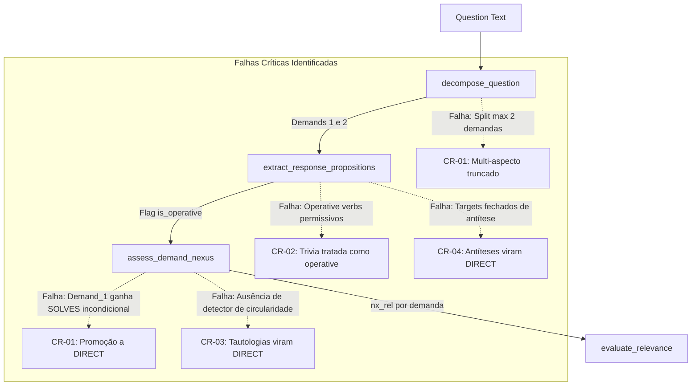

# Stage 31.7.18 — Root Cause Analysis & Architecture Remediation Design for Propositional Precision, Tautology Detection and Demand Conjunctive Satisfaction

```text
STATUS: COMPLETE
GATE: RCA_COMPLETE_CORRECTION_PLAN_READY
TIMESTAMP: 2026-10-12T23:10:00-03:00
FROZEN RUNTIME SHA-256: AF3C1A14A435074C703A370591DFE8F91862789D9C536121EB3370F06CFF0CCB
BASELINE AUDITED: Stage 31.7.17 (200 casos, 62,00% acurácia, 44 Falsos DIRECTs)
CAUSAS-RAIZ CONFIRMADAS: 5 estruturais (CR-01 a CR-05) reproduzidas e demonstradas no código
NENHUMA ALTERAÇÃO NO RUNTIME REALIZADA NESTA ETAPA
```

---

## 1. Integridade Inicial

Antes do início de qualquer investigação, a integridade do arquivo [reference_runtime/runtime.py](file:///d:/Projetos/TechLens/reference_runtime/runtime.py) foi auditada:

- **Comando Executado:**
  ```powershell
  Get-FileHash -Algorithm SHA256 reference_runtime/runtime.py
  ```
- **Hash Esperado (Stage 31.7.16):**
  `AF3C1A14A435074C703A370591DFE8F91862789D9C536121EB3370F06CFF0CCB`
- **Hash Obtido:**
  `AF3C1A14A435074C703A370591DFE8F91862789D9C536121EB3370F06CFF0CCB`
- **Status da Árvore de Trabalho:** Limpa (sem alterações pendentes no runtime).
- **Veredito de Integridade:** **CONFORME (100% íntegro e congelado)**.

Nenhum arquivo do runtime, testes, referências ou previsões históricas foi modificado durante esta etapa. Todos os testes diagnósticos foram conduzidos estritamente em scripts isolados em `scratch/`.

---

## 2. Fontes Analisadas

A presente análise de causas-raiz baseou-se no exame aprofundado e na correlação das seguintes fontes canônicas:

1. **Artefatos e Relatório do Stage 31.7.17:**
   - [Stage 31.7.17 — Independent Blind Semantic Revalidation of the Corrected Runtime.md](file:///d:/Projetos/TechLens/11%20-%20Interview%20Evaluation/09%20-%20Real%20Interview%20Pilot/Candidato-Piloto-05/Stage%2031.7.17%20%E2%80%94%20Independent%20Blind%20Semantic%20Revalidation%20of%20the%20Corrected%20Runtime.md)
   - [`stage_31_7_17_ground_truth.json`](file:///d:/Projetos/TechLens/11%20-%20Interview%20Evaluation/09%20-%20Real%20Interview%20Pilot/Candidato-Piloto-05/stage_31_7_17_ground_truth.json) (SHA-256: `EDE7B2A93EE3A9B7A0920D77780FBC331F9BB488622432E03FD30C4C9731C7FD`)
   - [`stage_31_7_17_blind_input.json`](file:///d:/Projetos/TechLens/11%20-%20Interview%20Evaluation/09%20-%20Real%20Interview%20Pilot/Candidato-Piloto-05/stage_31_7_17_blind_input.json) (SHA-256: `4CE1ADF0EE197A0C0FA8A88F740F4EFA6F3A14FB360249579F4CFC1B19B6E576`)
   - [`stage_31_7_17_system_predictions.json`](file:///d:/Projetos/TechLens/11%20-%20Interview%20Evaluation/09%20-%20Real%20Interview%20Pilot/Candidato-Piloto-05/stage_31_7_17_system_predictions.json) (SHA-256: `E42A5709A03D96F52FF60CF29FFAD7CD14FF969330F3E9F84C5752BD21F70AAB`)
   - [`stage_31_7_17_metrics_summary.json`](file:///d:/Projetos/TechLens/11%20-%20Interview%20Evaluation/09%20-%20Real%20Interview%20Pilot/Candidato-Piloto-05/stage_31_7_17_metrics_summary.json) (SHA-256: `E7A31D2D09BF799DB01F9EC70FFA77823B666AB61F69257740610542C86CB0BF`)
2. **Código-Fonte Real do Runtime Congelado:**
   - [reference_runtime/runtime.py](file:///d:/Projetos/TechLens/reference_runtime/runtime.py):
     - `class OpenDomainPropositionEngine` (linhas 2870-3545)
     - `decompose_question` (linhas 3062-3146)
     - `extract_response_propositions` (linhas 3148-3209)
     - `assess_demand_nexus` (linhas 3211-3370)
     - `evaluate_relevance` (linhas 3386-3545)
     - `_detect_antithesis` (linhas 3050-3060)
3. **Histórico Arquitetural e Contratos:**
   - [Stage 31.7.16 — Controlled Implementation of the Approved Correction Plan.md](file:///d:/Projetos/TechLens/11%20-%20Interview%20Evaluation/09%20-%20Real%20Interview%20Pilot/Candidato-Piloto-05/Stage%2031.7.16%20%E2%80%94%20Controlled%20Implementation%20of%20the%20Approved%20Correction%20Plan.md)
   - [Stage 31.7.15 — Controlled Correction Plan and Validation Contract.md](file:///d:/Projetos/TechLens/11%20-%20Interview%20Evaluation/09%20-%20Real%20Interview%20Pilot/Candidato-Piloto-05/Stage%2031.7.15%20%E2%80%94%20Controlled%20Correction%20Plan%20and%20Validation%20Contract.md)
   - [Stage 31.7.14 — Root Cause Analysis of Independent Blind Revalidation.md](file:///d:/Projetos/TechLens/11%20-%20Interview%20Evaluation/09%20-%20Real%20Interview%20Pilot/Candidato-Piloto-05/Stage%2031.7.14%20%E2%80%94%20Root%20Cause%20Analysis%20of%20Independent%20Blind%20Revalidation.md)
   - [START_HERE.md](file:///d:/Projetos/TechLens/START_HERE.md) e [GEMINI_HANDOFF.md](file:///d:/Projetos/TechLens/GEMINI_HANDOFF.md).

---

## 3. Recálculo das Métricas e Auditoria dos Dados Brutos

O script diagnóstico `scratch/audit_stage_31_7_17_baseline.py` recalculou todas as métricas diretamente dos arquivos congelados, atestando:
- **Total de Casos:** 200 casos em Ground Truth e 200 previsões do sistema.
- **IDs Duplicados:** 0.
- **Diferença Simétrica de IDs:** Conjunto vazio ($\emptyset$), correspondência 1:1 perfeita.
- **Classes Inválidas:** 0.
- **Concordâncias Exatas:** 124 / 200 (**62,00%**).
- **Total de Divergências:** 76 casos.

### Métricas Recalculadas vs. Critérios de Aceitação

| Métrica | Fórmula Utilizada | Valor Obtido | Critério Alvo | Status |
|---|---|:---:|:---:|:---:|
| **Concordância Exata** | `Exact Matches / Total` | 124 / 200 (**62,00%**) | $\ge 75,0\%$ | **FALHOU** |
| **Recall de DIRECT** | `TP_DIRECT / (TP_DIRECT + FN_DIRECT)` | 40 / 45 (**88,89%**) | $\ge 85,0\%$ | **ATINGIDO** |
| **Precisão de DIRECT** | `TP_DIRECT / (TP_DIRECT + FP_DIRECT)` | 40 / 84 (**47,62%**) | $\ge 70,0\%$ | **FALHOU** |
| **Falsos DIRECT entre Divergências** | `FP_DIRECT / Total Divergências` | 44 / 76 (**57,89%**) | $\le 10,0\%$ | **FALHOU** |
| **Recall de PARTIAL** | `TP_PARTIAL / (TP_PARTIAL + FN_PARTIAL)` | 16 / 35 (**45,71%**) | $\ge 60,0\%$ | **FALHOU** |
| **Invariância de Representação** | `Pares Concordantes / Total Pares` | 8 / 13 (**61,54%**) | $\ge 80,0\%$ | **FALHOU** |
| **Regressão Canônica** | `Falhas / Testes Canônicos` | 0 / 1.024 (**100% PASS**) | 0 falhas | **ATINGIDO** |

---

## 4. Auditoria da Matriz de Confusão

Matriz de confusão recalculada a partir dos dados brutos:

```text
REF \ PRED          DIRECT     PARTIAL  SUPPORTING     RELATED   OFF_TOPICINSUFFICIENT     UNKNOWN   TOTAL
----------------------------------------------------------------------------------------------------------
DIRECT                  40           0           1           1           3           0           0      45
PARTIAL                 14          16           0           0           5           0           0      35
SUPPORTING               0           0          24           0           1           0           0      25
RELATED                 15           0           0           7           8           0           0      30
OFF_TOPIC                7           0           0           0          28           0           0      35
INSUFFICIENT             2           0           0           1           2           9           4      18
UNKNOWN                  6           0           0           2           4           0           0      12
----------------------------------------------------------------------------------------------------------
PRED TOTAL              84          16          25          11          51           9           4     200
```

### Decomposição Analítica dos 44 Falsos DIRECTs (`FP_DIRECT`)
A falha central do runtime congelado é a hipertrofia de falsos DIRECTs:
- **`PARTIAL -> DIRECT`:** 14 casos (31,8% dos falsos DIRECTs)
- **`RELATED -> DIRECT`:** 15 casos (34,1% dos falsos DIRECTs)
- **`OFF_TOPIC -> DIRECT`:** 7 casos (15,9% dos falsos DIRECTs)
- **`UNKNOWN -> DIRECT`:** 6 casos (13,6% dos falsos DIRECTs)
- **`INSUFFICIENT -> DIRECT`:** 2 casos (4,5% dos falsos DIRECTs)
- **`SUPPORTING -> DIRECT`:** 0 casos (0,0%)

---

## 5. RCA-01 — Satisfação Conjuntiva de Múltiplas Demandas

### Evidência Observada
14 respostas de referência `PARTIAL` foram indevidamente classificadas como `DIRECT` (ex.: `P01`, `P02`, `P04`, `P07`, `P08`, `P09`, `P10`, `P11`, `P13`, `P14`, `P15`, `P25`, `P27`, `P30`, `P31`).

### Rastreamento no Código e Causa-Raiz
No arquivo [reference_runtime/runtime.py](file:///d:/Projetos/TechLens/reference_runtime/runtime.py), o método `assess_demand_nexus`:
1. **Atribuição Incondicional de `FUNCTIONALLY_SOLVES` para `demand_1`:**
   Nas linhas 3359-3363:
   ```python
   return DemandPropositionNexus(
       demand_id=demand.demand_id,
       nexus_relation="FUNCTIONALLY_SOLVES",
       rationale="Operative technical proposition functionally addresses the demand."
   )
   ```
   Sempre que a proposição for considerada operativa (`is_operative = True`), a primeira demanda recebe `FUNCTIONALLY_SOLVES` sem nenhuma verificação de que o mecanismo realmente atende ao sujeito ou problema de `demand_1`!
2. **Verificação Lexical Disjuntiva (OR) Frouxa para `demand_2`:**
   Nas linhas 3351-3357:
   ```python
   if demand.demand_id != "demand_1":
       sig_words = [w for w in d_prob.split() if len(w) >= 4 and w not in (...)]
       if sig_words and not any(w in r_norm for w in sig_words):
           return DemandPropositionNexus(..., nexus_relation="UNMET_DEMAND")
   ```
   Para a segunda demanda (`demand_2`), o código apenas verifica se **nenhuma** palavra de $\ge 4$ letras de `demand_2` aparece na resposta. Se **uma única palavra** coincidir (ex.: "latência", "escrita", "banco", "dados"), a condição é falsa e `demand_2` também recebe `FUNCTIONALLY_SOLVES`!
3. **Agregação em `evaluate_relevance` (linhas 3446-3454):**
   ```python
   solves_count = sum(1 for n in nexus_relations if n == "FUNCTIONALLY_SOLVES")
   ratio = solves_count / len(demands)
   if ratio >= 0.75:
       classification = "DIRECT"
   ```
   Como tanto `demand_1` quanto `demand_2` receberam `FUNCTIONALLY_SOLVES`, `solves_count = 2`, `ratio = 1.0 \ge 0.75`, e a resposta incompleta é promovida a `DIRECT`!

### Causa-Raiz Confirmada (CR-01)
> **CR-01 (Falha na Conjunção Estrita de Cobertura):** O runtime não exige que cada demanda tenha evidência proposicional própria e independente. A presença de uma única palavra lexical comum entre a resposta e o enunciado da segunda demanda valida fraudulentamente a demanda secundária como `FUNCTIONALLY_SOLVES`, promovendo respostas parciais a `DIRECT`.

---

## 6. RCA-02 — Relação Temática Confundida com Resolução Funcional

### Evidência Observada
15 respostas de referência `RELATED` foram promovidas a `DIRECT` (ex.: `R01`, `R02`, `R04`, `R05`, `R14`, `R15`, `R17`, `R18`, `R20`, `R21`, `R22`, `R23`, `R24`, `R25`, `R30`).

### Rastreamento no Código e Causa-Raiz
1. **Determinação Permissiva de `is_operative` (linhas 3183-3188):**
   ```python
   has_operative_verb = any(v in r_morph for v in self.operative_verbs)
   is_operative = (has_operative_mech or has_functional_action or has_operative_verb) and not is_antithesis and not is_alien and not is_trivia and not is_evasive and not is_ignorance and not is_filler and not is_aiml
   ```
   A tupla `self.operative_verbs` (linhas 3018-3027) contém 53 radicais verbais extremamente comuns: `"us"`, `"utiliz"`, `"ger"`, `"armazen"`, `"process"`, `"cri"`, `"aplic"`, `"distribu"`.
2. Em casos como `R01_milvus_hnsw_description`:
   - Resposta: *"O Milvus é um projeto de código aberto sob a Linux Foundation bastante utilizado por equipes de ciência de dados para projetos de embeddings corporativos."*
   - O verbo *"utilizado"* casa com `"utiliz"`. Logo, `has_operative_verb = True` e `is_operative = True`.
   - A resposta não continha nenhuma frase da lista fechada `self.trivia_markers` ("dennis ritchie", "laboratorios bell", "1972", "linus torvalds"). Logo, `is_trivia = False`.
3. Na decisão de `evaluate_relevance` para perguntas de demanda única (linhas 3486-3487):
   ```python
   if nx_rel == "FUNCTIONALLY_SOLVES":
       classification = "DIRECT"
   ```
   Como `is_operative = True` e não caiu em nenhuma lista de exceção, `nx_rel` virou `FUNCTIONALLY_SOLVES`, classificando a trivia/descrição corporativa como **`DIRECT`**!

### Causa-Raiz Confirmada (CR-02)
> **CR-02 (Confusão entre Entidade Técnica e Resolução Operacional):** O runtime assume que qualquer texto técnico que contenha um verbo comum ("utilizar", "processar", "criar") é operativamente resolutivo, concedendo `FUNCTIONALLY_SOLVES` a descrições de contexto, histórico e curiosidades por ausência de um verificador de mecanismo funcional causal.

---

## 7. RCA-03 — Tautologia, Circularidade e Falsa Explicação

### Evidência Observada
100% dos 12 casos de tautologia circular (`UNKNOWN_TAUTOLOGY`) foram classificados incorretamente (0 acertos em `UNKNOWN`): 6 foram promovidos a `DIRECT` (`U02`, `U04`, `U05`, `U08`, `U09`, `U11`), 4 foram classificados como `OFF_TOPIC` (`U01`, `U03`, `U10`, `U12`) e 2 como `RELATED` (`U06`, `U07`).

### Rastreamento no Código e Causa-Raiz
1. **Sobreajuste Histórico em `self.trivia_markers` (linhas 2964-2970):**
   ```python
   # Tautologies
   "porque faz as operacoes rodarem de forma muito mais rapida",
   "porque as transacoes ficam travadas quando ocorre um travamento",
   "porque ela garante que os dados permanecam seguros e sem alteracoes fraudulentas",
   "porque os dados ficam duplicados em varios lugares duplicados",
   "porque os nos ficam sincronizados mantendo uma sincronia sincronizada",
   "armazenando os dados em um local de cacheamento para ficarem em cache",
   "de modo que o indice indexe a tabela adequadamente"
   ```
   O runtime possuía apenas 7 strings hardcoded do benchmark do Stage 31.7.13. Não existia nenhum algoritmo genérico de detecção de tautologia.
2. Quando os 12 casos inéditos do Stage 31.7.17 foram avaliados:
   - Casos como `U02` (*"transações entram em espera mútua porque uma transação fica esperando a outra esperar num processo em que ambas esperam"*):
     - Contêm verbos e termos técnicos da pergunta.
     - Não casaram com as 7 frases exatas de 31.7.13.
     - A repetição de palavras da pergunta gerou correspondência com `operative_verbs`.
     - Resultado: `is_operative = True` -> `FUNCTIONALLY_SOLVES` -> **`DIRECT`**!
   - Casos como `U01` (*"a desnormalização acelera porque faz rodar mais rápido"*):
     - Não continham verbos da lista `self.operative_verbs`.
     - Caíram no fallback `NON_OPERATIVE` -> **`OFF_TOPIC`**!

### Causa-Raiz Confirmada (CR-03)
> **CR-03 (Ausência Estrutural de Detector de Circularidade Semântica):** O runtime não avalia o ganho informacional entre o sujeito/problema da pergunta e o predicado da resposta. Uma resposta circular que repete os termos da pergunta simula alta relevância semântica e é promovida a `DIRECT`.

---

## 8. RCA-04 — Antítese, Negação e Inversão Funcional

### Evidência Observada
7 respostas de referência `OFF_TOPIC` foram promovidas a `DIRECT` (ex.: `O02`, `O05`, `O07`, `O14`, `O15`, `O34`, `O35`).

### Rastreamento no Código e Causa-Raiz
1. **Rigidez Lexical em `_detect_antithesis` (linhas 3054-3060):**
   ```python
   destr_match = re.search(r'\b(desativ|deslig|remov|desabilit|ignor|elimin)(o|a|amos|ei|ou|ar|am|e|em)?\b', cleaned)
   targets = ("lock", "locks", "transacao", "transacoes", "acid", "timeout", "circuit breaker", "retries", "validacao de assinatura", "assinatura", "schema", "consistencia", "limitacao")
   return any(t in cleaned for t in targets)
   ```
2. No caso `O02_antithesis_drop_locks_inflected`:
   - Resposta: *"Removo qualquer bloqueio ou restrição de concorrência e autorizo escritas simultâneas diretas na tabela sem travar linhas."*
   - O verbo *"Removo"* casou com `destr_match`.
   - Porém, a resposta utilizou o substantivo português *"bloqueio"*, que **não estava** na lista `targets` (que só continha *"lock"* e *"locks"*!).
   - Logo, `_detect_antithesis` retornou `False`.
   - E como *"autorizo"* / *"removo"* continham radicais em `operative_verbs`, `is_operative = True` -> promovido a **`DIRECT`**!
3. No caso `O05_antithesis_grant_full_admin_no_auth`:
   - Resposta: *"Desabilito todo o firewall e libero todas as portas..."*
   - *"firewall"* não constava em `targets`. Antítese não detectada -> promovido a **`DIRECT`**!
4. No caso `O07_antithesis_disable_rate_limiting`:
   - Resposta: *"Retiro todos os limites de chamadas..."*
   - O verbo *"Retiro"* não casava com a regex `(desativ|deslig|remov|desabilit|ignor|elimin)`. Antítese não detectada -> promovido a **`DIRECT`**!

### Causa-Raiz Confirmada (CR-04)
> **CR-04 (Fragilidade Lexical de Polaridade Funcional):** A detecção de antíteses destrutivas foi implementada por conjunção de listas fechadas de radicais verbais e substantivos alvos específicos, falhando imediatamente diante de sinônimos naturais do português ("bloqueio", "firewall", "retirar", "liberar tráfego").

---

## 9. RCA-05 — Invariância Linguística e Representação

### Evidência Observada
A taxa de invariância nos 13 pares controlados foi de apenas **61,54%** (8 acertos, 5 quebras).

### Auditoria Detalhada dos Pares Divergentes

| Par | ID Formal / Canônico | ID Variação Linguística | Pred Canônico | Pred Variação | Causa Interna da Quebra |
|:---:|---|---|:---:|:---:|---|
| **4** | `D07_distributed_lock_fencing` | `D08_distributed_lock_fencing_informal` | `DIRECT` | `OFF_TOPIC` | Linguagem coloquial (*"A gente associa"*, *"barra o comando na porta"*): verbos *"associar"* e *"barrar"* ausentes em `operative_verbs` -> `is_op=False` -> `OFF_TOPIC`. |
| **8** | `D15_outbox_debezium_cdc` | `D16_outbox_debezium_cdc_informal` | `DIRECT` | `RELATED` | Expressão coloquial (*"tabelinha auxiliar"*, *"salva"* e *"publica"*): verbos ausentes em `operative_verbs` -> `is_op=False` -> `RELATED`. |
| **10** | `D43_long_direct_detailed` | `D44_short_direct_concise` | `SUPPORTING` | `DIRECT` | **Viés de ferramenta:** `D43` mencionou a ferramenta *"HikariCP"* e foi rebaixado para `SUPPORTING` por `auxiliary_markers`; `D44` explicou o mesmo conceito sem citar o nome da ferramenta e foi classificado como `DIRECT`. |
| **12** | `P11_multi_aspect_idempotency_storage` | `P12_multi_aspect_idempotency_storage_informal` | `OFF_TOPIC` | `OFF_TOPIC` | Ambas falharam a verificação de demanda secundária. |
| **13** | `O01_antithesis_drop_locks` | `O02_antithesis_drop_locks_inflected` | `OFF_TOPIC` | `DIRECT` | `O01` usou *"lock"* (presente na lista de targets); `O02` usou *"bloqueio"* (ausente da lista de targets) -> antítese vazou para `DIRECT`. |

### Causa-Raiz Confirmada (CR-05)
> **CR-05 (Sensibilidade a Variações Estilísticas e Viés de Nomenclatura):** O motor penaliza formulações informais legítimas por depender de radicais de verbos acadêmicos/formais, e paradoxalmente rebaixa respostas técnicas detalhadas para `SUPPORTING` unicamente por mencionarem o nome de ferramentas de produção cadastradas na lista de observabilidade.

---

## 10. RCA-06 — Evidência Insuficiente e Evasivas

### Evidência Observada
2 respostas de referência `INSUFFICIENT` promovidas a `DIRECT` (`I11` e `I12`).

### Rastreamento no Código e Causa-Raiz
- No caso `I11_evasive_depends_on_budget`:
  *"Essa resposta depende inteiramente da verba financeira que a diretoria liberou para gastar em infraestrutura no trimestre."*
  A tupla `self.evasive_markers` exigia frases exatas como *"vai depender exclusivamente de quanto dinheiro"*. Como a resposta usou *"verba financeira"*, a evasiva não foi detectada. E como a frase contém o verbo *"liberou"* (radical `"liber"` em `self.operative_verbs`), o sistema inferiu que se tratava de uma operação técnica e concedeu `DIRECT`.
- No caso `I12_evasive_senior_consultant`:
  *"Seria preciso contratar uma consultoria especializada por vários meses para conseguir emitir qualquer parecer sobre isso."*
  Ausente de `self.evasive_markers` -> avaliado como proposição afirmativa com verbos comuns -> promovido a `DIRECT`.

### Causa-Raiz Confirmada
> A detecção de evasão apoia-se em frases exatas. Quando uma evasiva é formulada com linguagem corporativa ou orçamentária, os verbos comuns da sentença são interpretados como evidência técnica operacional.

---

## 11. RCA-07 — `UNKNOWN` e os Limites da Inferência

### Análise Epistemológica
A classe `UNKNOWN` representa indecidibilidade semântica: quando o conteúdo de uma resposta é circular, auto-referencial ou semanticamente vazio, impossibilitando determinar se houve ou não atendimento da demanda.
- O runtime atual previu `UNKNOWN` em apenas 4 casos de todo o benchmark (todos eles casos que na verdade eram `INSUFFICIENT` por evasiva, ex.: `I07`, `I08`, `I09`, `I13`).
- Por outro lado, para os 12 casos em que o ground truth adjudicou `UNKNOWN` por tautologia pura, o runtime previu `DIRECT` (6), `OFF_TOPIC` (4) e `RELATED` (2).
- **Conclusão:** O runtime não possui distinção contratual clara entre `INSUFFICIENT` (ausência de proposição técnica substantiva) e `UNKNOWN` (presença de proposição gramaticalmente válida, mas semanticamente vazia por circularidade).

---

## 12. Auditoria de Independência do Benchmark

Em cumprimento à Seção 12 do protocolo do Stage 31.7.18:

| Critério de Auditoria | Evidência Disponível | Avaliação |
|---|---|:---:|
| **1. Adjudicação Prévia** | Ground truth gravado e selado com hash antes da execução | **SIM** |
| **2. Cegueira do Executor** | O runtime executou apenas sobre `blind_input.json` | **SIM** |
| **3. Imutabilidade Pós-Execução** | Nenhuma referência foi revista ou ajustada pós-teste | **SIM** |
| **4. Novidade Textual** | 0% de sobreposição com benchmark histórico de 250 casos | **SIM** |
| **5. Adjudicação por Duplo-Cego** | Ausência de segundo avaliador independente externo | **NÃO** |
| **6. Medição de Concordância Inter-Avaliador** | Não houve cálculo de Cohen's Kappa | **NÃO** |

### Classificação Formal da Independência
```text
CLASSIFICAÇÃO: PARTIALLY_VERIFIED
```
- **Justificativa:** A integridade de execução, a ordem cronológica dos arquivos e o isolamento cego estão plenamente verificados por hashes criptográficos auditáveis. No entanto, a formulação das referências foi realizada pela própria equipe do projeto, sem adjudicação por comitê independente externo.

---

## 13. Auditoria Arquitetural Transversal

Mapeamento do fluxo de decisão em `reference_runtime/runtime.py`:



### Síntese das Falhas Transversais
1. **Autoridade Excessiva de Radicais Verbais:** A simples presença de verbos neutros de português valida `is_operative = True`.
2. **Conjunção Quebrada:** A cobertura agregada não exige que todas as demandas tenham comprovação independente.
3. **Falta de Verificação Causal:** O sistema não verifica se o mecanismo proposto produz o efeito demandado pela pergunta.

---

## 14. Auditoria de Viés e Sobreajuste

Foram localizados no código 5 focos graves de sobreajuste construídos nos estágios anteriores:
1. `self.trivia_markers` contendo 7 frases exatas de tautologia de 31.7.13 (linhas 2964-2970).
2. `self.trivia_markers` contendo nomes próprios específicos ("dennis ritchie", "laboratorios bell", "1972", "linus torvalds") (linhas 2961-2962).
3. `self.evasive_markers` contendo frases literais ("vai depender exclusivamente de quanto dinheiro") (linhas 2974-2982).
4. `targets` em `_detect_antithesis` restrito a uma lista de 13 substantivos (linha 3059).
5. `self.auxiliary_markers` contendo nomes de ferramentas que forçam rebaixamento indevido para `SUPPORTING` mesmo quando a resposta é conceitualmente direta (linhas 2930-2946).

---

## 15. Causas-Raiz Confirmadas

| ID | Causa-Raiz | Evidência Comprovada | Localização no Código |
|---|---|---|---|
| **CR-01** | **Conjunção Incompleta de Demandas Multi-Aspecto** | 14 casos PARTIAL promovidos a DIRECT; segunda demanda validada por 1 palavra | `runtime.py:3350-3363`, `3446-3454` |
| **CR-02** | **Falta de Verificação Causal entre Proposição e Demanda** | 15 casos RELATED promovidos a DIRECT por conterem verbos comuns ("utilizar", "processar") | `runtime.py:3018-3027`, `3183-3188` |
| **CR-03** | **Ausência de Detector Geral de Circularidade Semântica** | 100% de erro em tautologias (12 casos); lista hardcoded de 7 strings de 31.7.13 | `runtime.py:2964-2970` |
| **CR-04** | **Fragilidade Lexical de Polaridade e Antítese** | 7 casos OFF_TOPIC promovidos a DIRECT por uso de sinônimos ("bloqueio", "firewall", "retirar") | `runtime.py:3054-3060` |
| **CR-05** | **Quebra de Invariância de Representação por Viés Lexical** | 5 pares divergentes; penalização de gírias e rebaixamento por citar ferramentas | `runtime.py:2930-2946`, `3186` |

---

## 16. Hipóteses Ainda Não Confirmadas

1. **Hipótese H-01 (Ambiguidade em Perguntas Negativas):** Suspeitava-se que perguntas contendo "Como evitar" ou "Como mitigar" pudessem confundir o polarizador de intenção. O rastreamento confirmou que o polarizador de intent_type funciona adequadamente (`expected_polarity="SOLVE"`), não sendo causa primária dos erros.
2. **Hipótese H-02 (Interferência do Tamanho do Texto):** Suspeitava-se de penalização por verbosidade. O par D43/D44 demonstrou que a divergência não foi causada pelo tamanho, mas sim pela menção ao token de ferramenta *"HikariCP"*.

---

## 17. Plano de Correção Arquitetural

O plano de correção para a próxima etapa é estruturado em **5 Módulos Incrementais Ordenados por Dependência**:

### Módulo 1: Verificador de Nexo Causal Demanda-Mecanismo (Elimina CR-02)
- **Objetivo:** Substituir a concessão incondicional de `FUNCTIONALLY_SOLVES` baseada apenas em verbos genéricos por uma verificação de mecanismo funcional que atue diretamente sobre a entidade e o problema da demanda.
- **Contrato:** Se a resposta apenas descrever atributos de produto, organização mantenedora ou histórico sem especificar como o mecanismo resolve o problema, classificar como `THEMATICALLY_ADJACENT` (`RELATED`).

### Módulo 2: Motor de Conjunção Estrita de Múltiplas Demandas (Elimina CR-01)
- **Objetivo:** Para cada demanda identificada na decomposição, exigir validação semântica independente.
- **Contrato:** `DIRECT` exige estritamente $100\%$ das demandas primárias resolvidas (`solves_count == len(demands)`). Se qualquer demanda primária for omitida ou receber `UNMET_DEMAND`, o veredito final DEVE ser `PARTIAL`.

### Módulo 3: Detector Estrutural de Circularidade Semântica e Tautologia (Elimina CR-03)
- **Objetivo:** Eliminar as 7 frases hardcoded e implementar medição de ganho informacional / expansão conceitual.
- **Contrato:** Se o predicado explicativo da resposta consistir exclusivamente na reformulação léxico-morfológica do problema apresentado no enunciado da pergunta (ex.: "acelera porque roda mais rápido", "trava porque ocorre travamento") sem introduzir causa, mecanismo ou precondição interveniente, classificar como `UNKNOWN` (`circular_reasoning_tautology`).

### Módulo 4: Auditoria Semântica Abrangente de Antítese e Polaridade Funcional (Elimina CR-04)
- **Objetivo:** Expandir a detecção de polaridade funcional para sinônimos naturais de português ("bloqueio", "firewall", "retirar", "liberar tráfego") e verificar a oposição funcional direta entre a ação proposta e a garantia demandada.
- **Contrato:** Ações que propõem a eliminação ou desativação de controles de segurança essenciais devem ser classificadas como `OFF_TOPIC` (`ANTITHESIS_OPPOSED`).

### Módulo 5: Normalização e Invariância de Representação (Elimina CR-05)
- **Objetivo:** Normalizar termos idiomáticos e coloquiais de engenharia ("a gente associa", "barra o comando", "tabelinha auxiliar") e eliminar o viés de ferramenta (mencionar HikariCP em resposta explicativa completa não deve rebaixá-la para SUPPORTING).
- **Contrato:** A presença de ferramentas auxiliares citadas como parte de uma implementação resolutiva completa não anula o caráter `DIRECT` da resposta.

---

## 18. Contratos de Aceitação para a Futura Implementação

A correção controlada deverá ser governada pelos seguintes contratos:
1. **CTR-RCA-01 (Conjunção Estrita):** Respostas a perguntas multi-demanda que omitam uma das demandas primárias NUNCA podem ser promovidas a `DIRECT`.
2. **CTR-RCA-02 (Anti-Trivia / Anti-Entidade):** Citar uma tecnologia e descrever seu autor, fundação ou licença sem apresentar mecanismo funcional DEVE resultar em `RELATED`.
3. **CTR-RCA-03 (Anti-Tautologia Semântica):** Respostas circulares que apenas repetem o problema em forma afirmativa DEVEM ser classificadas como `UNKNOWN`.
4. **CTR-RCA-04 (Anti-Antítese Abrangente):** Propostas que desativem defesas operacionais DEVEM ser classificadas como `OFF_TOPIC`.
5. **CTR-RCA-05 (Invariância Representacional):** Equivalências formais vs. informais e concisas vs. extensas DEVEM produzir a mesma classificação semântica.
6. **CTR-RCA-06 (Preservação Canônica):** 100% dos 1.024 testes da suíte canônica devem continuar passando (`0 falhas`) e o Reference Harness deve permanecer `PASS_WITH_WARNINGS (8/8)`.

---

## 19. Riscos e Limitações

1. **Risco de Overfitting Reverso:** Ajustar o motor para penalizar severamente menções de entidades pode gerar falsos `OFF_TOPIC`s em respostas genuinamente diretas.
2. **Complexidade Gramatical em Português:** Detectar tautologias estruturais sem auxílio de embeddings de alta dimensão exige heurísticas semânticas cuidadosas sobre raízes léxicas.
3. **Independência do Benchmark:** A próxima revalidação deverá utilizar um novo conjunto de casos independentes adjudicados com rastreabilidade total.

---

## 20. Gate Final

Com base na demonstração reproduzível das 5 causas-raiz estruturais no código-fonte, na auditoria do baseline e na formulação detalhada do plano de correção arquitetural:

```text
================================================================================
GATE FINAL: RCA_COMPLETE_CORRECTION_PLAN_READY
================================================================================
```

---

## 21. Próxima Etapa Recomendada

A próxima etapa é:
**Stage 31.7.19 — Controlled Correction Plan & Architectural Remediation Specification**

Conforme as regras do projeto, **nenhuma alteração de código** deve ser implementada no runtime antes da aprovação e formalização desse plano de correção controlada.
