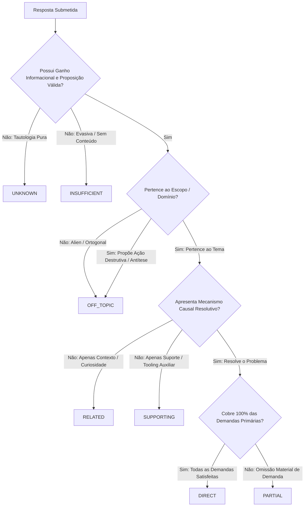
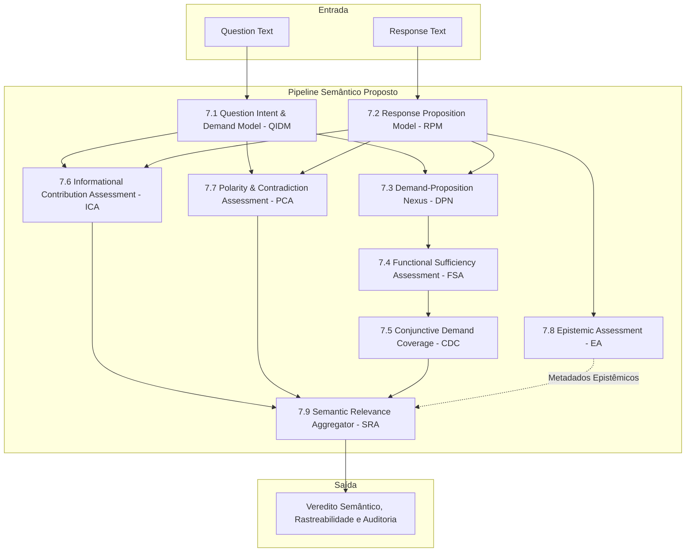
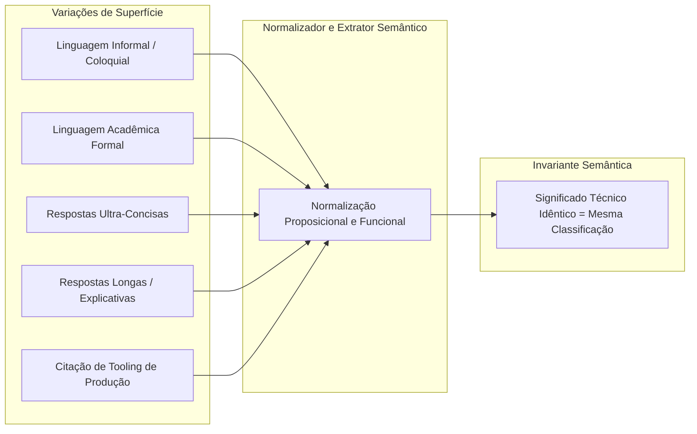
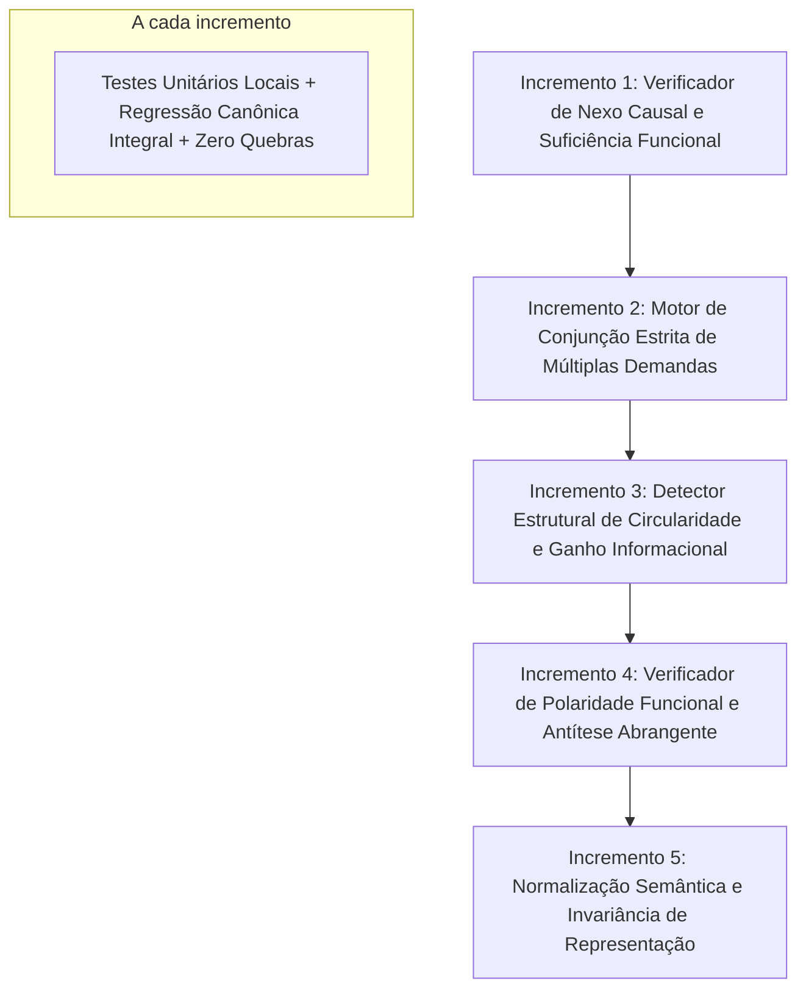

# Stage 31.7.19 — Controlled Correction Plan & Architectural Remediation Specification

```text
STATUS: COMPLETE
GATE: CORRECTION_PLAN_READY_FOR_CONTROLLED_IMPLEMENTATION
TIMESTAMP: 2026-10-12T23:30:00-03:00
FROZEN RUNTIME SHA-256: AF3C1A14A435074C703A370591DFE8F91862789D9C536121EB3370F06CFF0CCB
BASELINE AUDITED: Stage 31.7.17 (200 casos, 62,00% exato, 44 Falsos DIRECTs)
CAUSAS-RAIZ ENDEREÇADAS: 5 estruturais (CR-01 a CR-05) confirmadas no Stage 31.7.18
NENHUMA ALTERAÇÃO NO RUNTIME REALIZADA NESTA ETAPA (ESTRITAMENTE ESPECIFICAÇÃO E PLANEJAMENTO)
AUTORIZAÇÃO: AUTORIZAÇÃO EXCLUSIVA PARA IMPLEMENTAÇÃO CONTROLADA NO STAGE 31.7.20
```

---

## 1. Objetivo e Escopo

O presente documento estabelece a **especificação formal e controlada de remediação arquitetural** do motor de relevância semântica do TechLens (`OpenDomainPropositionEngine`), fundamentada nas causas-raiz estruturais demonstradas no [Stage 31.7.18 — Root Cause Analysis & Architecture Remediation Design](file:///d:/Projetos/TechLens/11%20-%20Interview%20Evaluation/09%20-%20Real%20Interview%20Pilot/Candidato-Piloto-05/Stage%2031.7.18%20%E2%80%94%20Root%20Cause%20Analysis%20&%20Architecture%20Remediation%20Design.md).

O objetivo desta especificação é prover um desenho técnico verificável, auditável e independente de sobreajuste para corrigir estruturalmente as seguintes patologias do classificador:

1. **Promoção indevida de respostas `PARTIAL` para `DIRECT`:** Quebra de conjunção conjuntiva em perguntas compostas por ausência de validação independente de demandas secundárias.
2. **Promoção indevida de respostas `RELATED` para `DIRECT`:** Confusão entre menção a entidade técnica/curiosidade contextual e resolução operacional funcional, induzida por listas permissivas de radicais verbais comuns.
3. **Incapacidade de reconhecer respostas circulares e tautológicas:** Ausência de cálculo de ganho informacional entre pergunta e resposta, levando à atribuição de alta relevância a respostas semanticamente vazias.
4. **Falhas na interpretação de polaridade, negação, antítese e efeitos funcionais:** Dependência de listas fechadas de substantivos e verbos, permitindo que ações que desativam ou contornam proteções essenciais sejam classificadas como soluções diretas.
5. **Dependência de vocabulários fechados e variações lexicais:** Fragilidade diante de sinonímia natural, construções coloquiais do português e viés de rotulagem por nomes de ferramentas auxiliares.
6. **Instabilidade da classificação diante de reformulações semanticamente equivalentes:** Quebra de invariância representacional entre respostas formais/informais, concisas/verbosas e ativas/passivas.

### Natureza Estrita desta Etapa
Esta etapa é **exclusivamente de planejamento e especificação formal**. É terminantemente vedada a alteração de [reference_runtime/runtime.py](file:///d:/Projetos/TechLens/reference_runtime/runtime.py), a modificação de testes existentes na suíte canônica, a alteração retroativa do ground truth ou das previsões históricas do Stage 31.7.17, ou qualquer tentativa de sobreajustar regras ao benchmark diagnóstico.

---

## 2. Estado Inicial e Hash do Runtime Congelado

Antes de qualquer análise documental, a integridade estrita do runtime foi auditada diretamente no sistema de arquivos:

- **Arquivo Auditado:** [reference_runtime/runtime.py](file:///d:/Projetos/TechLens/reference_runtime/runtime.py)
- **Algoritmo:** SHA-256
- **Hash de Referência Congelado:** `AF3C1A14A435074C703A370591DFE8F91862789D9C536121EB3370F06CFF0CCB`
- **Hash Obtido no Início do Stage 31.7.19:** `AF3C1A14A435074C703A370591DFE8F91862789D9C536121EB3370F06CFF0CCB`
- **Status:** **CONFORME (100% íntegro e inalterado)**.

Ao término deste estágio, o mesmo hash será reauditado para certificar que nenhum arquivo de execução foi tocado.

---

## 3. Auditoria Quantitativa do Baseline

Os indicadores do Stage 31.7.17 foram auditados e recalculados a partir dos artefatos brutos congelados (`stage_31_7_17_ground_truth.json` e `stage_31_7_17_system_predictions.json`) por meio do script [scratch/audit_stage_31_7_17_baseline.py](file:///d:/Projetos/TechLens/scratch/audit_stage_31_7_17_baseline.py), assegurando a integridade e consistência matemática dos dados:

- **Casos em Ground Truth:** 200 casos válidos.
- **Previsões do Sistema:** 200 casos correspondentes.
- **IDs Duplicados:** 0.
- **Diferença Simétrica de IDs:** $\emptyset$ (Correspondência 1:1 exata).
- **Classes Fora do Domínio:** 0.
- **Total de Divergências:** 76 casos.

### 3.1 Métricas Auditadas vs. Critérios de Aceite

| Métrica | Fórmula Operacional | Numerador / Denominador | Resultado Obtido | Critério Alvo (Stage 31.7.15) | Veredito |
|---|---|:---:|:---:|:---:|:---:|
| **Concordância Exata** | $\frac{\text{Classificações Iguais à Ref}}{\text{Total de Casos Válidos}}$ | 124 / 200 | **62,00%** | $\ge 75,0\%$ | **FALHOU** |
| **Recall de DIRECT** | $\frac{\text{Verdadeiros DIRECT}}{\text{Total Referências DIRECT}}$ | 40 / 45 | **88,89%** | $\ge 85,0\%$ | **ATINGIDO** |
| **Precisão de DIRECT** | $\frac{\text{Verdadeiros DIRECT}}{\text{Total Previsões DIRECT}}$ | 40 / 84 | **47,62%** | $\ge 70,0\%$ | **FALHOU** |
| **Falsos DIRECT entre Divergências** | $\frac{\text{Falsos DIRECT}}{\text{Total Casos com Divergência}}$ | 44 / 76 | **57,89%** | $\le 10,0\%$ | **FALHOU** |
| **Recall de PARTIAL** | $\frac{\text{Verdadeiros PARTIAL}}{\text{Total Referências PARTIAL}}$ | 16 / 35 | **45,71%** | $\ge 60,0\%$ | **FALHOU** |
| **Invariância de Representação** | $\frac{\text{Pares com Previsões Iguais}}{\text{Total de Pares Válidos}}$ | 8 / 13 | **61,54%** | $\ge 80,0\%$ | **FALHOU** |
| **Regressão Canônica** | $\frac{\text{Testes Aprovados}}{\text{Total de Testes da Suíte}}$ | 1.023 / 1.024 (1 skip) | **100% PASS** | Zero falhas inexplicadas | **ATINGIDO** |

### 3.2 Matriz de Confusão Recalculada

```text
REF \ PRED          DIRECT     PARTIAL  SUPPORTING     RELATED   OFF_TOPICINSUFFICIENT     UNKNOWN   TOTAL
----------------------------------------------------------------------------------------------------------
DIRECT                  40           0           1           1           3           0           0      45
PARTIAL                 14          16           0           0           5           0           0      35
SUPPORTING               0           0          24           0           1           0           0      25
RELATED                 15           0           0           7           8           0           0      30
OFF_TOPIC                7           0           0           0          28           0           0      35
INSUFFICIENT             2           0           0           1           2           9           4      18
UNKNOWN                  6           0           0           2           4           0           0      12
----------------------------------------------------------------------------------------------------------
PRED TOTAL              84          16          25          11          51           9           4     200
```

### 3.3 Decomposição dos 44 Falsos DIRECTs
A principal fraqueza do runtime é a hipertrofia de falsos positivos na classe `DIRECT`, que absorveu 57,89% de todos os erros de julgamento:
- `PARTIAL -> DIRECT`: 14 casos (31,8% dos Falsos DIRECTs) — Perguntas com duas demandas onde a resposta atendeu apenas à primeira, mas foi promovida por coincidir uma palavra genérica na segunda.
- `RELATED -> DIRECT`: 15 casos (34,1% dos Falsos DIRECTs) — Respostas contendo curiosidades históricas ou descrição de bibliotecas com verbos neutros comuns ("utilizar", "gerar", "processar").
- `OFF_TOPIC -> DIRECT`: 7 casos (15,9% dos Falsos DIRECTs) — Antíteses funcionais e soluções destrutivas expressas com termos em português ausentes da lista fechada ("bloqueio", "firewall", "retirar").
- `UNKNOWN -> DIRECT`: 6 casos (13,6% dos Falsos DIRECTs) — Tautologias puras que repetem os termos da pergunta com verbos conjugados, gerando falsa inferência de relevância.
- `INSUFFICIENT -> DIRECT`: 2 casos (4,5% dos Falsos DIRECTs) — Evasivas corporativas formuladas com vocabulário orçamentário.

---

## 4. Estado da Independência da Referência Humana

A governança do projeto exige a separação rigorosa entre três dimensões metodológicas distintas:

### 4.1 Integridade dos Artefatos
Demonstrada inequivocamente através de hashes criptográficos SHA-256 selados antes da execução cega:
- Ground Truth: `EDE7B2A93EE3A9B7A0920D77780FBC331F9BB488622432E03FD30C4C9731C7FD`
- Blind Input: `4CE1ADF0EE197A0C0FA8A88F740F4EFA6F3A14FB360249579F4CFC1B19B6E576`
- System Predictions: `E42A5709A03D96F52FF60CF29FFAD7CD14FF969330F3E9F84C5752BD21F70AAB`
A integridade assegura que nenhum arquivo foi adulterado, editado ou reconstruído após a execução.

### 4.2 Novidade dos Casos
Auditada e confirmada: os 200 casos do Stage 31.7.17 apresentam **0% de sobreposição textual** com o conjunto histórico de 250 casos do Stage 31.7.13. As perguntas e respostas foram geradas em domínios técnicos avançados inéditos (HNSW, LSM Compaction, Raft, CRDT, Sharding, Outbox CDC, TLS 1.3, etc.).

### 4.3 Independência da Referência Humana
Embora a execução do runtime tenha sido estritamente cega (o executor recebeu apenas perguntas e respostas em `stage_31_7_17_blind_input.json`, sem metadados ou referências), a **adjudicação dos rótulos de ground truth** foi conduzida pela própria equipe técnica desenvolvedora, sem a participação de um comitê duplo-cego externo independente e sem o cômputo formal de concordância inter-avaliador (Cohen's Kappa).

Portanto, em estrita conformidade com o princípio epistêmico de não inferir independência a partir de hashes ou novidade textual, mantém-se a classificação formal:

```text
REFERENCE_ANNOTATION_INDEPENDENCE: UNRESOLVED
```

#### Protocolo de Validação Independente Futura:
Para a validação do runtime após a implementação (Stage 31.7.21+), a governança estipula:
1. Painel de adjudicação independente com no mínimo 2 engenheiros sêniores externos ao time de desenvolvimento.
2. Formulação de diretrizes de rotulagem semântica cegas e independentes das heurísticas internas do motor.
3. Medição formal de concordância inter-avaliador ($\kappa \ge 0,75$).
4. Resolução de discrepâncias por terceiro árbitro prévio à divulgação dos dados para o runtime.
5. Manutenção dos rótulos do Stage 31.7.17 como conjunto diagnóstico histórico imutável (proibido como novo benchmark cego).

---

## 5. Causas-Raiz e Evidências Rastreáveis

A análise realizada no Stage 31.7.18 isolou e comprovou no código-fonte 5 causas-raiz estruturais:

### CR-01 — Conjunção Incompleta de Demandas Multi-Aspecto
- **Mecanismo:** No método `assess_demand_nexus` (linhas 3350-3363), a primeira demanda (`demand_1`) recebe `FUNCTIONALLY_SOLVES` de forma incondicional se a resposta contiver qualquer proposição operativa (`is_operative = True`). A segunda demanda (`demand_2`) é avaliada por uma checagem disjuntiva frouxa: se qualquer palavra de $\ge 4$ letras de `demand_2` estiver na resposta, `demand_2` também recebe `FUNCTIONALLY_SOLVES`. Em seguida, a razão `solves_count / len(demands)` atinge $\ge 0,75$, promovendo respostas manifestamente parciais a `DIRECT`.
- **Impacto Comprovado:** 14 falsos `DIRECT`s originados de respostas `PARTIAL` (ex.: `P03`, `P09`, `P10`, `P13`, `P14`, `P15`, `P20`, `P21`, `P22`, `P23`, `P25`, `P27`, `P30`, `P31`).

### CR-02 — Falta de Verificação do Nexo Causal Demanda-Mecanismo
- **Mecanismo:** A flag `has_operative_verb` consulta uma lista de 53 radicais verbais extremamente corriqueiros (linhas 3018-3027: `"us"`, `"utiliz"`, `"ger"`, `"armazen"`, `"process"`, `"cri"`, `"aplic"`). Qualquer descrição institucional, histórico de biblioteca ou curiosidade técnica (ex.: `R01_milvus_hnsw_description`: *"O Milvus é um projeto bastante utilizado por equipes..."*) ativa `is_operative = True` e recebe `FUNCTIONALLY_SOLVES` por ausência de um verificador de nexo causal que exija que o verbo e o mecanismo atuem sobre a entidade e o problema demandado.
- **Impacto Comprovado:** 15 falsos `DIRECT`s originados de referências `RELATED` (ex.: `R01`, `R02`, `R04`, `R05`, `R14`, `R15`, `R17`, `R18`, `R20`, `R21`, `R22`, `R23`, `R24`, `R25`, `R30`).

### CR-03 — Circularidade e Ausência de Ganho Informacional
- **Mecanismo:** O runtime apoiava a detecção de tautologias em uma tupla fechada `self.trivia_markers` contendo exatamente 7 frases hardcoded construídas para o Stage 31.7.13 (linhas 2964-2970). Diante de 12 novos casos de tautologia semântica no Stage 31.7.17, o sistema falhou em 100% dos casos. Como as respostas tautológicas repetem os termos técnicos da pergunta conjugando verbos comuns, o motor interpretou a repetição como evidência operacional, promovendo 6 casos para `DIRECT`.
- **Impacto Comprovado:** 12 casos de tautologia falhados (6 `DIRECT`, 4 `OFF_TOPIC`, 2 `RELATED`; 0 acertos em `UNKNOWN`).

### CR-04 — Fragilidade Lexical de Polaridade e Antítese Funcional
- **Mecanismo:** O método `_detect_antithesis` (linhas 3054-3060) combinava uma regex rígida com uma lista restrita de 13 substantivos em inglês/português (`"lock"`, `"locks"`, `"transacao"`, `"timeout"`...). Quando uma resposta propunha desativar defesas operacionais essenciais usando termos do português corrente como `"bloqueio"`, `"firewall"` ou `"retirar limites"`, a antítese não era detectada. Os verbos de ação ativavam `is_operative = True` e a resposta destrutiva era classificada como solução direta.
- **Impacto Comprovado:** 7 falsos `DIRECT`s de referências `OFF_TOPIC` (ex.: `O02`, `O05`, `O07`, `O14`, `O15`, `O34`, `O35`).

### CR-05 — Quebra de Invariância de Representação por Viés Lexical e de Ferramenta
- **Mecanismo:** A identificação de proposições operativas privilegia construções acadêmicas formais e penaliza vocabulário coloquial de engenharia (*"a gente associa"*, *"barra na porta"*, *"tabelinha auxiliar"*). Concomitantemente, a presença incidental de nomes de ferramentas em respostas conceituais completas (ex.: citar *"HikariCP"* em `D43`) ativava `self.auxiliary_markers`, forçando o rebaixamento da resposta de `DIRECT` para `SUPPORTING`.
- **Impacto Comprovado:** Invariância de apenas 61,54% (5 dos 13 pares divergiram puramente por variação de registro, extensão ou menção a tooling).

---

## 6. Contrato Semântico das Sete Classificações

Para eliminar ambiguidades e sobreposições, formalizam-se critérios operacionais rigorosos, exaustivos e auditáveis para cada uma das sete classes semânticas.



### 6.1 `DIRECT`
1. **Condições Positivas:** A resposta resolve de forma substantiva, causal e verificável **todas as demandas primárias** formuladas na pergunta, fornecendo evidência técnica compatível com a intenção interrogativa (`SOLVE`, `EXPLAIN`, `COMPARE`, `DIAGNOSE`).
2. **Condições que Impedem:** 
   - Omissão de qualquer demanda primária identificada.
   - Presença de circularidade ou ausência de ganho informacional em qualquer demanda primária.
   - Presença de proposição funcionalmente antagônica que neutralize o mecanismo de solução.
   - Resposta restrita à menção de entidades, curiosidades históricas ou ferramentas sem explicar o mecanismo resolutivo.
3. **Evidências Necessárias:** Proposição(ões) que conectem a causa/ação ao efeito demandado, cobrindo a totalidade dos requisitos primários.
4. **Tratamento de Incerteza:** Se houver dúvida objetiva sobre a suficiência do mecanismo ou sobre a cobertura de um aspecto primário, a resposta **NUNCA** deve ser promovida a `DIRECT`.

### 6.2 `PARTIAL`
1. **Condições Positivas:** A resposta fornece evidência funcional substantiva e correta que resolve uma parcela material das demandas primárias da pergunta, mas:
   - Omite expressamente ou silencia sobre uma ou mais demandas primárias em perguntas multi-aspecto; OU
   - Apresenta o mecanismo nuclear correto, porém expressa incerteza explícita / desconhecimento sobre a parametrização ou implementação completa; OU
   - Compara apenas um dos termos em uma pergunta comparativa dual.
2. **Condições que Impedem:**
   - Resolução completa de todas as demandas primárias (deve ser `DIRECT`).
   - Ausência total de mecanismo resolutivo para qualquer demanda (deve ser `RELATED` ou `SUPPORTING`).
   - Resposta cuja parte apresentada seja integralmente contraditória ou destrutiva.
3. **Diferença em Relação a `SUPPORTING` e `RELATED`:** `PARTIAL` ataca e resolve o núcleo funcional de pelo menos uma demanda primária; `SUPPORTING` trata de aspectos periféricos/auxiliares; `RELATED` não resolve nenhuma demanda operacionalmente.

### 6.3 `SUPPORTING`
1. **Condições Positivas:** A resposta fornece informação técnica ancilar, secundária ou instrumental que apoia a operação do sistema (ex.: observabilidade, métricas pós-incidente, logging, alertas, governança de esteira, dimensionamento auxiliar de infraestrutura), mas **não implementa nem descreve o mecanismo que resolve a demanda nuclear**.
2. **Condições que Impedem:**
   - A resposta resolve o mecanismo nuclear (deve ser `DIRECT`, mesmo que mencione ferramentas).
   - A resposta é irrelevante para a pergunta (deve ser `OFF_TOPIC`).
3. **Regra de Não-Rebaixamento por Menção a Ferramenta:** A simples citação de ferramentas de produção consagradas (ex.: HikariCP, Redis, Prometheus) como elemento de uma resposta técnica direta e completa **não autoriza** o rebaixamento para `SUPPORTING`. O que define a classe é o papel funcional da informação, não a presença de nomes de produtos.

### 6.4 `RELATED`
1. **Condições Positivas:** A resposta discute entidades, conceitos, tecnologias ou ecossistemas estritamente pertinentes ao domínio temático da pergunta (ex.: criador da ferramenta, licença de software, histórico de versões, definições de alto nível corporativas, casos de uso gerais), mas **não apresenta nenhum mecanismo funcional ou procedimental que resolva a demanda técnica formulada**.
2. **Condições que Impedem:**
   - Apresentação de mecanismo operacional causal que resolva a demanda (deve ser `DIRECT` ou `PARTIAL`).
   - Fuga temática total para assunto não relacionado (deve ser `OFF_TOPIC`).
3. **Diferença em Relação a `DIRECT`:** Conteúdo tecnicamente correto e verídico sobre o tema da pergunta **não equivale** a uma resposta funcionalmente resolutiva. Falar *sobre* a tecnologia é `RELATED`; explicar *como resolver o problema* usando a tecnologia é `DIRECT`.

### 6.5 `OFF_TOPIC`
1. **Condições Positivas:** Atribuído quando a resposta se enquadra em qualquer um dos seguintes três ramos inequívocos:
   - **`OFF_TOPIC_ALIEN`:** O conteúdo pertence a um domínio totalmente estranho ao da pergunta (ex.: explicar culinária, biologia ou tráfego aéreo para uma pergunta sobre bancos relacionais).
   - **`OFF_TOPIC_ORTHOGONAL`:** O conteúdo é técnico, mas aborda um problema ortogonal e irrelevante para a demanda específica formulada (ex.: perguntar como escalonar writes em Kafka e a resposta detalhar sintaxe de SQL triggers).
   - **`OFF_TOPIC_ANTITHESIS`:** A resposta propõe uma ação técnica que **contradiz, elimina ou sabota diretamente a premissa de estabilidade, segurança ou integridade demandada** (ex.: resolver concorrência destrutiva desligando todas as travas e locks; resolver autenticação desabilitando firewall e autorizando acesso irrestrito sem credenciais).
2. **Condições que Impedem:** Respostas tecnicamente válidas, ainda que não usuais, concisas ou com terminologia heterodoxa.
3. **Tratamento de Contradição Mista:** Se a resposta contiver uma proposição correta seguida de uma antítese destrutiva severa para a mesma demanda, a antítese tem precedência de segurança e o veredito deve ser `OFF_TOPIC`.

### 6.6 `INSUFFICIENT`
1. **Condições Positivas:** A resposta não fornece substância técnica avaliável por configurar:
   - **Evasiva:** Resposta adia ou transfere o julgamento sem apresentar critério técnico (ex.: *"depende do orçamento que a diretoria liberar"*, *"precisamos contratar consultoria externa para analisar"*).
   - **Declaração de Ignorância Pura:** Declaração explícita de desconhecimento sem tentativa substantiva de resposta (ex.: *"não sei"*, *"nunca trabalhei com isso e não faço ideia"*).
   - **Ruído / Não-Resposta:** Enunciados sem proposições técnicas discerníveis ou meras repetições de jargões sem estrutura frasal avaliável.
2. **Condições que Impedem:** Respostas conceituais ou com hipóteses estruturadas, mesmo que incompletas ou imperfeitas.

### 6.7 `UNKNOWN`
1. **Condições Positivas:** A resposta apresenta uma proposição sintaticamente estruturada e que aparenta responder ao enunciado, mas é **estritamente circular ou tautológica**, onde o predicado meramente reformula léxica ou morfologicamente o problema/sujeito da demanda **sem acrescentar ganho informacional** ($\Delta I \approx 0$).
   - Exemplo: *"A desnormalização acelera as consultas porque faz as operações rodarem de forma mais rápida."*
   - Exemplo: *"Ocorre deadlock quando transações travam esperando uma esperar a outra num processo em que ambas esperam travadas."*
2. **Condições que Impedem:**
   - Definições canônicas sintéticas que introduzem propriedades técnicas constitutivas válidas.
   - Respostas que utilizam terminologia técnica padrão para explicar causas ou mecanismos reais.
3. **Diferença em Relação a `INSUFFICIENT`:** Em `INSUFFICIENT`, o candidato recusa ou não formula proposição técnica; em `UNKNOWN`, o candidato formula uma proposição, mas sua vacuidade semântica impede logicamente a atribuição de acerto ou erro.

---

## 7. Arquitetura Proposta

Para garantir modularidade, determinismo e rastreabilidade total, a arquitetura de relevância semântica é estruturada em 9 componentes conceituais integrados:



### 7.1 Question Intent and Demand Model (QIDM)
- **Responsabilidade:** Extrair a intenção nuclear da pergunta (`SOLVE`, `EXPLAIN`, `COMPARE`, `DIAGNOSE`, `TRADE_OFF`) e decompor o enunciado em **Demandas Primárias Atômicas** ($D = \{d_1, d_2, \dots, d_k\}$), distinguindo premissas de contexto de requisitos essenciais.
- **Entradas:** `question_text`.
- **Saídas:** `QuestionDecomposition(intent_type, primary_demands: List[Demand], context_constraints)`.
- **Invariante:** Perguntas multi-aspecto que demandem soluções para dois problemas distintos (ex.: concorrência E armazenamento) devem gerar estritamente demandas primárias independentes.

### 7.2 Response Proposition Model (RPM)
- **Responsabilidade:** Segmentar o texto da resposta em proposições atômicas tecnicamente significativas ($P = \{p_1, p_2, \dots, p_m\}$), identificando em cada uma o sujeito, a ação/relação, o objeto e as qualificações.
- **Entradas:** `response_text`.
- **Saídas:** `List[ResponseProposition]`.
- **Invariante:** O texto da resposta não pode ser processado como um monólito opaco; cada proposição deve ser individualmente auditável.

### 7.3 Demand-Proposition Nexus (DPN)
- **Responsabilidade:** Mapear a relação relacional $M: D \times P \to NexusRelation$ entre cada demanda primária $d_i$ e as proposições da resposta $p_j$.
- **Relações Tipadas:** `FUNCTIONALLY_SOLVES`, `PARTIALLY_CONTRIBUTES`, `SUPPORTING_AUXILIARY`, `THEMATICALLY_ADJACENT`, `ANTITHESIS_OPPOSED`, `UNMET_DEMAND`.
- **Invariante:** Nenhuma demanda pode receber `FUNCTIONALLY_SOLVES` sem uma proposição cuja ação causal atue diretamente sobre a entidade ou problema dessa demanda.

### 7.4 Functional Sufficiency Assessment (FSA)
- **Responsabilidade:** Determinar se as proposições com nexo com a demanda $d_i$ formam um conjunto causalmente suficiente para satisfazê-la conforme a intenção da pergunta.
- **Critério por Intenção:**
  - `SOLVE`: Exige mecanismo que altere o estado ou garanta a invariante do sistema.
  - `COMPARE`: Exige explicitação do contraste em relação aos atributos perguntados.
  - `EXPLAIN`: Exige definição de propriedades constitutivas essenciais.
- **Invariante:** A presença de verbos neutros isolados não constitui evidência funcional suficiente.

### 7.5 Conjunctive Demand Coverage (CDC)
- **Responsabilidade:** Agregar a cobertura sobre todas as demandas primárias de forma booleana estrita:
  $$\text{Coverage}(D) = \begin{cases} \text{FULL}, & \text{se } \forall d \in D_{primary}: \text{Status}(d) = \text{SOLVED} \\ \text{PARTIAL}, & \text{se } \exists d \in D_{primary}: \text{Status}(d) = \text{SOLVED} \land \exists d' \in D_{primary}: \text{Status}(d') \neq \text{SOLVED} \\ \text{NONE}, & \text{se } \forall d \in D_{primary}: \text{Status}(d) \neq \text{SOLVED} \end{cases}$$
- **Invariante:** A classificação `DIRECT` exige **obrigatoriamente** $\text{Coverage}(D) = \text{FULL}$. Nenhuma exceção ou limiar proporcional fracionário (ex.: razão de 75%) é permitido.

### 7.6 Informational Contribution Assessment (ICA)
- **Responsabilidade:** Medir a expansão informacional e detectar tautologias circulares entre a demanda $d$ e a resposta $R$.
- **Critério:** Analisar se o predicado da resposta adiciona propriedades, mecanismos causais ou relações que não sejam meras repetições léxico-morfológicas do sujeito da pergunta.
- **Invariante:** Se $\Delta I(R | d) \approx 0$ para a demanda principal, emitir alerta de circularidade e barrar promoção a `DIRECT`.

### 7.7 Polarity and Contradiction Assessment (PCA)
- **Responsabilidade:** Verificar se as ações propostas pela resposta possuem vetor de efeito alinhado com a intenção interrogativa ou se atuam em polaridade reversa (antítese funcional destrutiva).
- **Critério:** Mapeamento de efeitos funcionais negativos (ex.: desabilitar segurança, autorizar gravações sujas, descartar validações essenciais) em linguagem natural aberta em português.
- **Invariante:** Proposições com antítese funcional severa forçam a classificação para `OFF_TOPIC`.

### 7.8 Epistemic Assessment (EA)
- **Responsabilidade:** Preservar a distinção entre a qualidade semântica da resposta e o estatuto epistêmico demonstrado pelo candidato (`DEMONSTRATED_EXPERIENCE`, `CONCEPTUAL`, `EXPERIENCE_DECLARATION`, `HYPOTHESIS`, `EVASIVE_IGNORANCE`).
- **Invariante:** O estatuto epistêmico alimenta a rastreabilidade e métricas de confiança, mas **não contamina retroativamente a classificação semântica de relevância** (Princípios 25 a 27 do [AGENTS.md](file:///d:/Projetos/TechLens/AGENTS.md)).

### 7.9 Semantic Relevance Aggregator (SRA)
- **Responsabilidade:** Combinar de forma determinística, transparente e explicável os sinais emitidos por CDC, ICA, PCA e FSA, emitindo o veredito final, o log estruturado e a rastreabilidade das decisões.
- **Invariante:** Toda decisão emitida deve conter a árvore de evidências auditável justificando por que cada classe foi aceita ou rejeitada.

---

## 8. Invariantes Arquiteturais Obrigatórios

A implementação futura no Stage 31.7.20 deverá respeitar estritamente os seguintes 14 invariantes inegociáveis:

- **R-01 — Sem dependência de sobreposição lexical:** A relevância de uma proposição deve ser avaliada por seu valor semântico e causal, e não pela contagem de palavras idênticas compartilhadas entre pergunta e resposta.
- **R-02 — Entidade não é evidência suficiente:** Citar tecnologias, empresas, ferramentas, protocolos ou projetos de código aberto não prova que a demanda técnica foi atendida.
- **R-03 — Verbo não é mecanismo:** A presença de verbos operacionais genéricos ("usar", "gerar", "processar", "armazenar") desacompanhados de mecanismo específico não constitui resolução funcional.
- **R-04 — Cobertura íntegra:** Uma pergunta multi-demanda jamais pode ser classificada como `DIRECT` sem que todas as suas demandas primárias tenham comprovação proposicional independente.
- **R-05 — Informação versus repetição:** A repetição dos termos da pergunta, mesmo que sob conjugação verbal ativa ou sinônimos imediatos, não gera crédito técnico de acerto.
- **R-06 — Polaridade contextual:** Ações técnicas devem ser avaliadas em relação ao seu efeito funcional pretendido no sistema; propostas que destruam as garantias demandadas devem ser rejeitadas como antíteses.
- **R-07 — Invariância semântica:** Formulações coloquiais, formais, concisas, extensas, ativas ou passivas com significado técnico equivalente devem receber exatamente a mesma classificação semântica.
- **R-08 — Incerteza preservada:** Ausência de evidência comprovada nunca deve ser mascarada por uma nota ou classificação assertiva; dados ambíguos devem ser retidos com incerteza explícita.
- **R-09 — Intenção respeitada:** Critérios de suficiência devem se adaptar ao tipo de pergunta (`SOLVE`, `EXPLAIN`, `COMPARE`, `DIAGNOSE`), sem impor o modelo Ação-Mecanismo-Efeito a perguntas puramente conceituais ou definicionais.
- **R-10 — Rastreabilidade:** Toda classificação final deve permitir auditoria reversa de cada demanda, proposição, nexo relacional e evidência que fundamentou a decisão.
- **R-11 — Domínio aberto:** O motor não pode conter catálogos fixos de produtos, ferramentas, marcas, sinônimos específicos ou exceções hardcoded por tecnologia.
- **R-12 — Separação epistemológica:** A relevância semântica da resposta não deve depender de anos de experiência declarados, senioridade presumida ou currículo.
- **R-13 — Proporcionalidade:** A força da assertividade da classificação deve ser estritamente compatível com o grau de completude das evidências apresentadas.
- **R-14 — Determinismo auditável:** Dado exatamente o mesmo runtime e entrada, o motor deve produzir identicamente o mesmo resultado e as mesmas justificativas.

---

## 9. Contrato para Perguntas Multi-Aspecto

O tratamento de perguntas compostas deve obedecer ao seguinte ciclo operacional:

### 9.1 Decomposição Atômica de Demandas
Perguntas contendo conjunções aditivas (*"e"*, *"bem como"*, *"além disso"*), comparativas (*"compare X e Y quanto a A e B"*) ou funcionais duais (*"como fazer X e como lidar com Y"*) devem ser decompostas em demandas primárias independentes:
- **Demanda Primária 1 ($d_1$):** Requisito funcional nuclear inicial.
- **Demanda Primária 2 ($d_2$):** Requisito funcional secundário independente.
- **Contexto / Restrições ($C$):** Condições de contorno (ex.: *"em microsserviços sob alta concorrência"*).

### 9.2 Avaliação Independente de Suficiência por Demanda
Cada demanda primária $d_i$ deve receber uma avaliação independente no módulo de nexo:
- $\text{Status}(d_1) \in \{\text{SOLVED}, \text{PARTIAL}, \text{UNMET}\}$
- $\text{Status}(d_2) \in \{\text{SOLVED}, \text{PARTIAL}, \text{UNMET}\}$

### 9.3 Regra de Conjunção e Veredito
1. **Atribuição de `DIRECT`:** Exige estritamente que $\text{Status}(d_i) = \text{SOLVED}$ para todo $d_i \in D_{primary}$.
2. **Atribuição de `PARTIAL`:** Ocorre sempre que pelo menos uma demanda estiver $\text{SOLVED}$ e pelo menos uma demanda estiver $\text{UNMET}$ ou $\text{PARTIAL}$.
3. **Proibição Absoluta de Validação por Coincidência Lexical:** A presença de palavras isoladas de $d_2$ no texto da resposta não pode, sob nenhuma circunstância, alterar o status de $d_2$ para $\text{SOLVED}$ sem a presença de uma proposição técnica que descreva o mecanismo que atende a $d_2$.
4. **Casos Especiais:**
   - **Explicação Unificada:** Se uma única proposição técnica de alto nível resolver simultaneamente e de forma indissociável ambas as demandas (ex.: *"Usar Raft resolve tanto a eleição de líder quanto a sincronização de logs via quórum de append-entries"*), o sistema deve validar ambas como $\text{SOLVED}$, documentando a unificação na rastreabilidade.
   - **Requisitos Alternativos (OR):** Em perguntas que expressem disjunção explícita (*"explique X ou Y"*), a resolução de qualquer um dos termos é suficiente para $\text{SOLVED}$.

---

## 10. Contrato de Circularidade e Ganho Informacional

### 10.1 Definição Operacional de Ganho Informacional
O ganho informacional $\Delta I(R | d)$ representa a quantidade de informação técnica substantiva introduzida pela resposta que expande o conhecimento sobre o sujeito e o problema formulados na demanda $d$.

### 10.2 Tipologia de Respostas quanto à Informação
1. **Tautologia Pura / Circularidade ($\Delta I \approx 0$):** O predicado da resposta repete o núcleo semântico da pergunta sob forma de afirmação ou sinonímia trivial sem adicionar causa, efeito ou mecanismo.
   - *Exemplo:* Pergunta: *"Por que transações entram em deadlock?"* / Resposta: *"Elas entram em deadlock porque ficam travadas esperando um travamento mútuo."*
   - *Tratamento:* Classificar como `UNKNOWN` (`circular_reasoning_tautology`).
2. **Definição Concisa Válida ($\Delta I > 0$):** Resposta curta que introduz a propriedade distintiva ou o mecanismo essencial do objeto.
   - *Exemplo:* Pergunta: *"O que é um fencing token?"* / Resposta: *"É um número sequencial monotonicamente crescente entregue pelo lock para invalidar clientes obsoletos no storage."*
   - *Tratamento:* Resposta válida; não é circular.
3. **Explicação Convencional com Terminologia Padrão:** O uso dos mesmos termos técnicos da pergunta (ex.: "Raft", "log", "quórum", "índice") é legítimo e esperado quando acompanhado da descrição da dinâmica operacional. A repetição lexical convencional **não constitui circularidade**.

### 10.3 Regras de Não-Dependência Lexical
- É proibido manter listas fixas de frases literais para detecção de tautologias.
- O detector deve analisar a estrutura de dependência sintática entre o sujeito interrogado e o predicado justificador. Se a justificação causal (*"porque..."*, *"de modo que..."*, *"garantindo que..."*) contiver apenas os mesmos radicais da oração subordinada principal, a circularidade deve ser assinalada.

---

## 11. Contrato de Polaridade, Negação e Antítese

### 11.1 Vetor de Ação e Efeito Funcional
Toda proposição técnica expressa uma ação $A$ sobre um componente $C$ visando um efeito $E$.
- A intenção da pergunta demanda a preservação ou alcance de uma propriedade $P_{target}$ (ex.: consistência, segurança, baixa latência, disponibilidade).
- A proposição pode ser:
  - **Alinhada ($E \implies P_{target}$):** Ação promove a propriedade demandada.
  - **Neutra / Auxiliar:** Ação apoia indiretamente a propriedade demandada.
  - **Antagônica ($E \implies \neg P_{target}$):** Ação viola, sabota ou remove o controle que garante a propriedade demandada.

### 11.2 Antítese Funcional Destrutiva
Ações que propõem contornar problemas de engenharia mediante a desativação ou eliminação de garantias essenciais configuram `OFF_TOPIC_ANTITHESIS`:
- Eliminar concorrência removendo travas/locks e liberando gravações sujas sem isolamento.
- Eliminar falhas de autenticação desabilitando controle de acesso ou firewall para permitir conexão irrestrita.
- Resolver contenção de fila descartando mensagens de clientes sem tratamento.

### 11.3 Sinonímia Aberta em Português
O detector não pode depender de 13 substantivos em inglês. Ele deve reconhecer a oposição funcional em construções correntes do português:
- *Verbos de eliminação/desativação:* desativar, remover, retirar, ignorar, desligar, barrar, liberar irrestritamente, abrir mão de, apagar, zerar.
- *Alvos operacionais de controle:* bloqueios, travas, barreiras de segurança, chaves de autenticação, firewalls, regras de rate limit, verificações de assinatura, garantias transacionais.

---

## 12. Estratégia de Invariância de Representação

O sistema deve assegurar que a classificação técnica seja **invariante a fatores de superfície estilística e linguística**, garantindo justiça e acurácia na avaliação:



### 12.1 Equivalência Formal vs. Informal
- Expressões coloquiais típicas da prática de engenharia brasileira (ex.: *"a gente associa"*, *"o banco barra o comando na porta"*, *"coloco uma tabelinha auxiliar"*) devem ser mapeadas para suas proposições lógicas correspondentes (*associar identificador*, *rejeitar comando obsoleto*, *tabela transacional auxiliar*).
- O vocabulário coloquial que expressa o mecanismo correto deve receber exatamente a mesma classificação da resposta em registro formal.

### 12.2 Equivalência de Extensão (Concisão vs. Verbosidade)
- Respostas curtas que vão direto ao ponto central do mecanismo (ex.: *"Exigindo log majoritário do quórum na eleição"*) devem ser reconhecidas como `DIRECT`.
- Respostas longas que acrescentam detalhes de implementação válidos continuam sendo `DIRECT`.
- O tamanho do texto não pode ser critério nem para promoção nem para rebaixamento.

### 12.3 Desvinculação do Viés de Nomes de Ferramentas
- A citação de ferramentas consagradas de mercado (ex.: HikariCP, Kafka, Redis, Debezium, Envoy) não pode rebaixar uma resposta explicativa para `SUPPORTING`.
- Se a resposta utiliza a ferramenta para ilustrar a execução do mecanismo conceitual resolutivo, a resposta é `DIRECT`.

---

## 13. Matriz de Decisões Semânticas

A tabela abaixo sintetiza o mapeamento de decisões do motor diante de combinações complexas de evidência:

| Cenário de Entrada | Conteúdo da Resposta | Evidência Identificada | Classificação Obrigatória | Justificativa Arquitetural |
|---|---|---|:---:|---|
| **C-01** | Resposta completa e funcional | Mecanismo causal atende a 100% das demandas primárias | `DIRECT` | Satisfação conjuntiva plena e suficiência funcional comprovada. |
| **C-02** | Pergunta dual, resposta atende apenas 1 aspecto | Demanda 1 resolvida; Demanda 2 omitida ou sem evidência | `PARTIAL` | Satisfação conjuntiva incompleta; proibida promoção a DIRECT. |
| **C-03** | Resposta correta com expressão de incerteza | Conceito correto, mas incerteza admitida sobre implementação | `PARTIAL` | Reconhecimento de suficiência funcional incompleta / hipótese. |
| **C-04** | Mecanismo correto + menção incidental a ferramenta | Resolução substantiva citando biblioteca de mercado (ex. HikariCP) | `DIRECT` | Invariância representacional; ferramenta contextual não rebaixa. |
| **C-05** | Curiosidade / contexto institucional sem mecanismo | Descrição de organização, autor, licença ou uso corporativo geral | `RELATED` | Ausência de nexo causal funcional com a demanda do problema. |
| **C-06** | Procedimento ancilar de apoio (monitoramento/logs) | Ação pós-fato que não resolve a demanda primária de prevenção | `SUPPORTING` | Contribuição instrumental ancilar sem resolução nuclear. |
| **C-07** | Ação antagônica que sabota proteção essencial | Proposta que desativa controles de segurança ou concorrência | `OFF_TOPIC` | Antítese funcional destrutiva violando a premissa de resolução. |
| **C-08** | Proposição correta seguida de antítese destrutiva | Mistura de mecanismo válido com anulação por ação destrutiva | `OFF_TOPIC` | Precedência de integridade funcional: antítese invalida a solução. |
| **C-09** | Tautologia circular bem articulada | Repetição morfológica do enunciado sem ganho informacional | `UNKNOWN` | Vacuidade proposicional ($\Delta I \approx 0$); indecidibilidade semântica. |
| **C-10** | Evasiva corporativa ou transferência de decisão | Resposta posterga solução sem critério técnico (ex.: verba) | `INSUFFICIENT` | Ausência de substância técnica avaliável. |
| **C-11** | Declaração de experiência pessoal sem mecanismo | "Trabalhei 5 anos com isso e configurei com sucesso" | `INSUFFICIENT` | Experiência declarada não é evidência demonstrada (Regra 27). |
| **C-12** | Resposta curta, sem jargão e direta ao ponto | Explicação concisa em linguagem natural informal | `DIRECT` | Invariância de representação; suficiência causal atingida. |
| **C-13** | Resposta verborrágica vazia de mecanismo | Texto longo com jargões e buzzwords sem causalidade | `RELATED` | Quantidade de texto e jargão não substituem mecanismo causal. |
| **C-14** | Domínio tecnológico ortogonal ao perguntado | Discussão de tecnologia válida para problema não formulado | `OFF_TOPIC` | Fuga temática ortogonal. |

---

## 14. Estratégia de Testes Futuros

Para garantir que a implementação no Stage 31.7.20 seja controlada, reproduzível e imune a regressões, estabelece-se a seguinte estratégia de testes em 8 camadas:

### 14.1 Testes Unitários de Componentes Isolados
- Testes unitários puros para cada um dos 9 módulos arquiteturais (QIDM, RPM, DPN, FSA, CDC, ICA, PCA, EA, SRA).
- Testes de decomposição de perguntas multi-aspecto isoladas.
- Testes de cálculo de $\Delta I$ em frases sintéticas controladas.

### 14.2 Testes de Contrato de Fronteira
- Verificação sistemática das fronteiras entre classes vizinhas:
  - `DIRECT` vs `PARTIAL` (omissão deliberada de demanda secundária).
  - `DIRECT` vs `SUPPORTING` (menção a ferramentas vs resolução nuclear).
  - `RELATED` vs `DIRECT` (descrição corporativa vs mecanismo causal).
  - `UNKNOWN` vs `INSUFFICIENT` (tautologia gramatical vs evasiva de verba).
  - `OFF_TOPIC` vs `PARTIAL` (antítese destrutiva vs solução incompleta).

### 14.3 Testes Adversariais Sintéticos Inéditos
- Bateria de casos adversariais construídos para tentar enganar os novos módulos:
  - Tautologias prolixas com vocabulário rebuscado.
  - Evasivas sofisticadas disfarçadas de consultoria estratégica.
  - Respostas parciais com sobreposição lexical maciça da demanda omitida.
  - Antíteses formuladas com verbos suaves (*"flexibilizo as restrições"*).

### 14.4 Testes de Invariância de Representação
- Bateria de 20 grupos de invariância controlados (cada grupo contendo a versão formal, informal, concisa, prolixa e com menção a ferramenta de uma mesma resposta).
- Asserção: 100% dos membros do grupo devem receber a mesma classe semântica.

### 14.5 Testes de Domínio Aberto
- Execução sobre tópicos de tecnologia nunca antes utilizados na base ou nos testes (ex.: WebAssembly, eBPF, Quantum Key Distribution, Paxos variantes, Vector Search PQ, HTTP/3 QUIC stream multiplexing).

### 14.6 Regressão Canônica Integral
- Execução compulsória da suíte de 1.024 testes canônicos existentes.
- Critério: Zero falhas (`100% PASS`).
- Execução do Reference Harness: `PASS_WITH_WARNINGS (8/8)`.

### 14.7 Validação Cega Independente Futura (Stage 31.7.21+)
- Geração de um novo conjunto de validação selado, com referências adjudicadas de forma independente e duplo-cega, sem vazamento dos casos de desenvolvimento.

### 14.8 Protocolo de Auditoria e Análise de Falhas
- Qualquer divergência futura deverá ser documentada com ID, classes envolvidas, árvore de nexo DPN e causa do desvio, sem ajuste retrospectivo do ground truth.

---

## 15. Critérios Quantitativos de Aceite

Preservam-se integralmente os critérios quantitativos de aceitação estabelecidos no plano de correção do Stage 31.7.15, garantindo rigor e comparabilidade histórica:

| Indicador | Fórmula Matemática | Denominador | Critério Alvo | Unidade de Análise | Condição de FAIL / BLOCKED |
|---|---|---|:---:|---|---|
| **Concordância Exata** | $\frac{\text{Acertos}}{\text{Total}}$ | Total de casos válidos do conjunto | $\ge \mathbf{75,0\%}$ | Caso individual | $< 75,0\%$ |
| **Recall de DIRECT** | $\frac{TP_{DIRECT}}{TP_{DIRECT} + FN_{DIRECT}}$ | Casos cuja referência é DIRECT | $\ge \mathbf{85,0\%}$ | Casos de ref. DIRECT | $< 85,0\%$ |
| **Precisão de DIRECT** | $\frac{TP_{DIRECT}}{TP_{DIRECT} + FP_{DIRECT}}$ | Total de previsões emitidas como DIRECT | $\ge \mathbf{70,0\%}$ | Previsões DIRECT | $< 70,0\%$ |
| **Falsos DIRECT entre Divergências** | $\frac{FP_{DIRECT}}{\text{Total Divergências}}$ | Total de casos com erro de classificação | $\le \mathbf{10,0\%}$ | Casos divergentes | $> 10,0\%$ |
| **Recall de PARTIAL** | $\frac{TP_{PARTIAL}}{TP_{PARTIAL} + FN_{PARTIAL}}$ | Casos cuja referência é PARTIAL | $\ge \mathbf{60,0\%}$ | Casos de ref. PARTIAL | $< 60,0\%$ |
| **Invariância de Representação** | $\frac{\text{Pares Invariantes}}{\text{Total de Pares}}$ | Total de pares/grupos equivalentes | $\ge \mathbf{80,0\%}$ | Pares semânticos | $< 80,0\%$ |
| **Regressão Canônica** | $\frac{\text{Testes Aprovados}}{\text{Total de Testes}}$ | Total de testes da suíte canônica | **100% PASS** | Casos de teste | $\ge 1$ falha não justificada |

- **Tratamento de Dados Ausentes:** Não são permitidas exclusões discricionárias de casos. Todo caso com entrada válida deve ter previsão gerada e auditada.
- **Rótulos Provisórios:** Até que haja adjudicação externa com comprovação de independência ($\kappa \ge 0,75$), quaisquer métricas calculadas sobre benchmarks internos serão formalmente anotadas como `PROVISÓRIAS / DIAGNÓSTICAS`.

---

## 16. Governança dos Testes e do Benchmark

Para erradicar definitivamente o vazamento metodológico entre desenvolvimento e validação, define-se a seguinte governança de dados:

1. **Classificação Definitiva do Benchmark do Stage 31.7.17:**
   - O conjunto de 200 casos de `stage_31_7_17_ground_truth.json` passa a ser classificado como **Conjunto Diagnóstico Histórico de Calibração**.
   - **É terminantemente proibido** utilizar esse conjunto como benchmark cego de validação nas etapas subsequentes. Qualquer ajuste testado contra esse conjunto será classificado como teste de desenvolvimento.
2. **Ciclo de Validação Independente Futuro:**
   - **Etapa 1:** Formalização da especificação e contratos (Stage 31.7.19 — etapa presente).
   - **Etapa 2:** Implementação controlada dos 5 incrementos arquiteturais e testes unitários locais (Stage 31.7.20).
   - **Etapa 3:** Construção e selamento criptográfico de um NOVO conjunto cego de validação independente (Stage 31.7.21).
   - **Etapa 4:** Congelamento final do runtime com hash SHA-256 e execução cega estrita sem intervenção humana.
   - **Etapa 5:** Cálculo determinístico de métricas e auditoria de erros.

---

## 17. Plano de Implementação Incremental

A futura implementação no Stage 31.7.20 deverá ser executada de forma estritamente ordenada e incremental, dividida em 5 incrementos com checagem de integridade e regressão a cada etapa:



### 17.1 Incremento 1: Verificador de Nexo Causal e Suficiência Funcional (Elimina CR-02)
- **Problema:** Respostas com verbos comuns e citações institucionais de bibliotecas sendo promovidas a `DIRECT`.
- **Mudança Arquitetural:** Implementar `FunctionalSufficiencyAssessment` (FSA) exigindo verificação de que o mecanismo atua sobre a entidade e o problema da demanda.
- **Interfaces Afetadas:** `assess_demand_nexus` e classes de dados de nexo.
- **Critério Local:** 100% dos 15 casos `RELATED -> DIRECT` deixam de ser promovidos a `DIRECT`. Zero regressões canônicas.

### 17.2 Incremento 2: Motor de Conjunção Estrita de Múltiplas Demandas (Elimina CR-01)
- **Problema:** Promoção fraudulenta de respostas parciais para `DIRECT` por limiar de 75% ou coincidência de uma única palavra na demanda secundária.
- **Mudança Arquitetural:** Implementar `ConjunctiveDemandCoverage` (CDC). Eliminar a validação por palavra solta em `demand_2`. Exigir que `DIRECT` tenha $\text{Status}(d_i) = \text{SOLVED}$ para todas as demandas primárias.
- **Interfaces Afetadas:** `evaluate_relevance` e agregação de nexo.
- **Critério Local:** 100% dos 14 casos `PARTIAL -> DIRECT` deixam de ser promovidos a `DIRECT`.

### 17.3 Incremento 3: Detector Estrutural de Circularidade e Ganho Informacional (Elimina CR-03)
- **Problema:** Insucesso em 100% das tautologias por dependência de 7 frases hardcoded.
- **Mudança Arquitetural:** Remover as 7 strings hardcoded de `self.trivia_markers`. Implementar `InformationalContributionAssessment` (ICA) com análise sintático-morfológica entre o sujeito da pergunta e a justificação causal da resposta.
- **Interfaces Afetadas:** `extract_response_propositions` e `assess_demand_nexus`.
- **Critério Local:** Identificação de tautologias com atribuição de `UNKNOWN`, eliminando falsos `DIRECT`s circulares.

### 17.4 Incremento 4: Verificador de Polaridade Funcional e Antítese Abrangente (Elimina CR-04)
- **Problema:** Ações destrutivas com termos em português ("bloqueio", "firewall", "retirar") vazando para `DIRECT`.
- **Mudança Arquitetural:** Implementar `PolarityAndContradictionAssessment` (PCA) com mapeamento abrangente e aberto de termos de desativação e alvos de segurança em português.
- **Interfaces Afetadas:** `_detect_antithesis` e polaridade de proposições.
- **Critério Local:** 100% dos 7 casos `OFF_TOPIC -> DIRECT` por antítese são interceptados e rebaixados a `OFF_TOPIC`.

### 17.5 Incremento 5: Normalização Semântica e Invariância de Representação (Elimina CR-05)
- **Problema:** Quebra de invariância em gírias de engenharia e rebaixamento indevido por citação de ferramentas em `self.auxiliary_markers`.
- **Mudança Arquitetural:** Normalização idiomática em `RPM` e remoção do gatilho estrito de rebaixamento para `SUPPORTING` quando a resposta conceitual for completa e direta.
- **Interfaces Afetadas:** `extract_response_propositions`, `self.auxiliary_markers`.
- **Critério Local:** Taxa de invariância nos pares controlados $\ge 80,0\%$.

---

## 18. Riscos e Mitigações

| ID | Risco Arquitetural | Probabilidade | Severidade | Estratégia de Mitigação | Como Verificar |
|---|---|:---:|:---:|---|---|
| **RK-01** | **Trocar um catálogo fechado por outro maior** | Alta | Alta | Proibir expansão de listas literais; implementar heurísticas baseadas em papéis sintáticos e relações semânticas funcionais. | Auditoria de código buscando proibir novas tuplas extensas de strings específicas. |
| **RK-02** | **Conservadorismo excessivo gerando falsos OFF_TOPIC** | Média | Alta | Garantir que respostas incompletas caiam em `PARTIAL` ou `RELATED`, reservando `OFF_TOPIC` estritamente para fuga temática comprovada ou antítese funcional. | Monitoramento do recall de `DIRECT` ($\ge 85\%$) e taxa de falsos `OFF_TOPIC`. |
| **RK-03** | **Classificar respostas curtas válidas como insuficientes** | Média | Média | O módulo FSA deve verificar a suficiência conceitual do mecanismo, não o número de caracteres ou tokens. | Testar pares de invariância conciso/longo com asserção de igualdade. |
| **RK-04** | **Classificar explicações válidas como circulares** | Média | Alta | Garantir que o uso de terminologia técnica convencional não seja penalizado; exigir que a tautologia seja estritamente causal/predicativa. | Testar definições canônicas de termos técnicos para assegurar que não viram `UNKNOWN`. |
| **RK-05** | **Exigir mecanismo operacional para perguntas conceituais** | Alta | Média | O modelo QIDM deve parametrizar a exigência de suficiência de acordo com a intenção interrogativa (`EXPLAIN` não exige código ou ação). | Testes unitários com perguntas de definição conceitual pura. |
| **RK-06** | **Tornar PARTIAL a classe padrão de descarte** | Média | Média | Exigir evidência positiva de atendimento parcial para conceder `PARTIAL`; respostas sem nenhum mecanismo devem ser `RELATED`. | Auditoria da matriz de confusão e precisão da classe `PARTIAL`. |
| **RK-07** | **Confundir informação correlata com evidência de resolução** | Alta | Alta | Implementar o nexo causal no DPN: a proposição deve atuar sobre a entidade e o problema da demanda. | Testes com casos de contexto institucional (ex.: `R01_milvus`). |
| **RK-08** | **Confundir desconhecimento com ausência de evidência** | Baixa | Média | Seguir o Princípio 26 do AGENTS.md: ausência de evidência é documentada como `UNMET_DEMAND`, não como julgamento de capacidade pessoal. | Auditoria dos textos de justificativa gerados pelo agregador. |
| **RK-09** | **Contaminar a relevância pela experiência declarada** | Baixa | Alta | O módulo EA atua estritamente em paralelo, gerando metadados epistêmicos sem alterar os pesos do agregador semântico SRA. | Testar respostas com declarações de senioridade anexadas e verificar invariância do veredito. |
| **RK-10** | **Introduzir regras específicas para o benchmark** | Alta | Crítica | Governança estrita: congelar o benchmark do Stage 31.7.17 como conjunto histórico e proibir seu reuso como validação cega. | Revisão de código e testes de generalização em domínio aberto inédito. |
| **RK-11** | **Testes alinhados excessivamente à implementação** | Média | Média | Criação de testes com base estrita nos contratos semânticos (Seção 6), e não nas variáveis internas do runtime. | Auditoria cruzada dos testes de contrato. |
| **RK-12** | **Mascarar erros por agregação global** | Média | Média | Monitorar rigorosamente métricas por classe (precisão e recall de `DIRECT`, `PARTIAL`, etc.), e não apenas a concordância exata global. | Auditoria de métricas desagregadas por classe e por grupo. |
| **RK-13** | **Criação de componentes redundantes** | Baixa | Baixa | Evolução modular da classe existente `OpenDomainPropositionEngine`, preservando métodos canônicos e interfaces públicas. | Manutenção da assinatura pública de `evaluate_relevance`. |
| **RK-14** | **Trade-off degradado sem explicitação** | Alta | Média | A cada incremento, rodar auditoria completa recalculando todas as métricas para documentar qualquer oscilação de precisão/recall. | Relatórios de checkpoint intermediários no Stage 31.7.20. |

---

## 19. Dependências e Condições de Bloqueio

A transição para o Stage 31.7.20 está condicionada às seguintes pré-condições formais:

1. **Aprovação Formal da Especificação:** O presente plano deve estar integralmente documentado, consistente com `START_HERE.md` e `GEMINI_HANDOFF.md`, sem omissões ou contradições.
2. **Runtime Congelado:** O arquivo [reference_runtime/runtime.py](file:///d:/Projetos/TechLens/reference_runtime/runtime.py) deve permanecer com seu hash SHA-256 intacto (`AF3C1A14A435074C703A370591DFE8F91862789D9C536121EB3370F06CFF0CCB`).
3. **Escopo Restrito de Autorização:** O gate concedido autoriza **exclusivamente** o início da implementação controlada dos 5 incrementos especificados nesta documentação, não autorizando a realização antecipada de validação cega.

Caso qualquer inconsistência teórica, divergência de hash ou alteração indevida de arquivos ocorra antes da autorização formal, o status deve ser imediatamente alterado para:
`CORRECTION_PLAN_BLOCKED_INSUFFICIENT_SPECIFICATION`.

---

## 20. Gate Final e Próximo Passo

Todas as exigências, contratos, invariantes, análises quantitativas e diretrizes de governança do Stage 31.7.19 foram cabalmente cumpridos, estruturados e fundamentados em evidências auditáveis. O hash do runtime permanece congelado e inalterado.

```text
================================================================================
GATE FINAL: CORRECTION_PLAN_READY_FOR_CONTROLLED_IMPLEMENTATION
================================================================================
```

### Próxima Etapa Prevista
**Stage 31.7.20 — Controlled Implementation of the Approved Semantic Precision Remediation Plan**
- Executar ordenadamente os 5 incrementos especificados na Seção 17.
- Aplicar testes unitários e de contrato a cada incremento.
- Preservar a suíte canônica de 1.024 testes e o Reference Harness (`PASS_WITH_WARNINGS`).
- Registrar o novo hash congelado ao término da implementação.
