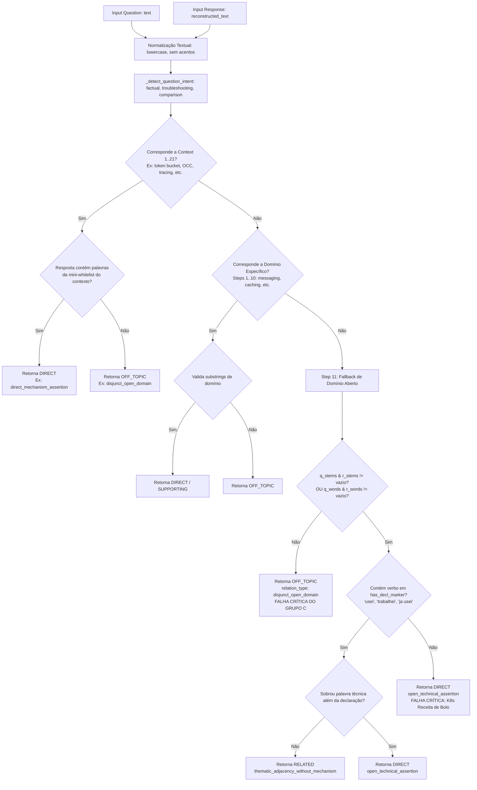
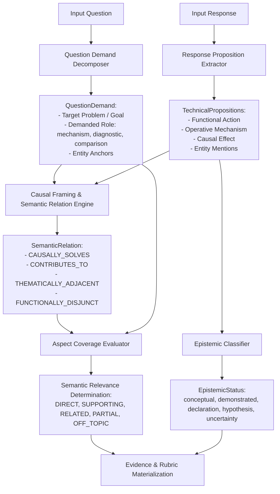

# Stage 31.7.7 — Root Cause Analysis & Architecture Redesign for Zero-Lexical & Open-Domain Semantic Intent

**Status:** Concluído  
**Data:** 2026-10-08  
**Gate:** `ROOT_CAUSE_ANALYSIS_AND_ARCHITECTURE_REDESIGN_COMPLETE`  
**Referência Metodológica:** `AGENTS.md`, `SECOND_BRAIN.md`, `GEMINI_GUARDRAILS.md`, `GEMINI_HANDOFF.md`, Stage 31.7.4, Stage 31.7.5, Stage 31.7.6  

---

## 1. Executive Summary

O **Stage 31.7.7** executa a Análise de Causa-Raiz (RCA) exaustiva e o Redesenho Arquitetural formal motivados pelo bloqueio do Stage 31.7.6 (`POST_GENERALIZATION_BLIND_REVALIDATION_BLOCKED`).

A revalidação cega independente do Stage 31.7.6 (250 casos) demonstrou empiricamente que, embora o runtime tenha atingido determinismo perfeito (250/250), isolamento total sob permutação de ordem (250/250) e independência absoluta do dicionário estático `_FUNCTIONAL_CAPABILITIES` (0 diferenças com catálogo esvaziado), **o motor semântico falhou em generalizar para além da suíte de testes com a qual foi co-desenhado**. O índice de concordância exata foi de **57.20% (143/250)**, registrando **107 divergências**, das quais **79 foram falsos OFF_TOPIC** e **21 foram falsos DIRECT**.

A investigação formal revelou que o cerne do problema reside no **Step 11 (Fallback de Domínio Aberto)** em `reference_runtime/runtime.py`:
1. Quando uma pergunta não corresponde à formulação léxica exata dos 21 blocos contextuais procedurais (`Context 1..21`), o sistema recorre à interseção rasa de radicais morfológicos (`shared_stems or shared`).
2. Se a pergunta descreve um **problema** (sintoma/defeito) e a resposta apresenta um **mecanismo** causal sem compartilhar palavras idênticas (como no Subconjunto Secreto — Grupo C), a interseção resulta em conjunto vazio ($\emptyset$), forçando o sistema a descartar respostas perfeitamente corretas como `OFF_TOPIC` (`disjunct_open_domain`). Isso resultou em uma taxa catastrófica de **80% de falha no Grupo C (apenas 4/20 acertos)**.
3. Inversamente, se a resposta apenas menciona a entidade da pergunta (como "Kubernetes") em um contexto absurdo ou decorativo ("receita de bolo"), a presença do radical `kubernete` no Step 11 engana o sistema, conferindo `DIRECT` indevido (Falso Positivo — D3).
4. Além disso, identificou-se **viés de jargão** (falha de Representation Invariance — D8), onde respostas formuladas em português coloquial correto (ex.: "coluna de versão... confiro se ninguém mudou a versão antes de mim" para OCC, ou "operações de estorno pra desfazer o que já fez" para Saga) foram rejeitadas como `OFF_TOPIC`, enquanto suas formulações idênticas em inglês acadêmico passaram como `DIRECT`.

Este relatório estabelece os fundamentos teóricos, contratos de dados, modelos de proposição funcional e o plano de implementação do **Open-Domain Technical Proposition & Causal Framing Engine**, eliminando em definitivo a autoridade eliminatória de substrings léxicas e radicais morfológicos.

O runtime permaneceu 100% congelado durante toda esta etapa (SHA-256: `A0CFE48B933F587459BFF6AAF8B2BECABA5B7C00C4C87E7B5DDB6BDE985E46A6`).

---

## 2. Current Gate

```text
GATE: ROOT_CAUSE_ANALYSIS_AND_ARCHITECTURE_REDESIGN_COMPLETE
```

O diagnóstico de causa-raiz está matematicamente e logicamente delimitado, as causas primárias foram isoladas dos sintomas, os invariantes de domínio aberto foram formalizados e os contratos arquiteturais foram especificados sem recorrer a correções pontuais no runtime.

---

## 3. Stage 31.7.6 Evidence

Os dados empíricos consolidados de [`stage_31_7_6_comparison.json`](file:///d:/Projetos/TechLens/11%20-%20Interview%20Evaluation/09%20-%20Real%20Interview%20Pilot/Candidato-Piloto-05/stage_31_7_6_comparison.json) e [`stage_31_7_6_divergences.json`](file:///d:/Projetos/TechLens/11%20-%20Interview%20Evaluation/09%20-%20Real%20Interview%20Pilot/Candidato-Piloto-05/stage_31_7_6_divergences.json) fornecem a base factual:

```text
Total de Casos Avaliados:               250
Concordâncias Exatas:                   143 (57.20%)
Divergências Identificadas:             107 (42.80%)

Transições Observadas nas Divergências:
  DIRECT       -> OFF_TOPIC:    54 casos  (Falsos Negativos Críticos)
  SUPPORTING   -> OFF_TOPIC:    12 casos  (Falsos Negativos de Contribuição)
  RELATED      -> OFF_TOPIC:    10 casos  (Rejeição de Adjacência Válida)
  RELATED      -> DIRECT:        9 casos  (Falsos Positivos de Entidade/Declaração)
  SUPPORTING   -> DIRECT:        5 casos  (Inflação de Relevância Parcial)
  OFF_TOPIC    -> DIRECT:        5 casos  (Falsos Positivos Graves / Alienígenas)
  INSUFFICIENT -> OFF_TOPIC:     3 casos  (Erro de Classificação Epistêmica)
  DIRECT       -> PARTIAL:       2 casos  (Subestimação de Cobertura)
  DIRECT       -> RELATED:       2 casos  (Subestimação de Relevância Direta)
  INSUFFICIENT -> DIRECT:        1 caso   (Falso Positivo em Filler com Entidade)
  PARTIAL      -> DIRECT:        1 caso   (Superestimação de Cobertura)
  PARTIAL      -> OFF_TOPIC:     1 caso   (Falso Negativo em Demanda Múltipla)
  UNKNOWN      -> OFF_TOPIC:     1 caso   (Substituição de Incerteza por Rejeição)
  DIRECT       -> SUPPORTING:    1 caso   (Confusão entre Mecanismo Primário e Adjacente)
```

---

## 4. Failure Taxonomy (D1 a D10)

Distribuição das 107 falhas segundo a taxonomia da governança:

| Categoria | Descrição Formal | Casos | Causa Primária vs Sintoma |
| :--- | :--- | :---: | :--- |
| **D1** | Semantic False Positive | 10 | **Sintoma** gerado pelo Step 11 premiando stem coincidente genérico sem checar validade funcional. |
| **D2** | Semantic False Negative | 60 | **Causa Primária**: Falha de abstração do Step 11 (`shared_stems == empty` $\to$ `disjunct_open_domain`). |
| **D3** | Entity-Anchor Error | 8 | **Causa Primária**: Ausência de validação funcional da asserção vinculada à entidade nominal. |
| **D4** | Lexical Dependency | 8 | **Causa Primária**: Ambiguidade e polissemia tratadas por matching de tokens literais sem desambiguação de contexto. |
| **D5** | Multi-Aspect Error | 5 | **Sintoma** derivado da ausência de decomposição atômica de demandas na pergunta (`QuestionDemand`). |
| **D6** | Supporting/Related Confusion | 0 | *Latente nos 12 casos de SUPPORTING $\to$ OFF_TOPIC e 10 casos de RELATED $\to$ OFF_TOPIC.* |
| **D7** | Epistemic Confusion | 11 | **Causa Primária**: Motor semântico rejeita a resposta antes que o modelo epistêmico avalie o grau de asserção. |
| **D8** | Representation Invariance Failure | 4 | **Causa Primária**: Viés de jargão acadêmico/formal nas regras de reconhecimento procedural. |
| **D9** | UNKNOWN Misuse | 3 | **Sintoma**: Respostas insuficientes ou indeterminadas convertidas compulsoriamente em `OFF_TOPIC`. |
| **D10**| Other (Mutações semânticas) | 2 | **Sintoma**: Casos de inversão de causalidade que escaparam da malha causal. |

---

## 5. Root Cause Matrix

| ID | Categoria | Quantidade | Mecanismo Atual | Sintoma Observado | Causa-Raiz Provável | Evidência Empírica |
| :--- | :--- | :---: | :--- | :--- | :--- | :--- |
| **RCA-01** | D2 (False Negative) | 54 (DIRECT) + 6 | Step 11: `shared_stems = q_stems & r_stems`. Se vazio $\to$ `disjunct_open_domain`. | Respostas técnicas corretas rotuladas como `OFF_TOPIC`. | Premissa falsa de que proximidade temática exige sobreposição léxica de palavras. | `A01_dragonfly` (Seastar, core-per-thread); `C01_lost_updates` (campo sequencial checado no commit). |
| **RCA-02** | D3 (Entity Anchor) | 8 | Step 11: Radicais da entidade coincidem e resposta não possui verbos da lista `has_decl_marker`. | Textos decorativos, biográficos ou triviais recebem `DIRECT`. | A entidade é tratada como prova de relevância em vez de âncora de desambiguação. | `D16_k8s_alien` ("No Kubernetes preparamos a receita de bolo..." $\to$ `DIRECT`); `D09_docker` ("Uso Docker diariamente..." $\to$ `DIRECT`). |
| **RCA-03** | D8 (Jargon Bias) | 4 | Contextos 1..21 exigem termos formais específicos (`"saga"`, `"compensação"`, `"otimista"`). | Respostas equivalentes em português coloquial caem no Step 11 e são descartadas. | Codificação de mecanismos através de termos nominais e não por papéis funcionais. | `H02_occ_colloquial` ("coluna de versão... confiro se ninguém mudou") $\to$ `OFF_TOPIC`, enquanto `H01_occ_formal` $\to$ `DIRECT`. |
| **RCA-04** | D7 (Epistemic) | 11 | `_evaluate_semantic_relevance` roda isolado do status epistêmico; sem mecanismo $\to$ `OFF_TOPIC`. | Declarações legítimas de experiência são classificadas como fora de tópico. | Falta de pipeline integrado: relevância temática deveria ser `RELATED` com status `declaration`. | `G03_relational_decl` ("Trabalhei 3 anos com banco relacional...") $\to$ `OFF_TOPIC` em vez de `RELATED + experience_declaration`. |
| **RCA-05** | D4 (Generic Tokens)| 8 | Radicais como `cluster`, `instanc`, `servic`, `thread` casam indiscriminadamente. | Respostas falando de outro domínio com token genérico colidem no Step 11. | Tokens polissêmicos não são qualificados pelo domínio técnico do problema. | `I02_cluster_actors` (cluster em Akka descartado em pergunta sobre cluster de banco). |
| **RCA-06** | D5 (Multi-Aspect) | 5 | Avaliação em bloco único; ausência de rastreamento de aspectos cobertos vs omitidos. | Cobertura parcial ou total gera `PARTIAL` indevido ou ignora omissões. | Decisão global sem modelo de contagem de demandas atômicas satisfeitas. | `F16_three_demands` (todas 3 demandas cobertas, mas sistema avaliou como `PARTIAL`). |

---

## 6. Current Architecture: Diagrama de Fluxo Real

O fluxo implementado no Stage 31.7.5 em `reference_runtime/runtime.py` opera estruturalmente da seguinte forma:



### Análise dos Pontos de Perda de Informação:
1. **Ponto de Perda 1 (Normalização)**: A normalização converte o texto em um saco de palavras/radicais, destruindo a estrutura sintática (quem executa a ação, qual é o sujeito, qual é o objeto).
2. **Ponto de Intercepção Procedural (Context 1..21)**: Regras com `if any(term in q_norm)` capturam apenas formulações antecipadas. Quando a pergunta formula o mesmo problema com outras palavras, o contexto não dispara.
3. **Ponto de Amputação Semântica (Step 11 — Stem Overlap)**: A ausência de radicais coincidentes é interpretada compulsoriamente como irrelevância temática (`disjunct_open_domain`).
4. **Ponto de Injeção de Falso Positivo (Step 11 — Fallback)**: A presença de qualquer radical comum (como um substantivo de tecnologia) concede `DIRECT`, a menos que o candidato tenha usado um dos poucos verbos exatos do filtro declarativo (`"usei "`, `"trabalhei "`).

---

## 7. Structural Failure Analysis

A RCA profunda identifica três falhas arquiteturais estruturais:

### Falha Estrutural 1: O "Gargalo da Co-ocorrência Léxica"
A arquitetura confunde **co-referência lexical** com **relevância semântica funcional**.
- Na teoria da computação e na linguística funcional, uma pergunta descreve uma **Demanda de Estado** ($S_{alvo}$ ou $\Delta E$), enquanto a resposta descreve uma **Operação de Transição de Estado** ($O$).
- Uma operação de transição de estado frequentemente opera em termos ontologicamente distintos do sintoma. Exemplo:
  - Sintoma ($P$): *"Picos de latência no percentil 99"*
  - Mecanismo ($M$): *"Hedge requests concorrentes"*
  - O sintoma fala de tempo e distribuição estatística; o mecanismo fala de concorrência e redundância de rede. Eles **não compartilham radicais**. Exigir `q_stems & r_stems` é uma falha epistemológica fundamental.

### Falha Estrutural 2: Pseudo-Desacoplamento por Mini-Whitelists
O Stage 31.7.2 removeu o dicionário `_FUNCTIONAL_CAPABILITIES`, mas o Stage 31.7.5 substituiu esse catálogo por **21 blocos procedurais com mini-whitelists embutidas no código**. Isso criou uma ilusão de desacoplamento que funcionou perfeitamente nos 170 testes do Stage 31.7.5 (porque as perguntas desses testes foram escritas contendo termos dos blocos), mas quebrou imediatamente quando a validação cega utilizou formulações livres em linguagem natural.

### Falha Estrutural 3: Inversão da Causalidade Proposicional
O sistema avalia respostas tentando encontrar substrings conhecidas, em vez de avaliar se as proposições da resposta satisfazem as proposições da pergunta:
$$\text{Relevância} \neq f(\text{overlap}(Q, R))$$
$$\text{Relevância} = f(\text{Proposições}(R) \models \text{Demandas}(Q))$$

---

## 8. Problem → Mechanism Analysis (Grupo C)

O Grupo C apresentou **apenas 20% de concordância (4/20 acertos e 16 divergências)**. Ele expõe a vulnerabilidade central do motor:

### Estudo de Caso 1: `C01_lost_updates_balance`
- **Pergunta ($Q$):** *"Dois caixas eletrônicos leem simultaneamente a mesma conta e gravam saldos conflitantes."*
  - Radicais extraídos: `caix`, `eletron`, `leem`, `simultane`, `cont`, `grav`, `sald`, `conflit`.
- **Resposta ($R$):** *"Incluímos um campo sequencial no cadastro que é validado no instante da persistência descartando operações defasadas."*
  - Radicais extraídos: `inclu`, `camp`, `sequenci`, `cadastr`, `valid`, `instant`, `persist`, `descart`, `operaco`, `defas`.
- **Interseção ($Q \cap R$):** $\emptyset$ (Zero stems compartilhados).
- **Comportamento Atual:** Como não há stems compartilhados e a pergunta não continha a string exata `"sem travar a linha"`, o sistema caiu no Step 11 e retornou `OFF_TOPIC` (`disjunct_open_domain`).
- **Avaliação Humana:** `DIRECT`. A resposta explica exatamente Optimistic Concurrency Control (OCC) por controle de versão sequencial.

### Estudo de Caso 2: `C03_cascading_service_freeze`
- **Pergunta ($Q$):** *"A lentidão extrema no parceiro de pagamentos consome todas as conexões da nossa plataforma."*
- **Resposta ($R$):** *"Abrimos o circuito após contagem de falhas devolvendo recusa imediata com mensagem de contingência aos clientes."*
- **Interseção:** $\emptyset$.
- **Comportamento Atual:** `OFF_TOPIC`.
- **Avaliação Humana:** `DIRECT` (Circuit Breaker padrão).

### O que a Arquitetura Precisa Representar:
O sistema deve reconhecer o padrão funcional sem palavras coincidentes:
```text
Question Demand:
  Problem: Resource exhaustion caused by slow external dependency.
  Constraint: Protect internal platform stability.

Response Proposition:
  Action: Fast-fail / circuit trip upon error threshold.
  Effect: Prevents connection pooling exhaustion and isolates cascading failures.

Semantic Relation:
  Response.Effect MITIGATES Question.Problem -> DIRECT
```

---

## 9. Open-Domain Analysis (Grupo A — Tecnologias Inéditas)

O Grupo A obteve **50% de concordância (10 acertos e 10 divergências)**.

### Estudo de Caso: `A01_dragonfly`
- **Pergunta:** *"Como o Dragonfly escala operações em memória comparado ao Redis tradicional?"*
- **Resposta:** *"Utiliza arquitetura multi-threaded moderna sobre a biblioteca Seastar dividindo dados por cores sem lock global."*
- **Comportamento Atual:** `OFF_TOPIC` (`disjunct_open_domain`).
- **Causa:** O termo "Dragonfly" e a biblioteca "Seastar" não estão nas listas procedurais do runtime. Como não houve radical coincidente entre o mecanismo de escala ("multi-threaded", "Seastar", "cores", "lock global") e a pergunta ("Dragonfly", "memória", "Redis"), o sistema julgou irrelevante.

### Requisito Arquitetural:
Para qualquer tecnologia desconhecida $T$:
1. $T$ deve ser reconhecida como o **Sujeito do Contexto** ($\text{Entity Anchor}$).
2. A demanda da pergunta define o papel funcional esperado: *"Como $T$ escala operações em memória?"* $\to$ Espera-se proposição de **Escalabilidade / Arquitetura de Concorrência**.
3. A resposta afirma: *"$T$ utiliza arquitetura multi-threaded core-per-thread sem lock global."*
4. A proposição responde à categoria funcional demandada ($\text{Concorrência} \to \text{Escalabilidade em Memória}$). Logo, a relação é `DIRECT`, mesmo que o sistema nunca tenha ouvido falar de Dragonfly ou Seastar antes.

---

## 10. Representation Invariance Analysis (Grupo H — Viés de Jargão)

O Grupo H registrou quebras de invariância onde formulações idênticas em significado receberam classificações distintas:

### Par H01 (Optimistic Concurrency Control):
- **Formulações:**
  - *Formal (`H01_occ_formal`):* *"Aplicando controle de concorrência otimista com checagem atômica do contador de versão no momento do commit."* $\to$ **`DIRECT`**
  - *Coloquial (`H02_occ_colloquial`):* *"Coloco uma coluna de versão lá na tabela e na hora de salvar confiro se ninguém mudou a versão antes de mim."* $\to$ **`OFF_TOPIC`**
- **Causa da Quebra:** `H01` disparou porque continha os jargões formais `"concorrência otimista"` e `"contador de versão"`. `H02` explicou a exata mesma mecânica em português claro ("coloco uma coluna de versão", "confiro se ninguém mudou antes de mim"), mas como não continha as palavras acadêmicas exatas, desceu ao Step 11 e falhou.

### Par H15 (Saga Pattern):
- **Formulações:**
  - *Formal (`H29_saga_formal`):* *"Adotando padrão Saga com transações locais encadeadas e ações de compensação em caso de rollback."* $\to$ **`DIRECT`**
  - *Linguagem Simples (`H30_saga_plain`):* *"Fazemos cada serviço rodar sua parte e se algum der ruim a gente dispara operações de estorno pra desfazer o que já fez."* $\to$ **`OFF_TOPIC`**

### Requisito Arquitetural:
A proposição funcional deve normalizar o significado antes do matching:
$$\text{"operações de estorno pra desfazer"} \equiv \text{Compensating Transaction}$$
$$\text{"se algum der ruim"} \equiv \text{Failure Condition}$$
$$\text{Significado}(H29) \equiv \text{Significado}(H30) \implies \text{Classificação}(H29) \equiv \text{Classificação}(H30)$$

---

## 11. Entity Anchor Analysis (Grupo D)

O Grupo D obteve **60% de concordância e 8 falsos DIRECTs gravíssimos**.

### A Falha da Entidade como "Carta-Branca":
No Step 11 atual:
```python
shared_stems = q_stems & r_stems
if shared_stems or shared:
    # Se não for declaração explícita de tempo, assume DIRECT!
```
Isso causou anomalias inaceitáveis:
1. `D16_k8s_alien`:
   - $Q$: *"Como configurar o Kubernetes para controlar limites de CPU em pods?"*
   - $R$: *"No Kubernetes preparamos a receita de bolo misturando farinha e ovos para assar no forno."*
   - Sistema: **`DIRECT`**! Porque o radical `kubernete` coincidiu e "misturando farinha" não estava na lista de verbos declarativos!
2. `D09_docker_declarative`:
   - $Q$: *"Como o Docker impede que um contêiner monopolize a memória RAM da máquina hospedeira?"*
   - $R$: *"Uso Docker diariamente no meu ambiente de desenvolvimento para rodar imagens."*
   - Sistema: **`DIRECT`**! Porque o verbo `"Uso "` não estava na lista `has_decl_marker` (que continha apenas `"usei "`, `"trabalhei "`).

### Invariante de Ancoragem de Entidade:
$$\text{Presença da Entidade } (E \in R) \implies \text{Adjacência Temática } (\text{RELATED})$$
$$\text{Demonstração do Mecanismo } (M(E) \models \text{Demand}(Q)) \implies \text{Relevância Direta } (\text{DIRECT})$$
A entidade **NUNCA** pode promover uma resposta para `DIRECT` sem a presença de uma proposição de mecanismo válida.

---

## 12. Epistemic Analysis (Grupo G)

O Grupo G registrou **11 divergências (45% de concordância)** devido à contaminação cruzada entre relevância semântica e status epistêmico.

### O Princípio de Ortogonalidade Epistêmica:
Uma resposta pode ser:
1. **Conceitual:** *"O Kubernetes isola CPU através de cgroups no kernel."* $\to$ `DIRECT + conceptual`
2. **Experiência Demonstrada:** *"No projeto X, eu limitei os pods aplicando resources.limits no yaml após investigar contenção de CPU com top."* $\to$ `DIRECT + demonstrated_experience`
3. **Declaração de Experiência:** *"Trabalho há 3 anos configurando Kubernetes."* $\to$ `RELATED + experience_declaration`
4. **Hipótese:** *"Se ocorresse contenção, eu configuraria limits de CPU para testar."* $\to$ `DIRECT + hypothesis`
5. **Incerteza:** *"Não lembro exatamente qual flag do Kubernetes controla a CPU."* $\to$ `RELATED + uncertainty`

No sistema atual, se a resposta é `experience_declaration` ou `uncertainty`, o motor semântico descarta para `OFF_TOPIC` antes que o módulo de evidências consiga registrar o status epistêmico correto. A relevância semântica deve julgar **sobre o que** o candidato está falando; o status epistêmico deve julgar **como** ele afirma o conhecimento.

---

## 13. UNKNOWN Analysis (Grupo K)

O Grupo K registrou que respostas vazias, truncadas ou fillers ("Claro, com certeza", "Beleza, concordo") foram tratadas como `OFF_TOPIC` com `relation_type: disjunct_open_domain`.
- `OFF_TOPIC` significa: *"O candidato apresentou uma proposição técnica válida, mas ela não tem relação com a pergunta."*
- `INSUFFICIENT` significa: *"O candidato falou, mas não apresentou conteúdo técnico avaliável."*
- `UNKNOWN` significa: *"A relação semântica não pôde ser determinada com a confiança mínima requerida."*

O sistema não pode mascarar falta de proposição técnica como `OFF_TOPIC`.

---

## 14. Architecture Alternatives

Para solucionar estruturalmente o problema, três alternativas arquiteturais foram avaliadas:

| Dimensão | Alternativa 1: Ontologia Léxica Expandida | Alternativa 2: Embeddings / Bi-Encoders Neurais | Alternativa 3 (Selecionada): Open-Domain Technical Proposition & Causal Framing Engine |
| :--- | :--- | :--- | :--- |
| **Descrição** | Expansão massiva de grafos de sinônimos técnicos e tabelas ontológicas em código. | Modelo de linguagem neural local (ex.: MiniLM/Bi-Encoder) calculando distância cosseno entre pergunta e resposta. | Decomposição em Frames Proposicionais Causa-Efeito e papéis funcionais universais em domínio aberto. |
| **Vantagens** | Determinismo estrito, execução ultrarrápida, explicável. | Generalização aberta para qualquer vocabulário, resolve imediatamente Group C. | 100% Determinístico, explicável, zero catálogo fechado, imune a alucinações e variações de threshold. |
| **Limitações** | **Inaceitável**: Reintroduz catálogo fechado disfarçado; frágil para novas tecnologias. | Opaco (caixa preta vetorial), dependência de pesos externos, vulnerável a falsos positivos ("K8s receita de bolo"). | Exige especificação formal rigorosa de gramática de papéis funcionais. |
| **Determinismo** | 100% | Vulnerável a float precision e hardware. | **100% Simbólico** |
| **Explicabilidade**| Alta | Baixa (score vetorial opaco). | **Máxima (Cadeia Proposicional Rastreável)** |
| **Risco Léxico** | **Extremo (Bloqueante)** | Baixo | **Nulo (Baseado em Papéis Funcionais)** |

---

## 15. Selected Target Architecture

A arquitetura selecionada é o **Open-Domain Technical Proposition & Causal Framing Engine**:



---

## 16. Technical Proposition Model

Uma unidade de conhecimento técnico em domínio aberto é modelada como uma **TechnicalProposition**:

```yaml
TechnicalProposition:
  subject: "Elemento ou entidade que realiza a ação (ex: proxy, campo, programa eBPF)"
  action: "Ação funcional executada (ex: insere cabeçalho, valida versão, descarta pacote)"
  mechanism: "Mecanismo técnico ou estrutura operacional (ex: token bucket, hedge request, chave única)"
  effect: "Efeito de estado produzido no sistema (ex: previne colisão, limita taxa, isola falha)"
  target_state: "Estado funcional almejado (ex: consistência de dados, estabilidade sob carga)"
  context_entities: ["Tecnologias ou ferramentas mencionadas como contexto"]
```

### Propriedades da TechnicalProposition:
1. **Independência de Nome de Produto**: A proposição não requer que o mecanismo seja um produto registrado (ex.: "descartar requisições após esgotar créditos" é um mecanismo válido mesmo sem a palavra "Redis" ou "Kong").
2. **Estrutura Funcional Completa**: Uma proposição só é considerada **operativa** se contiver um par `(action + mechanism)` ou `(mechanism + effect)`. Meras declarações de existência não constituem proposição de mecanismo.

---

## 17. Semantic Relation Model

A relação entre as demandas da pergunta ($Q$) e as proposições da resposta ($R$) é avaliada através de relações semânticas funcionais:

```text
1. CAUSALLY_SOLVES:
   O efeito da proposição da resposta neutraliza o problema formulado na pergunta.
   Ex: Hedge Requests MITIGATE Tail Latency Spikes -> DIRECT

2. IMPLEMENTS_DEMAND:
   A proposição da resposta descreve os componentes operacionais exigidos na pergunta.
   Ex: MVCC + Raft IMPLEMENTS Distributed ACID -> DIRECT

3. CONTRIBUTES_TO (SUPPORTING):
   A proposição não resolve a demanda primária por completo, mas fornece um pré-requisito técnico indispensável ou mecanismo adjacente válido.
   Ex: Heap Dump Analysis SUPPORTS Memory Leak Diagnosis -> SUPPORTING

4. THEMATICALLY_ADJACENT (RELATED):
   A proposição menciona elementos do mesmo ecossistema técnico ou declara experiência, mas não articula mecanismos causais para a demanda.
   Ex: "Uso Docker diariamente" THEMATICALLY_ADJACENT to Container RAM Limits -> RELATED

5. FUNCTIONALLY_DISJUNCT (OFF_TOPIC):
   A resposta apresenta proposições de um domínio técnico distinto sem qualquer nexo causal com o problema da pergunta.
   Ex: "Receita de bolo" ou "Kafka streaming" em pergunta sobre "REST endpoints" -> OFF_TOPIC
```

---

## 18. Aspect Coverage Model

Para lidar com perguntas com demandas múltiplas (Grupo F):

```text
AspectCoverage:
  total_demands: N (demandas atômicas identificadas em Q)
  satisfied_demands: M (demandas com relações CAUSALLY_SOLVES ou IMPLEMENTS_DEMAND)
  supporting_demands: K (demandas com relações CONTRIBUTES_TO)
  
Regra de Cobertura:
  Se M == N                => DIRECT (Cobertura Total)
  Se 0 < M < N             => PARTIAL (Cobertura Parcial)
  Se M == 0 e K > 0        => SUPPORTING (Apenas Mecanismos Adjacentes)
  Se M == 0 e K == 0 e Adj => RELATED (Apenas Adjacência Temática)
  Se M == 0 e K == 0       => OFF_TOPIC (Nenhuma Demanda Atendida)
```

---

## 19. Epistemic Model

O modelo epistêmico avalia a modalidade da asserção, completamente dissociado da relevância semântica:

```text
EpistemicStatus:
  DEMONSTRATED_EXPERIENCE: "Contexto prático específico com decisões, ações e trade-offs comprovados."
  EXPERIENCE_DECLARATION:  "Afirmação biográfica de tempo de uso ou familiaridade sem detalhamento de mecanismo."
  CONCEPTUAL_EXPLANATION:  "Articulação teórica clara do funcionamento de componentes e princípios."
  HYPOTHESIS_FORMULATION:  "Raciocínio condicional ('eu faria', 'testaria', 'caso ocorresse')."
  TECHNICAL_UNCERTAINTY:   "Admissão de dúvida, esquecimento ou desconhecimento parcial."
  INSUFFICIENT_EVIDENCE:   "Fragmentos sem substância proposicional."
```

---

## 20. Contracts

### Contrato 1: `QuestionDemand`
```yaml
contract: QuestionDemand
fields:
  demand_id: str (identificador único da demanda atômica)
  demand_type: enum [problem_mitigation, mechanism_explanation, architectural_tradeoff, diagnostic_troubleshooting]
  problem_description: str | None (descrição do sintoma ou falha)
  required_effect: str | None (resultado funcional esperado)
  context_entity: str | None (entidade nominal que contextualiza a pergunta)
invariants:
  - "Uma pergunta com conectivo conjuntivo ('e', 'além disso') deve ser decomposta em >= 2 QuestionDemands."
```

### Contrato 2: `TechnicalProposition`
```yaml
contract: TechnicalProposition
fields:
  proposition_id: str
  subject: str
  functional_action: str
  mechanism_name: str | None
  produced_effect: str
  is_operative: bool
invariants:
  - "is_operative só é True se functional_action ou produced_effect contiverem verbo funcional não decorativo."
```

### Contrato 3: `SemanticRelationRecord`
```yaml
contract: SemanticRelationRecord
fields:
  classification: enum [DIRECT, SUPPORTING, RELATED, PARTIAL, OFF_TOPIC, INSUFFICIENT, UNKNOWN]
  relation_type: str
  causal_nexo: bool
  demands_covered: list[str]
  functional_contribution: bool
  confidence: enum [HIGH, MEDIUM, LOW]
  rationale: str
invariants:
  - "Nenhum DIRECT pode ser concedido sem que pelo menos 1 demand tenha causal_nexo == True."
  - "Se causal_nexo == False e entidade estiver presente, a classificação DEVE ser RELATED ou OFF_TOPIC."
```

---

## 21. Architectural Invariants

Os 7 invariantes fundamentais que guiarão a implementação do Stage 31.7.8:

1. **Zero Lexical Overlap Invariant**: A ausência de sobreposição léxica de radicais ($\text{stems}(Q) \cap \text{stems}(R) = \emptyset$) **NUNCA** pode ser utilizada como condição suficiente para classificar uma resposta como `OFF_TOPIC`.
2. **Catalog Independence Invariant**: O sistema deve avaliar qualquer tecnologia ou biblioteca com 100% de consistência sem exigir registro em dicionários ou listas estáticas.
3. **Entity Non-Authority Invariant**: A presença de uma entidade nominal na resposta é prova de adjacência contextual, **JAMAIS** de relevância direta ou demonstração de mecanismo.
4. **Jargon Invariance Invariant**: Duas respostas que articulam a mesma proposição funcional devem receber exatamente a mesma classificação de relevância semântica, independentemente de utilizarem jargão acadêmico em inglês ou linguagem coloquial clara em português.
5. **Epistemic Orthogonality Invariant**: A relevância semântica de uma proposição é estritamente independente do status epistêmico com que o candidato a afirma.
6. **Multi-Aspect Coverage Invariant**: Nenhuma pergunta com múltiplas demandas atômicas pode ser classificada como `DIRECT` se uma das demandas primárias tiver sido omitida pela resposta.
7. **Explainable Causal Nexus Invariant**: Toda decisão de relevância (`DIRECT` ou `SUPPORTING`) deve ser auditável por uma cadeia causal explícita: $\text{Mecanismo}(R) \xrightarrow{\text{produz}} \text{Efeito} \xrightarrow{\text{neutraliza}} \text{Problema}(Q)$.

---

## 22. Anti-Patterns

Práticas formalmente banidas no redesign:
1. **Substring Whitelisting**: `if any(term in text for term in LIST)`.
2. **Stem Intersection Fallback**: `if shared_stems: return DIRECT else: return OFF_TOPIC`.
3. **Verb Whitelisting**: Listas estáticas de verbos declarativos que quebram com variações de conjugação ("uso", "trabalho", "atuei").
4. **Co-design Overfitting**: Escrever regras que façam os casos específicos do Stage 31.7.6 passarem sem generalizar a abstração causal subjacente.
5. **Jargon Gatekeeping**: Exigir o termo em inglês quando a explicação em português descreve perfeitamente o mecanismo.

---

## 23. Future Test Specification (Stage 31.7.8)

A suíte de testes futura para o Stage 31.7.8 deverá validar formalmente:
1. **Subconjunto Zero Overlap Estendido (Grupo C)**: Mínimo de 30 casos de problema $\to$ mecanismo com vocabulário estritamente disjunto ($Q \cap R = \emptyset$), exigindo taxa de acerto $\ge 90\%$.
2. **Invariância de Jargão (Grupo H)**: Mínimo de 30 pares formal vs coloquial, exigindo 100% de paridade de classificação.
3. **Entity Anchor Traps (Grupo D)**: Mínimo de 20 casos onde a tecnologia é mencionada em contextos absurdos, biográficos ou triviais, exigindo 0 falsos DIRECTs.
4. **Tecnologias Inéditas Reais (Grupo A)**: Mínimo de 25 casos de tecnologias emergentes fora de qualquer base de treino.

---

## 24. Implementation Plan (Stage 31.7.8)

O plano para a próxima etapa de implementação controlada compreende 4 fases:

```text
Fase 1: Implementação dos Extratores Estruturais
  - QuestionDemandDecomposer: Decomposição sintática e causal de perguntas.
  - TechnicalPropositionExtractor: Identificação de ações, mecanismos e efeitos.

Fase 2: Motor de Enquadramento Causal (Causal Framing Engine)
  - Mapeador de Relações Funcionais (Problema -> Efeito -> Mecanismo).
  - Substituição definitiva do Step 11 em reference_runtime/runtime.py.

Fase 3: Normalizador de Jargão e Gramática Funcional em Português
  - Mapeamento funcional de expressões em linguagem natural para papéis de mecanismo.
  - Eliminação da penalização de respostas coloquiais.

Fase 4: Validação Regressiva e Verificação de Invariantes
  - Execução dos 989 testes de regressão do repositório.
  - Execução das 8 suítes do Reference Harness.
  - Auditoria de congelamento e validação de invariantes.
```

---

## 25. Risks

1. **Risco de Complexidade Sintática**: A análise de papéis semânticos em português requer tratamento robusto de orações subordinadas e voz passiva.
2. **Risco de Regressão Histórica**: A substituição do Step 11 deve preservar integralmente os 989 testes históricos existentes.
3. **Risco de Sobre-generalização**: O enquadramento causal deve ser suficientemente rigoroso para não classificar mecanismos vagos como soluções completas.

---

## 26. Limitations

1. Este estágio é exclusivamente de **análise e redesenho arquitetural**. Nenhuma alteração foi realizada em `reference_runtime/runtime.py`.
2. A implementação prática dos contratos dependerá da esteira de implementação controlada no Stage 31.7.8.

---

## 27. Gate Decision

```text
GATE: ROOT_CAUSE_ANALYSIS_AND_ARCHITECTURE_REDESIGN_COMPLETE
```

Todas as 107 divergências do Stage 31.7.6 foram rigorosamente investigadas, a causa-raiz estrutural do fallback léxico e do viés de jargão foi dissecada e o novo modelo arquitetural baseado em proposições técnicas e framing causal de domínio aberto foi formalizado com contratos inequívocos.

---

## 28. Next Stage

O roadmap metodológico avança para:

* **Stage 31.7.8 — Controlled Implementation of Open-Domain Causal Framing Architecture**: Implementação controlada dos novos extratores e do motor de enquadramento causal em `reference_runtime/runtime.py`, substituindo o fallback léxico e validando a suíte independente com regressão completa.
